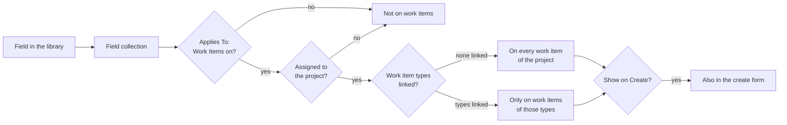

import WhoCanDoThis from "/snippets/who-can-do-this.mdx";

Custom fields add your own data to work items and pages, such as a customer, a cost centre or a severity. You define each field once in a library for the whole instance. To use fields, you group them into a <Tooltip tip="A named group of custom fields that you attach to projects, Spaces and work item types." cta="Glossary" href="/glossary#field-collection">field collection</Tooltip> and decide where that collection applies.

<WhoCanDoThis role="System administrator with a second factor set up" edition="Every installation" />

## How fields reach a work item {#how-fields-apply}

A field never applies on its own. It shows up because a collection that contains it applies. The diagram shows the checks a collection passes before its fields appear on a work item.

| Where | The collection's fields appear when |
|---|---|
| **Work items** | **Work Items** is on in **Applies To**, the collection is assigned to the project, and the work item's type is linked to the collection or no type is linked at all |
| **Create form of a work item** | The same as above, and **Show on Create** is on |
| **Pages** | **Pages** is on in **Applies To**, and the Space has activated the collection under **Space Settings → Custom Fields** |

Activating a collection in a Space affects pages only. Work items get their collections from the project or from its [project template](/projects/templates).

## Field types {#field-types}

Pick the type when you create the field. These are the types the **Type** list offers:

| Type | Stores | Options in the field panel |
|---|---|---|
| **Text** | One line of text | Default value |
| **Long text** | Several lines of text | Default value |
| **Number** | A number | Default value |
| **Date** | A date | None |
| **Single choice** | One value from a list | Choices |
| **Multiple choice** | Several values from a list | Choices |
| **Yes/no** | A switch | None |
| **Link** | A web address | Default value |
| **E-mail** | An email address | Default value |
| **Phone** | A phone number | Default value |
| **Amount** | A number shown as an amount | Default value. There is no currency setting. |
| **Rating** | Five stars | None |
| **Progress** | A slider from 0 to 100 % | None |
| **Person** | One member | **Only people with access to the space**, on by default |
| **People** | Several members | **Only people with access to the space**, on by default |
| **Relation** | Links to other content | **Links to**: **Pages**, **Work items**, **Projects** or **Pages and work items** (default) |
| **Registry object** | Links to Registry Objects | **Registry Schema**, **Object Types**, **Allow multiple selection**, **Filters** |
| **Location** | An address | None |

For **Single choice** and **Multiple choice**, add entries under **Choices** with **Add choice**. Each choice has a **Label**, a **Value** and one of seven colours.

Fields marked **System** come with Collabase and are locked. You cannot edit or delete them.

## Create a field {#create-field}

<Steps>
  <Step title="Open the field library">
    Open **System Settings → Content & Organization → Custom Fields** and click **New Field**.
  </Step>
  <Step title="Describe the field">
    Fill in the panel from top to bottom:

    | Setting | Details |
    |---|---|
    | **Link to a collection (optional)** | Adds the field to one collection right away. Pick **No collection** to keep it in the library only. |
    | **Name** | The label members see. |
    | **Field Translations** | The name in English, German, French and Italian. **Translate with AI** fills them in when an AI provider is configured. |
    | **Type** | See [Field types](#field-types). |
    | **Description (optional)** | A hint for whoever fills in the field. |
    | **Default value (optional)** | Offered for text, number, link, email, phone and amount fields. |
    | **Choices** | Offered for single and multiple choice fields. |
  </Step>
  <Step title="Save">
    Click **Save field**. You see **Field created.** and the field appears in the list with a key such as `cf.0001`.
  </Step>
</Steps>

The list shows 25 fields per page. Search by name or key, filter by type, or tick **Hide locked fields** to hide the system fields.

## Create a field collection {#create-collection}

<Steps>
  <Step title="Open Field Collections">
    Open **System Settings → Content & Organization → Field Collections** and click **New**.
  </Step>
  <Step title="Name the collection">
    Enter a **Name**. **Display Name** is optional and is the heading members see on work items. Click **Create**.
  </Step>
  <Step title="Decide where it applies">
    Select the collection, click **Edit** and set **Applies To**:

    | Setting | Details |
    |---|---|
    | **Pages** | The fields appear on pages in Spaces that activate the collection. On for a new collection. |
    | **Work Items** | The fields appear on work items of projects that use the collection. Off for a new collection. |
    | **Show on Create** | Shown when **Work Items** is on. The fields also appear in the create form, below the default fields. |

    Click **Save**.
  </Step>
  <Step title="Add fields">
    While editing, pick a field under **Assign existing field…**, or click **New Field** to create one inside the collection.
  </Step>
  <Step title="Limit it to work item types (optional)">
    Under **Work Item Types**, pick a type in **Link work item type…**. Leave the list empty to apply the collection to every type. Links take effect at once, without **Save**.
  </Step>
</Steps>

Then make the collection available where it is needed:

- **Projects:** in the project's **Settings → Fields**, tick the collection and click **Save Changes**. See [Project settings](/projects/project-settings#fields).
- **Project templates:** select the collection under **Field Collections** in the template. See [Project templates](/projects/templates).
- **Pages in a Space:** in **Space Settings → Custom Fields**, switch the collection on.

## Ask for fields during a transition {#transition-fields}

A workflow transition can ask for field values before a work item moves, for example a root cause when a bug is closed. You set this on the transition, not on the field. See [Workflows](/admin/workflows#transition-fields).

## Delete fields and collections {#delete}

| Action | Result |
|---|---|
| **Delete** on the **Custom Fields** page | The field leaves the library and every collection. Values on pages are deleted. Values already stored on work items stay in the database but are no longer shown. |
| **Delete** on a field inside a collection | The field is removed from this collection only. It stays in the library with its values. |
| **Delete** a collection | The collection and its links to Spaces, projects, templates and work item types are removed. The fields and their values stay in the library. |

<Warning>
  Neither delete checks whether a field or collection is in use. Check the **Collections** column on the **Custom Fields** page before you delete a field.
</Warning>

## Best practices

- **Reuse fields across collections.** One "Customer" field in several collections keeps reports comparable.
- **Keep collections small and purposeful.** A collection per use case, such as bug details or service request, is easier to attach and to retire.
- **Link work item types only when the fields make no sense elsewhere.** An empty type list is the simplest rule to explain.

## Troubleshooting

| What you see | Cause | What to do |
|---|---|---|
| A field does not appear on a work item | The collection is not assigned to the project, **Work Items** is off, or the work item's type is not linked | Check the three conditions in [How fields reach a work item](#how-fields-apply) |
| The project's **Fields** section is read-only | The project is linked to a project template | Add the collection to the template, or detach the project in **General** |
| **System fields cannot be modified** | The field is a system field | Create your own field instead |
| **No field collections defined yet.** in Space settings | No collection exists | Create one under **Field Collections** |

## Related pages

<CardGroup cols={2}>
  <Card title="Work item types" icon="tag" href="/admin/work-item-types">
    The types you link collections to.
  </Card>
  <Card title="Configuration model" icon="layers" href="/concepts/configuration-model">
    How instance, Space and project settings relate.
  </Card>
</CardGroup>
