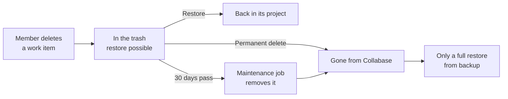

import WhoCanDoThis from "/snippets/who-can-do-this.mdx";

Collabase deletes some data on its own after a fixed time, and keeps everything else until someone deletes it. This page lists both, so you can answer a data protection question or a question like "can we still get this back?" without searching through every screen.

<WhoCanDoThis role="System administrator" edition="All editions" />

None of the periods on this page can be changed on a screen, except the one for locked accounts. Most of it is removed by a maintenance job that runs every five minutes and deletes in batches, so a large backlog takes several runs.

---

## What Collabase deletes on its own {#automatic-deletion}

| Data | Kept for | Then | Where it is described |
|---|---|---|---|
| Deleted projects and work items in the trash | 30 days after deletion | Deleted for good. Until the job reaches an item, you can still restore it. | [Trash](/admin/backup#trash) |
| Sign-in, failed sign-in and sign-out entries in the audit log | 180 days | Deleted. All other audit entries stay. | [Audit log](/admin/audit-log#retention) |
| Saved CollabaseAI chats | 30 days | Deleted for good | [CollabaseAI](/concepts/collabase-ai) |
| The list of recent mails of the inbound mailbox | 90 days | Deleted. It holds no mail addresses. | [Inbound mailbox](/admin/inbound-mail) |
| Locked accounts | 30 days by default, 1 to 3,650 days | Anonymized: name, mail address and sign-in methods are removed, content stays | [Locked accounts](/admin/security-policies#locked-accounts) |
| The log of the search index | The last 50 lines | Older lines are dropped | [Search index](/admin/system-settings#search-index) |

## What Collabase keeps until you act {#kept-until-deleted}

| Data | How it is removed |
|---|---|
| Deleted Spaces and pages in the trash | They have no expiry date. They stay in the trash until you restore them or delete them for good. |
| All other audit log entries | Never removed by Collabase |
| PDF export history | By hand, with **Clear >30 Days** under **Administration → Export History**. See [Export history](/admin/templates-and-exports#export-history). |
| Content of anonymized accounts | Pages, work items and comments stay and show the name followed by `(deleted)` |

---

## The life of a deleted work item {#lifecycle}

The diagram follows a project or a work item from deletion to the point where only a backup brings it back.

Spaces and pages follow the same path without the 30-day step: they wait in the trash until someone acts.

## Delete something for good {#delete-for-good}

<Steps>
  <Step title="Open the trash">
    Go to **Administration → Data & Backup → Trash**. The list shows **Type**, **Title**, **Space** and **Deleted on**. Narrow it with **All**, **Spaces**, **Projects**, **Pages** or **Work Items**.
  </Step>
  <Step title="Open the item's menu">
    Click **Open menu** at the end of the row and choose **Permanent delete**.
  </Step>
  <Step title="Confirm">
    The dialog asks **Permanently delete "name"?**. Click **Permanent delete**. **Item permanently deleted** confirms it.
  </Step>
</Steps>

<Danger>
  A permanent delete cannot be undone in Collabase. A deleted project is removed together with the work items listed under it (**incl. n work items**). After that, only a [full restore](/admin/restore-runbook) of a backup brings it back, and a full restore replaces everything else as well.
</Danger>

## Backups keep what Collabase deleted {#backups}

Deleting data in Collabase does not remove it from backups you took before. A request to erase personal data is complete only when those backups have expired, too. Set the retention of your backups with that in mind, see [Backup and restore](/admin/backup).

## Troubleshooting

| What you see | Cause | What to do |
|---|---|---|
| A deleted work item is not in the trash any more | Its 30 days have passed, or someone deleted it for good. | Check the audit log for **Entity** `Trash` to see which. After that, only a backup brings it back, see [Restore runbook](/admin/restore-runbook). |
| **Restore the project first: this work item belongs to a project that is still in the trash.** | The work item's project is deleted, too. | Restore the project. It brings its work items with it. |
| **Its address or key is now used by something else. Rename that first, then restore.** | A newer project or Space took the same key or address. | Rename the newer one, then restore. |
| **Failed to delete item** | The item could not be removed. | Reload the trash and try again. If it persists, check the [application log](/admin/troubleshooting). |

## Related pages

<CardGroup cols={2}>
  <Card title="Backup and restore" icon="database" href="/admin/backup">
    What a backup contains, and the trash in detail.
  </Card>
  <Card title="Audit log" icon="list-checks" href="/admin/audit-log">
    Who deleted or restored what, and when.
  </Card>
  <Card title="Security policies" icon="shield-check" href="/admin/security-policies">
    The period after which locked accounts are anonymized.
  </Card>
  <Card title="Data protection" icon="lock" href="/security/data-protection">
    How Collabase handles personal data.
  </Card>
</CardGroup>
