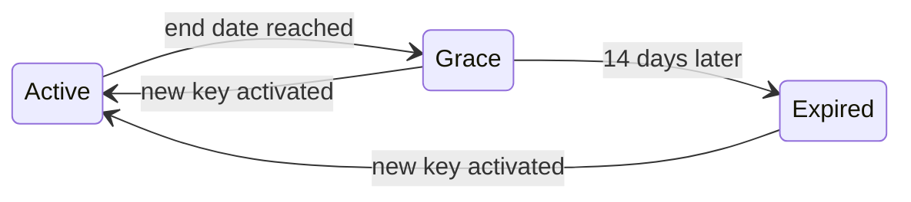

import WhoCanDoThis from "/snippets/who-can-do-this.mdx";

Every Collabase installation runs the same software. A licence key decides which edition is active: with a valid Enterprise key, the features listed under [What the licence unlocks](#what-the-licence-unlocks) are switched on, without a new installation or a restart. This page shows how to activate a key, how many seats it covers, and what happens when it expires.

<WhoCanDoThis role="System administrator with a second factor set up" edition="Every installation" />

## Before you begin

- Open **Settings → Collabase License → License**. The page is called **License & System**.
- Have the **System ID / Machine ID** of this installation at hand if you need a new key. A key is issued for one installation and works only there.
- Make sure no environment variable sets the key for your deployment. When the key comes from the deployment, the page refuses every change, see [Troubleshooting](#troubleshooting).

## The License & System page {#license-page}

| Area | Details |
|---|---|
| **System Status** | **Edition** shows **Enterprise Edition** with **Active**, or **Community Edition** when no valid key is active. **Check** reads the licence status again. |
| **System ID / Machine ID** | The ID of this installation, in the form `CBASE-XXXX-XXXX-XXXX`. Copy it with the copy button and send it with your licence request. It is stored in the database, so it stays the same across updates and when you restore a database backup. |
| **Enterprise Upgrade** | Shown while no key is active, or after you click **Change license key**. Contains the field **Activate license key** and the button **Activate**. |
| **Collabase Enterprise** and **License Details** | Shown once a key is active. **Status** is **Active**, **Grace period active** or **Expired**. **Valid until** shows the end date, or **Unlimited** for a key without one. |
| **Support** | Links to help, feedback and incident reports. |
| **Partner** | Shown only when your installation is supplied by a partner: the partner's **Service Desk** and **Contact Persons**. |

## Activate or change the licence key {#activate}

<Steps>
  <Step title="Open the licence page">
    Go to **Settings → Collabase License → License**.
  </Step>
  <Step title="Open the key field">
    On an installation without a key, the **Enterprise Upgrade** card is already open. On a licensed installation, click **Change license key** under **License Details**.
  </Step>
  <Step title="Paste the key">
    Paste the complete key into **Activate license key**. Keys start with `HC-`.
  </Step>
  <Step title="Activate">
    Click **Activate**. Collabase checks the signature, the installation the key was issued for, and the end date.
  </Step>
</Steps>

<Check>
  **Checkpoint.** The message **License successfully activated!** appears, **Edition** shows **Enterprise Edition** and **License Details** shows **Active** with the end date. The activation is recorded in the audit log. If a red message appears instead, look it up in [Troubleshooting](#troubleshooting).
</Check>

A new key takes effect at once. The Enterprise features start working on the next request, and nobody has to sign in again. There is no button to remove a key: to replace one, activate the new key.

## What the licence unlocks {#what-the-licence-unlocks}

The licence controls a fixed set of features. Everything else, including all apps, Spaces, projects and AI settings, works the same on every installation.

| Feature | Without an Enterprise licence | With an Enterprise licence |
|---|---|---|
| **Identity Providers**: SAML, sign-in with external providers, LDAP directory sync | Page is locked | Available, see [Identity providers](/admin/identity-providers) |
| **SCIM provisioning** | Requests are refused | Available, see [User provisioning](/admin/user-provisioning) |
| **Enforced single sign-on** | Not applied | Applied |
| **Security → Policies** | Page is locked | Available, see [Security policies](/admin/security-policies) |
| **Security → Brute Force Protection** | Page is locked | Available |
| **Infrastructure → Audit Log** | Page is locked | Available |
| Internal users | The **Users** page creates at most 10 users | As many as the key's seat count, or unlimited when the key sets none |

A locked page stays visible but blurred, with the notice **… is an Enterprise Feature** and the button **Upgrade to Enterprise**.

### How seats are counted {#seats}

A seat is an internal person who can sign in: an active account with the role **Admin** or **User**. These do not take a seat:

- guests;
- locked and anonymized accounts;
- the accounts Collabase uses for its own work.

When every seat is taken, Collabase refuses new accounts and reactivations, whether they come from the **Users** page, single sign-on or SCIM. Lock or anonymize accounts you no longer need to free seats, see [Users and groups](/admin/users-groups).

## Expiry and the grace period {#expiry}

A key with an end date runs through three states. The grace period is fixed at 14 days and cannot be changed.

The diagram shows the licence states and what moves a licence from one to the next.

| State | What administrators and members see | Enterprise features |
|---|---|---|
| **Active** | Nothing special | On |
| **Grace period active** | The header shows **Enterprise license is expiring – {days} days left.** with **Renew Now**. The licence page says **Your license expired on {date}. You have {days} days left to renew it.** | Still on |
| **Expired** | The header says that the licence has expired and read-only mode is active, with the link **Update License**. The interface no longer accepts clicks | Off. SCIM requests and directory sync stop |

<Warning>
  Activate the new key during the grace period. Once the licence has expired, the interface is read-only for everyone, including administrators, so the key can no longer be entered on the licence page.
</Warning>

## Best practices

- **Put the end date in your calendar a month ahead.** Getting a new key needs the System ID and a reply from your supplier, and the grace period is only 14 days.
- **Keep a seat or two free.** A provisioning run that finds no free seat turns people away until a seat is freed.
- **Copy the System ID before you move to new hardware.** Note it with your licence papers, so a key can be reissued quickly if the installation has to be rebuilt without its database.

## Troubleshooting {#troubleshooting}

| What you see after **Activate** | Cause | What to do |
|---|---|---|
| **Invalid license signature or format** | The key is incomplete or was changed while copying | Copy the key again in full, without spaces or line breaks |
| **License is bound to another device** | The key was issued for a different System ID | Request a key for the **System ID / Machine ID** shown on this page |
| **License format is newer than this version supports** | The key needs a newer Collabase version | [Update Collabase](/admin/updates), then activate again |
| **License expired and grace period ended** | The key's end date plus 14 days has passed | Request a renewed key |
| **The licence is set by the deployment (COLLABASE_LICENSE_KEY). Change it there.** | The deployment provides the key, so the page cannot change it | Change the key where your deployment sets it |
| **System administrators only.** | Your account is not a system administrator | Ask a system administrator to activate the key |
| **Could not verify installation identity** or **Verification service error** | Collabase could not read its installation ID or the database | Check that the database is reachable, see [Troubleshooting](/admin/troubleshooting#database-connection-failures) |

## Related pages

<CardGroup cols={2}>
  <Card title="Identity providers" icon="key-round" href="/admin/identity-providers">
    Sign-in with SAML, external providers and LDAP, all part of the Enterprise licence.
  </Card>
  <Card title="User provisioning" icon="users" href="/admin/user-provisioning">
    SCIM provisioning and how seats limit it.
  </Card>
  <Card title="Users and groups" icon="user" href="/admin/users-groups">
    Lock, unlock and anonymize accounts to free seats.
  </Card>
  <Card title="App Store" icon="store" href="/admin/app-store">
    Install the apps bundled with your Collabase version.
  </Card>
</CardGroup>
