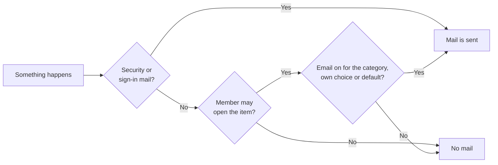

import WhoCanDoThis from "/snippets/who-can-do-this.mdx";

Collabase sends mail for invitations, password resets, security notices, mentions, assignments, meetings and more. All of it goes through one sender that you configure under **Administration → Mail Server**. **Administration → Notifications** decides which kinds of mail members get by default, and **Administration → Mail Templates** shows every mail for review.

<WhoCanDoThis role="System administrator" edition="All editions" />

Collabase can also read a mailbox and turn mails into work items. That is set up on the same screen, see [Inbound mailbox](/admin/inbound-mail).

## Before you begin

- **A way to send mail.** One of these three:
  - an SMTP server and an account on it, for example your company relay or a mail service;
  - a Google account with an OAuth client in Google Cloud Console;
  - a Microsoft 365 mailbox with an app registration in Microsoft Entra ID.
- **A sender address** your mail provider allows this account to send from, for example `noreply@example.com`.
- **Network access** from the Collabase server to the SMTP server, or to Google or Microsoft.

---

## Choose how Collabase sends mail {#choose-a-provider}

The card **Mail provider** offers three ways. Pick the one your organization already uses.

| Provider | How Collabase signs in | Choose it when |
|---|---|---|
| **SMTP** | Host, port, user name and password | You have a mail relay or a mail service with SMTP. This is the most common choice. |
| **Gmail** | OAuth, through a Google account you connect once | Your organization uses Google Workspace and does not offer SMTP. |
| **Office 365** | OAuth, through Microsoft Graph and a mailbox you connect once | Your organization uses Microsoft 365 and has switched off SMTP sign-in. |

Only one provider is active at a time. The card of the saved SMTP provider shows **Active**, the card of a connected Gmail or Office 365 account shows **Connected** and the address it sends from.

---

## Set up outgoing mail {#set-up-outgoing-mail}

<Tabs>
  <Tab title="SMTP">
    <Steps>
      <Step title="Open the mail settings">
        Go to **Administration → Mail Server** and click the **SMTP** card under **Mail provider**.
      </Step>
      <Step title="Enter the sender">
        Under **Sender**, fill in **Sender name** (for example `Collabase`) and **From Email Address**. Recipients see both in their mail program.
      </Step>
      <Step title="Enter the server">
        Fill in the card **SMTP Configuration**:

        | Setting | Details |
        |---|---|
        | **SMTP Host** | The host name of your mail server, for example `smtp.example.com`. Required. |
        | **Port** | `587` in most cases. |
        | **Username** | The account Collabase signs in with. Some providers want the full mail address. Leave it empty for a relay that accepts mail without sign-in. |
        | **Password** | The password of that account. Stored encrypted. When you edit the settings later, the field shows a masked value: leave it as it is to keep the stored password. |
        | **Authentication** | Leave it on **Automatic (Recommended)**. The other choices are **PLAIN**, **LOGIN** and **CRAM-MD5**. |
      </Step>
      <Step title="Send a test mail">
        Click **Test Connection**. Collabase signs in to the server with the values on the screen, before you save them, and sends a test mail to your own address. **Test email sent successfully! Check your inbox.** confirms it.
      </Step>
      <Step title="Save">
        Click **Save Settings**. **Mail settings saved successfully** confirms it.
      </Step>
    </Steps>

    Collabase connects to the port in plain text and switches to TLS when the server offers STARTTLS, which is the usual setup on port `587`. It checks the server's certificate, so a server with a self-signed certificate is refused.
  </Tab>
  <Tab title="Gmail">
    <Steps>
      <Step title="Create an OAuth client at Google">
        In Google Cloud Console, create an OAuth client of type web application. Collabase asks for two scopes when you connect: sending mail (`gmail.send`) and reading the account's mail address (`userinfo.email`).
      </Step>
      <Step title="Select Gmail in Collabase">
        Go to **Administration → Mail Server** and click the **Gmail** card. The card **Gmail Configuration** opens.
      </Step>
      <Step title="Enter the client and the redirect address">
        Fill in **Client ID** and **Client Secret**. Click **Copy URI** next to **Redirect URI** and paste the address into the field, so it is stored. Then add the same address in Google Cloud Console under **Authorized redirect URIs** of the OAuth client.
      </Step>
      <Step title="Enter the sender and save">
        Fill in **Sender name** and **From Email Address** under **Sender**, then click **Save Settings**.
      </Step>
      <Step title="Connect the account">
        Click **Connect Gmail** on the Gmail card and sign in with the Google account that should send the mail. Back in Collabase, **Gmail connected successfully!** appears and the card shows the account's address.
      </Step>
      <Step title="Send a test mail">
        Click **Test Connection**. The test mail goes to your own address.
      </Step>
    </Steps>
  </Tab>
  <Tab title="Office 365">
    <Steps>
      <Step title="Register an application in Microsoft Entra ID">
        Create an app registration with a client secret. Collabase asks for the Microsoft Graph permissions `Mail.Send`, `User.Read` and `offline_access` when you connect.
      </Step>
      <Step title="Select Office 365 in Collabase">
        Go to **Administration → Mail Server** and click the **Office 365** card. The card **Office 365 Configuration** opens.
      </Step>
      <Step title="Enter the registration and the redirect address">
        | Setting | Details |
        |---|---|
        | **Application (Client) ID** | The ID of the app registration |
        | **Client Secret** | The secret value of the app registration. Stored encrypted. |
        | **Redirect URI** | Click **Copy URI** and paste the address into the field, so it is stored. Add the same address in the app registration under **Authentication**, as a redirect address of the platform **Web**. |
        | **Tenant ID** | The ID of your Microsoft Entra tenant. The field suggests `common`. |
      </Step>
      <Step title="Enter the sender and save">
        Fill in **Sender name** and **From Email Address** under **Sender**, then click **Save Settings**.
      </Step>
      <Step title="Connect the mailbox">
        Click **Connect Office 365** and sign in with the mailbox that should send the mail. Back in Collabase, **Office 365 connected successfully!** appears and the card shows the mailbox address.
      </Step>
      <Step title="Send a test mail">
        Click **Test Connection**. The test mail goes to your own address.
      </Step>
    </Steps>
  </Tab>
</Tabs>

<Check>
  The test mail arrives in your inbox, and the provider card shows **Active** or **Connected**. Then ask a colleague to request a password reset on the sign-in page and check that the reset mail arrives.
</Check>

<Note>
  With Gmail and Office 365, the provider may replace **From Email Address** with the address of the connected account. The screen points this out once an account is connected.
</Note>

To switch from Gmail or Office 365 back to SMTP, click **Disconnect** on the connected card. **Provider disconnected** confirms it.

---

## Notification defaults {#notification-defaults}

**Administration → Notifications** sets what every member gets until they choose for themselves. Each category has two switches, **In the app** and **Email**:

| Category | Examples |
|---|---|
| **Mentions and comments** | @mentions, comments on a member's work item, suggestions on their page |
| **Assignments and work items** | A work item is assigned or changes |
| **Pages and shares** | A page is shared or a followed page changes |
| **Projects** | Status reports, phase gates, budget warnings |
| **Time tracking** | Timesheets submitted and reviewed |
| **Meetings** | Invitations, changes, cancellations, meeting notes |
| **Spaces and access** | Added to a space, a guest accepted an invitation |
| **Studio and apps** | Messages from automations and apps. Email is off by default. |
| **Searches and filters** | A filter is shared with a member, [subscribed filters](/concepts/subscribe-to-filters) by email, a filter that stopped working. Administrators: shared filters lost their owner |
| **Security** | Account notices. Always on, the switches are locked. |

Below the categories, set the **Email frequency** members start with: **Right away**, or **Once a day** as one summary email at the hour you choose. Click **Save**. **Notification defaults saved** confirms it, and the audit log records which values changed.

A default applies at once to every member who has not changed that switch in their own [notification settings](/getting-started/profile#notifications). A member's own choice always wins. Nobody is mailed about something they are not allowed to open.

<Note>
  Before this screen, mails were switched off one by one under **Mail Templates**. On update, a category starts with email off only if every mail of it was switched off there. A category with only some of its mails switched off starts with email on; check those categories after the update.
</Note>

### Mails that always go out

These tell a person that their own account changed, or they are the only way into Collabase, so turning them off would hide exactly what someone must see: account security (`new-device`, `password-changed`, `account-locked`, `mfa-changed`, `mfa-reset`, `passkey-added`, `sso-linked`, `api-token-issued`, `agent-connected`), getting in (`welcome`, `welcome-credentials`, `password-reset`) and guests (`guest-invitation`, `guest-sign-in`, `guest-removed`).

## Preview the mails {#mail-templates}

**Administration → Mail Templates** lists every mail Collabase can send, one row per event, with the languages it exists in. **Preview Template** opens the mail in a side panel, with one tab per language. Values such as names and links are samples.

Every mail carries your logo at the top, your accent color on its button and a small Collabase logo at the bottom. It arrives in the language of the person who gets it. See [Name and logos](/admin/branding#name-and-logos) for where these come from. Every notification mail has a link at the bottom that turns off that category of mail for the person who got it.

<Note>
  The wording of the mails is fixed. The screen shows them for review, it does not edit them.
</Note>

---

## Troubleshooting {#troubleshooting}

| What you see | Cause | What to do |
|---|---|---|
| **Test Connection** is greyed out | With SMTP, **SMTP Host** is empty. With Gmail or Office 365, the account is not connected yet. | Fill in the host, or connect the account first. |
| **Test failed:** followed by a message about authentication | The user name or password is wrong, or the provider wants an app password. | Check both. Try the full mail address as **Username**. |
| **Test failed:** followed by a timeout or a refused connection | The server cannot reach the SMTP host on that port. | Check the host name, the port and your firewall. |
| **Test failed:** followed by a message about a self-signed certificate | The SMTP server uses a certificate that is not issued by a public authority. | Install a certificate from a public authority on the mail server, or use another relay. |
| After **Connect Gmail** or **Connect Office 365**, Google or Microsoft shows an error about the redirect address | The **Redirect URI** stored in Collabase and the one in Google or Microsoft differ. | Copy the address again with **Copy URI**, save, and enter exactly the same address at the provider. |
| After clicking **Connect Gmail** or **Connect Office 365**, a page says **Gmail is not configured** or **Office365 is not configured** | **Client ID** or **Redirect URI** was not saved. | Fill in both, click **Save Settings**, then connect. |
| The test works, but members get no mail of one kind | Email is off for that category, as a default under **Administration → Notifications** or in the member's own settings. | Check the category in both places. |
| Mails land in spam | The sender domain does not authorize your mail server. | Ask your mail administrator to add the server to the SPF record of the domain and to sign the mails with DKIM. |

For more causes, see [Email not sending](/admin/troubleshooting#email-not-sending).

## Related pages

<CardGroup cols={2}>
  <Card title="Inbound mailbox" icon="inbox" href="/admin/inbound-mail">
    Let members create work items and comments by mail.
  </Card>
  <Card title="System settings" icon="settings" href="/admin/system-settings">
    Every screen of the administration area and where it is documented.
  </Card>
  <Card title="Security policies" icon="shield-check" href="/admin/security-policies">
    Password rules and sessions, which decide when security mails are sent.
  </Card>
  <Card title="Troubleshooting" icon="wrench" href="/admin/troubleshooting">
    Logs and common problems of an installation.
  </Card>
</CardGroup>
