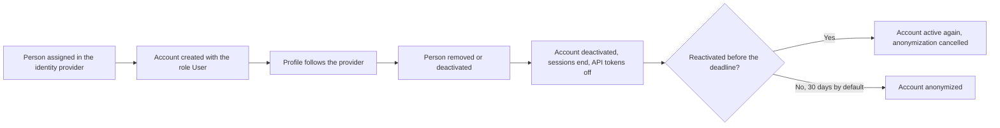

import WhoCanDoThis from "/snippets/who-can-do-this.mdx";
import TokenShownOnce from "/snippets/token-shown-once.mdx";

User provisioning connects your <Tooltip tip="The system your team already uses to sign in, such as Microsoft Entra ID, Okta, Keycloak or Google." cta="Glossary" href="/glossary#identity-provider">identity provider</Tooltip> to Collabase, so accounts and group memberships follow your directory. Assign a person in your identity provider and Collabase creates the account. Change the profile there and Collabase updates it. Remove the person and Collabase deactivates the account.

Collabase uses the System for Cross-domain Identity Management (<Tooltip tip="A standard for automated user provisioning. It creates, updates and deactivates accounts and group memberships from your identity provider." cta="Glossary" href="/glossary#scim">SCIM</Tooltip>) in version 2.0. After you connect your identity provider, you manage names, email addresses, job titles, department and group memberships from your identity provider.

<WhoCanDoThis role="System administrator in Collabase, and a role in your identity provider that may configure provisioning" edition="Collabase Enterprise Edition" />

SCIM does not sign anybody in. You need a sign-in method next to it, see [SAML single sign-on](/admin/saml-sso) or [Identity providers](/admin/identity-providers).

## Before you begin

- Have an active Enterprise licence. SCIM stops when the licence has expired and resumes when it is renewed.
- Have enough licensed seats. A person who does not fit is turned away.
- Set up a sign-in method first, and decide which attribute of your identity provider is the email address. Use the same one for sign-in and for SCIM.
- Start with a pilot group of people who have no Collabase account yet. SCIM never claims an existing account by email address, see the section on existing accounts.
- Create test persons and groups in your identity provider and use them for the first sync.

## Connect your identity provider

<Steps>
  <Step title="Enable SCIM">
    Open **Admin → Identity Providers**, scroll to **SCIM Provisioning** and switch on **Enable SCIM provisioning**. Requests are refused until this switch is on, even with a valid token.
  </Step>
  <Step title="Generate a token">
    Click **Generate token** and copy it when **SCIM token created** appears. Collabase shows it only once.

    <Frame caption="The token dialog. Copy the token before you click the button, you cannot show it again.">
      
    </Frame>
  </Step>
  <Step title="Configure your identity provider">
    In the SCIM settings of your provider, enter:

    | Setting | Value |
    |---|---|
    | **SCIM base URL** | `https://your-collabase-domain/api/scim/v2` |
    | **Authentication method** | Bearer token |
    | **Bearer token** | The token you copied |
  </Step>
  <Step title="Assign people and groups">
    Assign the Collabase application to the people or groups to provision. Your provider pushes them to Collabase.
  </Step>
  <Step title="Check the result">
    Open **Admin → Users**. The accounts you expect appear, and the **Identity** column shows where each one came from.
  </Step>
</Steps>

<TokenShownOnce days="365" />

For Microsoft Entra ID, see [IAM with Microsoft Entra ID](/admin/iam-microsoft-entra).

## Attributes Collabase reads

| SCIM attribute | What Collabase does with it |
|---|---|
| `emails` | The primary address, or the first one, becomes the sign-in address. |
| `userName` | Used as the address when no email is sent. |
| `displayName`, `name.givenName`, `name.familyName` | The name of the member. |
| `externalId` | Links the account to the person in your directory. Do not change what you send here after the first sync. |
| `active` | Inactive deactivates the account, active reactivates it. |
| `title` and the enterprise attribute `department` | Job title and department on the profile. |

A directory never grants a role. Every account that SCIM creates starts as **User**.

## How existing accounts are handled {#how-existing-accounts-are-handled}

- **No matching by email.** If your identity provider sends a person whose email address already belongs to a Collabase account that SCIM did not create, Collabase rejects the person with a conflict (HTTP 409). Change the email address of one of the two accounts, then let your provider try again.
- **Matching by the directory's own ID.** A person whose external ID is already stored on a Collabase account is linked to that account. Name and email address then follow your provider.
- **Administrators.** The sign-in address of an administrator is not the directory's to change. Your existing administrator accounts stay as they are. If you assign them, they show up as rejected, which is harmless.
- **Deactivation by an administrator stays.** If an administrator deactivated an account in **Admin → Users**, a later message from your provider that the person is active does not reactivate it.
- **No free seat.** When the licensed user limit is reached, new people and reactivations are rejected with HTTP 403.

Below the token list, the **SCIM Provisioning** card shows **Recently turned away**: the last ten people your provider tried to create and Collabase refused, with the reason and the time. Fix the cause, and the next provisioning run takes the person in.

<Frame caption="The SCIM Provisioning card with the switch, the token list and Recently turned away.">
  
</Frame>

## Supported user account operations

When you do one of these in your identity provider, Collabase follows.

| Operation | Notes |
|---|---|
| **Create an account** | Collabase creates the account with the email address from your provider and the role **User**. A licensed seat must be free. |
| **Link an existing account** | Only through the external ID of an account that already carries it. Never through the email address. |
| **Update account details** | Name, email address, job title and department follow your provider. The sign-in address of an administrator stays. |
| **Deactivate an account** | Collabase locks the account, ends its sessions and switches off its API tokens. Pages, work items and comments stay. After 30 days by default the account is anonymized, see below. |
| **Activate an account** | Collabase reactivates the account when a licensed seat is free and no administrator deactivated it. |
| **Delete an account** | Collabase never deletes an account through SCIM. To delete a member for good, use **Admin → Users**, see [Members and groups](/admin/users-groups). |

The diagram shows the life of an account that SCIM manages.

### What happens after a deactivation

A deactivated account is anonymized once its deadline passes: the name and email address are removed, and pages, work items and comments stay and show the name followed by `(deleted)`. The default is 30 days. You change it under **Anonymize locked accounts after** in the [security policies](/admin/security-policies). A changed period applies to accounts deactivated from then on. Reactivating the account before the date cancels the anonymization.

## Supported group operations {#supported-group-operations}

Groups that SCIM pushes become Collabase groups. Their members follow your identity provider.

| Operation | Notes |
|---|---|
| **Create a group** | The group is created in Collabase. You cannot add or remove members, rename or delete it there. You can give it access to spaces. |
| **Push an existing group** | A group with the same name as an existing Collabase group takes over that group. Its members are replaced by the members from your provider. |
| **Update group membership** | Members are added and removed to match your provider. |
| **Delete a group** | Delete the group in your provider and Collabase removes it. |

A group can have at most 1,000 members.

## Troubleshooting {#troubleshooting}

| Problem | Workaround | Recorded in the log |
|---|---|---|
| The connection test fails with "SCIM provisioning is disabled for this instance". | Switch on **Enable SCIM provisioning**. | No |
| Requests fail with "The Enterprise licence has expired". | Renew the licence. Provisioning resumes on its own. | No |
| Requests fail with "Not found". | The instance has no Enterprise licence. Activate one. | No |
| Requests are refused as unauthorized. | The token is wrong, revoked or older than 365 days. Generate a new token and enter it in your provider. | No |
| A person is not provisioned and shows as turned away because the email address belongs to another account. | Change the email address of one of the two accounts. | Yes, as `SCIM_USER_REJECTED` in the audit log and under **Recently turned away** |
| A person is not provisioned and shows as turned away because no seat was free. | Free a seat. The next run takes the person in. | Yes, as `SCIM_USER_REJECTED` in the audit log and under **Recently turned away** |
| A person is active in your provider but stays deactivated in Collabase. | An administrator deactivated the account. Release it in **Admin → Users**. | No |
| A person cannot sign in after provisioning. | Check the sign-in method and that the email address at sign-in equals the one SCIM sent, see [SAML single sign-on](/admin/saml-sso). | No |
| A synced group cannot be edited in Collabase. | By design. Change it in your identity provider. | No |
| An account was anonymized after a deactivation. | The period under **Anonymize locked accounts after** passed. The account cannot be restored. | No |

<CardGroup cols={2}>
  <Card title="IAM with Microsoft Entra ID" icon="key-round" href="/admin/iam-microsoft-entra">
    The full setup for Microsoft Entra ID, with sign-in and SCIM.
  </Card>
  <Card title="SAML single sign-on" icon="shield-check" href="/admin/saml-sso">
    Let members sign in through your identity provider.
  </Card>
  <Card title="Members and groups" icon="users" href="/admin/users-groups">
    Manage, deactivate and delete members.
  </Card>
  <Card title="SCIM reference" icon="code" href="/api/scim/overview">
    The SCIM endpoints for developers.
  </Card>
</CardGroup>
