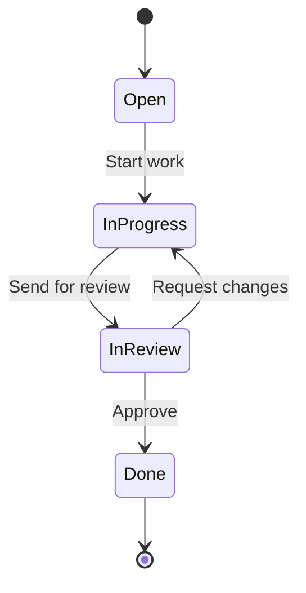

import WhoCanDoThis from "/snippets/who-can-do-this.mdx";

A workflow is the set of statuses a work item moves through and the transitions between them. You design workflows once for the instance. Projects and project templates then pick the workflows they use, see [Workflows in a project](/projects/workflows).

<WhoCanDoThis role="System administrator with a second factor set up" edition="Every installation" />

## How a workflow is built {#how-it-works}

The example shows a small workflow. Each box is a status, each arrow a transition, and the label on an arrow is the transition name that members see as a button.

- **Statuses** carry a name, a colour and a category.
- **Transitions** connect two statuses. Only the transitions you draw are offered on a work item.
- **New work items** start in the status you created first in the workflow.

### Status categories {#status-categories}

Every status belongs to one <Tooltip tip="The group a status belongs to: To Do, In Progress, Done or Closed." cta="Glossary" href="/glossary#status-category">status category</Tooltip>. The category tells Collabase how to treat work items in that status, whatever the status is called.

| Category | Meaning |
|---|---|
| **To Do** | Work that has not started. New statuses start in this category. |
| **In Progress** | Work that is under way. |
| **Done** | Finished work. The work item gets a completion date. |
| **Closed** | Finished without being done, for example rejected or duplicate. The work item gets a completion date. |

The board hides work items in **Done** and **Closed** after a number of days. Use **Closed** where other tools would use a resolution such as "Won't do".

## Create a workflow {#create}

<Steps>
  <Step title="Open Workflows">
    Open **System Settings → Content & Organization → Workflows** and click **New Workflow**.
  </Step>
  <Step title="Name it">
    Enter a **Name**, for example "Software Development", and a **Description** that says when to use it. Click **Create Workflow**.
  </Step>
  <Step title="Open the editor">
    The new workflow has no statuses yet. Click **Open Editor**.
  </Step>
</Steps>

## Add statuses {#statuses}

<Steps>
  <Step title="Add a status">
    In the editor, click **Add Status**. A status called **New Status** appears on the canvas in the category **To Do**.
  </Step>
  <Step title="Set name, colour and category">
    Click the status to open **Status Details**. Set the **Name**, pick a **Color** and choose the **Category**. These changes are saved when you click **Save** in the panel. You can also double-click a status to rename it on the canvas.
  </Step>
  <Step title="Arrange the canvas">
    Drag statuses to where they make the flow readable. Click **Save** at the top right to keep the layout.
  </Step>
</Steps>

Create the starting status first. New work items always start in the status that was created first.

## Add transitions {#transitions}

<Steps>
  <Step title="Connect two statuses">
    Drag from the handle of one status to another. The transition is saved at once.
  </Step>
  <Step title="Name the transition">
    Click the transition to open **Transition Details** and enter a **Name**, for example "Start Review". It is shown as the button label when a member changes the status of a work item.
  </Step>
  <Step title="Add rules (optional)">
    Add conditions, validators, functions or transition fields as described below, then click **Save**.
  </Step>
</Steps>

### Rules on a transition {#rules}

Each transition can carry three kinds of rules. Click **Add condition**, **Add validator** or **Add function**, choose the **Type** and click **Apply**.

<Tabs>
  <Tab title="Conditions">
    A condition decides whether the transition is offered at all.

    | Type | The transition is offered when |
    |---|---|
    | **Field value** | A field matches a value, for example priority is High |
    | **Field is not empty** | A field has a value |
    | **Checklist complete** | The work item has no open sub-items |
    | **User is in group** | The person moving the work item is in a group |
  </Tab>
  <Tab title="Validators">
    A validator blocks the transition and tells the member why.

    | Type | The transition is blocked when |
    |---|---|
    | **Field is required** | The chosen field is empty |
    | **No open sub-tasks** | The work item still has open sub-items |
    | **Minimum comments** | The work item has fewer comments than the number you set |
  </Tab>
  <Tab title="Functions">
    A function changes the work item after the transition.

    | Type | Effect |
    |---|---|
    | **Set field value** | Sets a field to a fixed value |
    | **Clear field** | Empties a field |
    | **Set due date** | Sets the due date to today plus **Offset (days from today)** |
    | **Send notification** | Notifies the **Assignee**, the **Reporter** or the **Watchers**, with an optional message |
  </Tab>
</Tabs>

### Transition fields {#transition-fields}

Transition fields ask the member for values before the work item moves, for example a root cause when a bug is closed.

<Steps>
  <Step title="Add a field">
    In **Transition Details**, under **Transition Fields**, click **Add Field** and pick a standard or custom field.
  </Step>
  <Step title="Make it required (optional)">
    Switch on **Required** for fields that must be filled.
  </Step>
</Steps>

When a member uses the transition, a dialog opens with these fields. **Confirm Transition** stays disabled until every required field has a value.

## Delete statuses, transitions and workflows {#delete}

| What | How | What happens to work items |
|---|---|---|
| **Status** | **Delete** in **Status Details**, then **Save** at the top right | If work items are in the status, **Status Migration Required** opens. Pick a status under **Move work items to** and click **Migrate & Save**. |
| **Transition** | **Delete transition** on the arrow | None. The transition and its rules are removed. |
| **Workflow** | **Delete** on the workflow card | If projects still use it, a dialog lists them. Choose a replacement workflow per project, map the statuses and click **Migrate & Delete**. |

<Warning>
  Use the **Delete** buttons. Pressing Delete or Backspace on the canvas removes a status or transition from the screen only, and it reappears when you reload the editor.
</Warning>

Workflows marked with a lock are system workflows used by the templates that come with Collabase. You can edit them but not delete them.

## Best practices

- **Keep statuses few.** Every status is a column on the board. Use a field for detail that does not change who works on the item.
- **Name transitions as actions.** "Send for review" tells the member what happens; "In Review" does not.
- **Prefer validators over conditions for required data.** A hidden transition confuses members; a blocked one tells them what is missing.

## Troubleshooting

| What you see | Cause | What to do |
|---|---|---|
| A member cannot find a transition | A condition is not met, or there is no transition from the current status | Check the conditions in **Transition Details** |
| A transition is refused with a message about a field or sub-items | A validator failed | Fill the field or close the sub-items, then try again |
| **Status Migration Required** when saving | Work items are still in a status you deleted | Choose a replacement status |
| A project still shows a deleted status | The editor could not delete it because work items use it through a work item type mapping | Move those work items to another status first, then delete the status again |

## Related pages

<CardGroup cols={2}>
  <Card title="Workflows in a project" icon="git-branch" href="/projects/workflows">
    Assign workflows and map them to work item types.
  </Card>
  <Card title="Project templates" icon="layout-template" href="/projects/templates">
    Bundle workflows for new projects.
  </Card>
</CardGroup>
