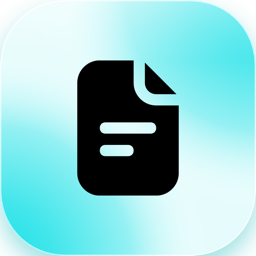
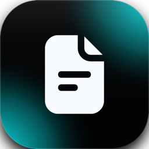
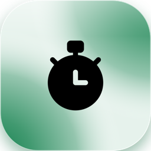
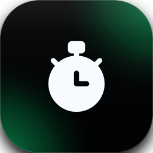

Release notes for Collabase are published here from version 1.0 onwards. For every version, you will find the new features, improvements and changes that matter to administrators.

Every year brings a new major version with its own name. The monthly versions in between can include changes that need a step from you; they are always listed first, under **Breaking changes**.

Each release has one entry with its version and month, and a link to it ends in the version, for example `#v1-0-0`. Filter the entries by category with the tags, or subscribe with the RSS button.

<Update
  label="v1.1.0"
  description="November 2026 · Rigi"
  tags={["New features", "Bug fixes", "Administration", "Breaking changes", "Docs", "Projects", "Meetings", "Time Tracking", "Roadmaps", "Studio", "Service Management", "Collabase AI"]}
  rss={{ title: "Collabase 1.1.0", description: "Studio brings automations to Collabase, meetings end with a summary, Times becomes one app with one access setting, and Collabase AI works again with Infomaniak and Ollama." }}
>
  Collabase 1.1 has a new look, brings Studio with automations, ends every meeting with a summary and
  tells everyone when their instance has been updated. Times becomes one app with one access setting, and Collabase AI works
  again for instances that use Infomaniak or Ollama as their AI provider.

  <Warning>
    This version changes who sees Times. See [Update notice for self-hosters](#update-notice-for-self-hosters).
  </Warning>

  ### New apps and features

  - **New look:** one set of colours, shapes and type across the whole product, with Inter as the only typeface and Lime as the default accent. Every app uses the same controls, menus, popups, tabs, lists, detail views, dashboards, empty states, status pills and icons, in light and dark mode and in every accent colour. Edit forms open as popups, and side sheets are gone. Administrators still choose another accent under **Settings** → **System Theme**, and each person still chooses light, dark or system.
  - **Sign-in page:** the sign-in page comes in two designs, a centred card on a soft colour gradient and a two-column layout with a wallpaper.
  - **Update notice:** after every update, administrators see once which version the instance now runs, until when it is supported, what is new and a short update report: when the update happened, whether the services run and how many apps are installed. Afterwards the version is one click away at the bottom of the **Feedback & help** menu and on the sign-in page. [Learn more](/admin/updates#after-the-update)
  - **Meeting summary:** when you end a meeting, a popup shows who attended and who did not, the link to the meeting notes where Docs is on, the AI recap, the topics that were not discussed and the tasks that were created. Only the person who ended the meeting sees it.
  - **Assign to me:** press `I` in a work item to assign it to yourself.
  - **Times access:** Times is now one app with one access setting for groups, replacing Time Reports and Planner. See the [update notice](#update-notice-for-self-hosters).
  - **Service Management:** a new app next to Projects for teams that work customer requests. A service project has request forms, queues with the tickets that need attention, SLA policies with clocks that warn before a target is missed, approvals that start when a ticket enters a workflow status, public replies and internal notes, and a customer portal where customers submit requests, follow them and share them with colleagues. Customers are their own kind of account, grouped in organizations, and can register themselves with their company address. They approve requests that need their say, search the knowledge base from the portal, and vote and comment on a public roadmap; agents see who voted, customers only the count. A ready-made Service Desk template sets up statuses, request forms, queues and SLA policies. SLA, queue and vote gadgets are available for dashboards, and tickets and customers can be exported. A ticket can also start from a mail. An administrator gives the app to groups, and it can run with or without Projects. [Learn more](/service-management/overview) Service Management starts as a beta: switch it on for yourself under **Settings** → **Profile** → **User settings** → **Collabase Lab**. An operator switches it on for the whole instance, see the [update notice](#update-notice-for-self-hosters).
  - **Studio:** build flows that react to events in Collabase and other systems, run on a schedule, ask people for approval and use AI, with every run on record. Studio is the new name of Collabase Automation and is part of this release. Own integrations are built with the open source [Plug SDK](https://github.com/Collabase/plug-sdk) and the [plug examples](https://github.com/Collabase/plug-examples). [Learn more](/automation/overview)
  - **Agents in Studio (beta):** define an assistant once, with an instruction, tools and optional knowledge, and use it in chats, flows and jobs. Agents are a beta feature of Collabase Lab and off until you switch them on. [Learn more](/automation/agents)
  - **Popups keep what you typed:** edit and settings popups no longer close when you click beside them. Escape and the close button still close them.

  ### Docs

  **New features**

  - **Page tree:** create pages and folders from a menu at the top of the tree or on any row. The new page appears under the page you have open, the parents unfold, and a new folder opens in rename mode.
  - **Page tree search:** a search field above the tree filters pages by title. Escape restores the full tree exactly as it was.
  - **One page menu everywhere:** the same actions are available from the tree row, a right click, the page header and the folder view: move, archive, delete (with the number of affected pages), copy link and more. Pages can also be moved with a menu step, not only by dragging.
  - **Insert menu:** the slash menu and the **+** button now share one catalogue, so both offer the same blocks in the same order.
  - **Table header row:** tables have a **Header row** switch. The header is shown in bold on a tinted background.
  - **Markdown shortcuts:** Markdown you type while writing turns into formatting, for example headings, lists, quotes, code and emoji by name.
  - **Callout variants:** a callout can be switched between variants with a new button. The PDF export keeps the variant.
  - **On this page:** on wide screens a column next to the page lists its headings (from two headings on), and a bar below it shows where you are.
  - **Inline comments:** select text and comment on it, also in read mode. Threads stay on their passage after saving and publishing, replies and @mentions notify the people involved, and new comments from others appear without a reload. [Learn more](/docs/comments)
  - **Public API:** pages can be created and read through the API, in all four page types. [Learn more](/api/pages/create-page)
  - **Export and import:** PDF and Markdown export appear with their logos in the page menu and in the **More** menu of the toolbar. Import is in the **More** menu as well.
  - **Save and share:** the toolbar has a **Save changes** button, and the copy-link button in the page header is now called **Share**.
  - **Embed a roadmap in a page:** the insert menu has a **Roadmap** block that shows a roadmap as a timeline in a page. Readers see it with their own rights, and a person without access to the roadmap sees a notice instead. [Learn more](/planning/roadmaps#embed-in-page)

  **Improvements**

  - The toolbar fits on one line and moves the less used actions (find and replace, indent, line height, export, import) into the **More** menu.
  - Toolbars, menus and labels of the editor are translated into German, French, Italian and English, and the editor looks like the rest of Collabase.
  - Tables, lists, media, links, mentions, dates, equations, columns, toggles and code blocks behave more consistently. Dates are shown in the Swiss format, for example 30.10.2026.
  - The page tree loads in a fixed order and no longer jumps around.
  - Menus across the app (app drawer, files, mind map, task graph, automation, registry designer and others) look and behave the same, in the dropdown and in the right-click menu.
  - Hover and the active page in the sidebar fill the whole row, without a bar at the side.
  - Spacing between the toolbar and the page content is more even.
  - A copied page is placed directly below the original.

  **Bug fixes**

  - The **Turn into** menu in the toolbar no longer crashes.
  - Image upload from the toolbar image button works again. The chosen file was dropped before.
  - Pressing Enter on an image, a diagram or a macro opens a new line below it.
  - The slash menu no longer closes when you press its scrollbar.
  - Row actions in the page tree no longer cover the page title.
  - On a page with live collaboration, the **AI** entry in the slash menu, **Ask AI** on a block and **AI commands** in the toolbar were shown but did nothing. They are hidden there now; the Collabase AI assistant still reads and changes the page. [Learn more](/docs/collaboration#ai)

  ### Projects

  **New features**

  - Press `I` in a work item to assign it to yourself, in the work item popup and on its page. It does not fire while you type in a field.
  - **Assign to me** sits at the top of every assignee list, in the same row style as the people below it, and stays in place while the list scrolls.
  - **Add to agenda:** the **Meetings** panel of a work item lets you add it to the agenda of a meeting that already exists, next to creating a new meeting. Meetings that already list the work item are greyed out.
  - **Critical path:** the **Critical path** switch in the timeline toolbar highlights the work items and dependencies that set the finish date and shows each work item's slack in days.
  - **Baselines:** the **Baseline** menu in the timeline toolbar captures the current dates of a project as a baseline and compares the timeline with it, with a shadow bar under each work item and its slip in days.
  - **Scenarios:** the **Scenario** menu in the timeline toolbar lets you try out new dates, estimates and assignees without touching the live plan. Review the changes against the live plan and adopt the ones you want. [Learn more](/planning/baselines-and-scenarios#scenarios)
  - **Programme health:** a portfolio shows the worst traffic light of the latest approved status reports of all projects below it. The portfolio owner can override it with a reason, and the suggestion from the projects stays visible beside it.
  - **Programme risks:** a portfolio has a **Risks** tab with its own risks, kept in the risk register of a space you choose, and beside them the open and critical risks of the projects below it.
  - **Programme reports:** a portfolio has a **Reports** tab with a monthly programme report that the portfolio owner writes, submits and has approved, with one row per project and frozen figures once approved.
  - **Reminder when a status report is due:** on the fifth working day of the month, project leads and portfolio owners get one notification listing the reports of the month before that are still missing. [Learn more](/projects/reports#reminders)
  - **PDF export for status reports:** a status report and a programme report have an **Export** button that downloads the report as a PDF in A4 portrait, in your language. A programme report lists only the projects you can see. [Learn more](/projects/reports#export-pdf)
  - **Gantt export (PDF and PNG):** the **Export** button in the timeline toolbar of a project and of a portfolio downloads the Gantt as a PDF in A4 or A3 landscape or as a PNG. It shows the work items you may see, with the baseline, critical path and scenario that are switched on. [Learn more](/projects/timeline#gantt-export)

  **Improvements**

  - Links in comments and descriptions open in a new tab, so the work item stays open.
  - A web address typed at the end of a comment is now clickable, and so is a link written without `https://`, such as `www.example.ch`. This also fixes older comments.
  - Gantt: year view. The timeline offers **Year** next to **Quarter**, with the months under each year.

  **Bug fixes**

  - Writing a comment now has a **Cancel** button that discards the draft.
  - In comments and descriptions, **Backspace** at the start of an indented line takes the indent back, as in a text editor. Before, only Shift+Tab did.
  - A title and description handed to the **Create work item** popup, for example from the tasks macro on a page, were dropped. They are kept now.
  - Syncing repositories from GitHub failed for a GitHub App created through Collabase, so no repository could be linked to a project. It works now.

  ### Meetings

  **New features**

  - **Summary when a meeting ends:** a popup for the person who ends the meeting. It shows who attended, who did not and whose attendance was not recorded, the link to the meeting notes (only where Docs is on, and while the note is being written it says so), the AI recap when the note has one, the topics that were not discussed and the tasks that were created.
  - **Duplicate agenda items and sections:** duplicate an item below itself or a whole section with its items. Notes, owner, estimate and linked work items come along; decisions and recorded results do not.
  - **Previous topic:** a running meeting has a button to go back to the topic before the running one. The running topic is not marked as done.
  - **Presentation mode:** it now shows the agenda with its sections and, for each topic, who is responsible with name and photo. Tasks can be recorded in presentation mode, without leaving it.
  - **Work item form for tasks:** a task recorded in a meeting becomes a work item through the same popup as everywhere else, filled with its text, responsible person and due date, so every field the project needs can be filled in.

  **Improvements**

  - New meetings start with **Participants may edit the agenda** and **Topics go straight to the agenda** switched on. Existing meetings keep their settings.

  **Changed behaviour**

  - A meeting records only tasks now. The outcome type **Information** is gone, and the AI no longer suggests information. Existing information notes stay visible.
  - In a space where Docs is off, a meeting offers no pages under **Add agenda item** or when linking, and it writes, shows and publishes no meeting note. A note that was written while Docs was on is hidden until Docs is on again.

  **Bug fixes**

  - People invited to one date of a series were missing from the next dates. Participants now belong to the whole series: someone you invite, remove or give another role changes on every upcoming date, and new dates start with them. A series that was created before this update has the participants it had when it was created, so invite someone once to bring the list up to date.

  ### Time Tracking

  **Changed behaviour**

  - The **Times** entry in the sidebar appears only for people whose group has the **Times** app. Administrators always see it. Booking time on work items does not depend on it.
  - Inside Times, **My times** and the planner are open to every role of the app, and **Time Reporting** needs the Manager role or higher.

  ### <Icon icon="route" size={20} /> Roadmaps

  **New features**

  - **Roadmaps:** the new **Roadmaps** app lists every roadmap you may see, with its number of initiatives and the date of the last change. Create a roadmap with a name and a description, rename it or delete it. Deleted roadmaps move to the trash of the system administration, where they wait 30 days to be restored. [Learn more](/planning/roadmaps)
  - **Timeline with drag and drop:** open a roadmap to see its initiatives on a timeline, grouped in swimlanes, with phases as bands and milestones as diamonds. Drag a bar to move it, drag its ends to change its length, and drag a row to another lane or position. Zoom from year to week. Viewers see the same timeline without the drag handles. [Learn more](/planning/roadmaps#timeline)
  - **Swimlanes, phases and milestones:** editors add, rename, recolour, reorder and delete swimlanes (initiatives of a deleted lane move to another one), add coloured phases and milestones with a right click on the timeline, and drag a milestone to another day. Viewers see them without any menu or handle. [Learn more](/planning/roadmaps#lanes)
  - **Initiative details and conflict hints:** click a bar to open the details of an initiative. Edit name, description, status, lane, period, colour and owner right there, and link projects, work items, portfolios and pages. A link to something you may not see shows only that you have no permission. When a linked project or portfolio lies outside the initiative's period, is closed or is off track, the initiative says so and offers to adopt the period of the linked objects. [Learn more](/planning/roadmaps#edit-initiatives)
  - **Share a roadmap:** share a roadmap with people and groups as editor or viewer. Guests can only view, and the last editor cannot be removed. New viewers and editors get a notification.
  - **Custom statuses and relation types per roadmap:** editors rename, recolour, reorder, add and remove the statuses of a roadmap and sort each into open, active or completed. Relation types get a name, colour, line style, arrow and icon. A status or type that is still in use is replaced by another one when you remove it. [Learn more](/planning/roadmaps#statuses)
  - **Relations between initiatives:** editors connect two initiatives with a typed relation, either by dragging from one bar onto another or with **Add relation** in the details. The line shows the colour, line style, arrow and icon of its type, hovering over it names the type, the label and both initiatives, and several relations between the same two initiatives are drawn side by side. [Learn more](/planning/roadmaps#relations)
  - **Linked items on the timeline:** an initiative with links unfolds into read-only rows for its linked projects, work items, portfolios and pages, with their real period, traffic light and status. A portfolio unfolds into its sub-portfolios and projects. A warning symbol marks a row that starts before or ends after the initiative, one button unfolds or folds everything, and the PDF and PNG export can include the rows. [Learn more](/planning/roadmaps#linked-rows)
  - **Ask Collabase AI about roadmaps:** ask which initiatives are planned in a quarter, what the status of one is or which ones are overdue. Collabase AI only reads, and only roadmaps you may open. [Learn more](/planning/roadmaps#ai)
  - **Search and gadget:** find roadmaps and initiatives in search, and show a roadmap as a dashboard gadget. Both show only roadmaps you may open. [Learn more](/planning/roadmaps#search-gadget)
  - **Export a roadmap as PDF or PNG:** the **Export** button in the roadmap toolbar downloads the timeline with lanes, phases, milestones and relations as a PDF in A4 or A3 landscape or as a PNG, in your language. While you compare with a snapshot or look at a scenario, the file shows that comparison or scenario: the snapshot dates appear as shadow bars under the initiatives. A link to something you may not see shows no name. [Learn more](/planning/roadmaps#export)
  - **Reminders for overdue initiatives and conflicts:** the owner of an initiative gets a notification when its planned end has passed, and when a linked project or portfolio newly falls outside the period, is closed or turns red. Each case is reported once. [Learn more](/planning/roadmaps#reminders)
  - **Snapshots: freeze a roadmap and compare it with today:** editors freeze a roadmap under a name, and everyone who may open it can look at the frozen state or set it against the plan of today, with shadow bars under the moved initiatives and a count of what is new, removed, moved or has a new status. A snapshot cannot be changed. [Learn more](/planning/roadmaps#snapshots)
  - **Scenarios: try out changes and adopt them:** editors create a scenario on a roadmap, drag initiatives to other dates, move them to another swimlane or give them another status, and look at the result next to the live plan. **Review changes** lists every change, and only the ones you choose go into the roadmap, all or nothing. Viewers can look at scenarios but not change them. [Learn more](/planning/roadmaps#scenarios)
  - **Comments and activity on initiatives:** open an initiative to discuss it in **Comments**, with answers and @mentions of people who may open the roadmap, and to follow in **Activity** who changed which field and when. Viewers write comments too. [Learn more](/planning/roadmaps#comments)
  - **Turn an initiative into a project:** editors who may create projects in a space turn an initiative into a project from its details. The project takes the period of the initiative and its owner as lead, the initiative links to it, and linked pages appear in the project as web links. A key that is already taken is reported at the field. [Learn more](/planning/roadmaps#convert)

  ### <Icon icon="life-buoy" size={20} /> Service Management (beta in Collabase Lab)

  Service Management is a beta feature and shows up in **Collabase Lab**. It stays off, with no app in the sidebar and no service desk template, until you switch it on under **Settings** → **Profile** → **User settings** → **Collabase Lab**. The switch is yours alone. An operator can switch it on for the whole instance, see the [update notice](#update-notice-for-self-hosters).

  **What you get**

  - **Service projects:** a project becomes a service project, or you start one from the **Service Desk** template with statuses, request forms, queues and SLA policies already in place.
  - **Customers and organizations:** customers are their own kind of account, grouped in organizations. Administrators invite them, edit them and give them access per project. Customers can also register themselves with their company address.
  - **Request forms:** each request type has its own form with the fields of its work item type, its own name and a start status.
  - **Customer portal:** customers submit requests, follow them, answer and share them with colleagues or their organization. Organization admins see all requests of the organization and approve where needed. `/portal` lists every portal a customer may open.
  - **Queues and SLAs:** queues show the tickets that need attention with live counts. SLA policies run clocks on working calendars and warn before a target is missed.
  - **Replies and notes:** agents choose per comment whether it is public in the portal or private. Reply templates speed up the answers.
  - **Approvals:** approvals sit on a workflow status. A ticket that enters the status waits for the decision of the named people or of the customer's organization admin.
  - **Knowledge base and search:** a space, or a page with everything below it, is the knowledge base in the portal. Customers search articles and request forms while they write a request.
  - **Public roadmap:** the portal shows a roadmap of the work items you choose, with votes. Customers see only the number of votes, never who voted.
  - **More:** open a ticket from a customer mail, dashboard gadgets for SLA, queues and votes, export of tickets and customers, optional AI triage and reply drafts, and a portal agent that answers from the knowledge base. The AI features are off until an administrator switches them on per project.

  **Beta limits**

  - Customers and background work follow the instance switch: without it customers see no portal, and SLA clocks, the mail intake and the notifications do not run.
  - The beta can change before it is generally available.

  ### <Icon icon="hand" size={20} /> Studio

  **New features**

  - **Flows:** a flow starts from a trigger, such as a new work item, a call from another system or a time of day, and runs its steps one after the other. Each step is an action of a plug: create a work item, send a notification and more. A flow has a draft you edit and a published version that runs. [Learn more](/automation/building-flows)
  - **Automation workspaces:** a team owns a group of flows with its own members, connections, runs, audit trail and analytics. The team sees every flow, every run and every change in one list, and a failed run says which step failed and why. [Learn more](/automation/overview)
  - **Runs on record:** every run keeps the log of each step. Open a run to see what went in and out of a step and where it stopped. [Learn more](/automation/debugging-runs)
  - **Plugs and connections:** plugs add triggers and actions for an app or service. Collabase plugs come with the product, administrators install core and community plugs. Connection values are stored encrypted and never shown again. [Learn more](/automation/plugs)
  - **Plug SDK and plug examples (open source):** build your own integrations as plugs. The [Plug SDK](https://github.com/Collabase/plug-sdk) and the [plug examples](https://github.com/Collabase/plug-examples) are open source, and the [developer page](https://collabase.ch/platform/developers/plug-sdk) shows how to start. In this documentation, [Build a plug](/automation/build-a-plug) walks through it.
  - **Safe by design:** a flow acts with the rights of its workspace's service account, never with more. Plugs that Collabase did not write run in an isolated sandbox with no route to your internal systems.
  - **People stay in control:** a step can ask a named person to approve before the flow goes on, and a sensitive space needs a second administrator before a flow is published or switched on. [Learn more](/automation/flow-approvals)
  - **Works without AI:** everything except the AI steps, building a step from a sentence and the Collabase AI tools works without an AI provider.

  ### <Icon icon="bot-message-square" size={20} /> Agents in Studio (beta)

  **New features**

  - **Collabase Lab:** agents are a beta feature. They stay off until you switch them on under **Settings** → **Profile** → **User settings** → **Collabase Lab**, and the switch is yours alone. An operator can keep the feature off for everyone.
  - **Define an agent once:** an agent has an instruction, tools, optional knowledge and its own conversation starters. Describe it in a sentence and Collabase writes the draft, which needs an AI model on your instance. [Learn more](/automation/agent-editor)
  - **Use it everywhere:** chat with an agent in the docked AI chat, run it in a flow with the **Agent** step, or let it work on its own in jobs under its own identity. An agent can be held to the approval rule for each tool it uses. [Learn more](/automation/agents)
  - **Share it and set limits:** share an agent with people and groups, set a monthly token limit and read its usage.
  - **Beta limits:** guests cannot use agents. The beta can change before it is generally available.

  ### <Icon icon="sparkles" size={20} /> Collabase AI

  **Bug fixes**

  - With Infomaniak or Ollama as the AI provider, the provider refused requests that offered Collabase AI its tools, so the assistant answered with an error. It works again.

  ### Administration

  - **Times app:** under **Admin** → **Roles & App Access**, the apps **Time Reports** and **Planner** are replaced by one app, **Times**, with the roles User, Manager and Admin. User opens My times, reviews and the planner, Manager adds Time Reporting for the spaces the person manages, and Admin adds all reports and the billing settings. [Learn more](/admin/users-groups)
  - The time sum gadget on dashboards needs a role on **Times**.
  - Deleted roadmaps are removed for good after 30 days. Deleting a user also removes the roadmaps only that person could open.

  ### Update notice for self-hosters

  **Breaking changes**

  - **Times access.** A group that had Time Reports or Planner keeps access under **Times**: it gets the highest role it had there. A group that had neither no longer sees Times in the sidebar, although everyone saw it before. Booking time on work items keeps working for them.
  - A group with the Manager role on Time Reports now also sees the planner, which shows the workload of other people.
  - **Service desk portal.** The old customer portal of service projects is replaced by the new portal under the same address. Its request forms are converted automatically. Portal settings, the `serviceDesk` project setting and the old portal API (`config`, `tickets`, `submit`, `categories`) are removed; integrations that call them must use the new portal. After the update, logo and banner of every enabled portal show on the sign-in page.
  - **Meeting outcomes in the API.** Creating a meeting outcome of type `INFORMATION` through the API or an AI tool is refused with a validation error; send `TASK` or leave `type` out. Existing information outcomes stay readable.

  **Before you update**

  - Studio is on from this version. To use **Agents** and **Service Management** for everyone on your instance, set `FEATURE_FLAG_OVERRIDES="SERVICE_MANAGEMENT=true"` (and the matching flag for agents) before you start the update. Without it, people switch them on for themselves in Collabase Lab. Customers reach the portal of Service Management only when the instance switch is on.
  - Decide which groups that had neither Time Reports nor Planner should still use Times, and give them the **Times** app under **Admin** → **Roles & App Access**, before the update or right after it.

  **What the update does**

  - Adds one column to the user table that records which version's notice a person has closed. The migration runs on start and needs no step from you.
  - Everyone who used Collabase before the update sees the update notice once.
  - Adds one column to the comment table that remembers where an inline comment sits. The migration runs on start.
  - Adds the **Times** app to the list of apps and copies each group's rights on Time Reports and Planner to it. The old rows stay for one release, so a rollback loses no access. Both migrations run on start.

  - Instances on the default colour preset now show Lime instead of the previous brand colour. Other presets keep their name and colour family.
  - Instances that used the sign-in designs Liquid Glass or Standard now show the two-column design. Pick the centred card under **Settings** → **Login screen** if you prefer it.
  - The Outfit typeface is no longer used. Headings use Inter.
  - Commenting on a page now needs the comment permission instead of the edit permission, so people who may only read and comment can now comment. Guests can no longer comment.
</Update>

<Update
  label="v1.0.1"
  description="November 2026 · Rigi"
  tags={["Security"]}
  rss={{ title: "Collabase 1.0.1", description: "Security updates for PDF text extraction, charts and the translation connection." }}
>
  Collabase 1.0.1 closes several security advisories in components of the platform. We recommend
  this update for every instance.

  ### Security

  | Vulnerability / CVE | Severity | Affected component / Description |
  |---|---|---|
  | CVE-2026-119203, CVE-2026-119204, CVE-2026-119205 | High | Document processing: a specially crafted PDF could keep the text extraction of PDF files in an endless loop or use a very large amount of memory. Fixed by updating the PDF component. |
  | CVE-2026-116689 | High | Translation connection (DeepL): updated a component that handles web requests, which could pass on a custom credential header to another site after a redirect. Updated as a precaution. |
  | CVE-2026-45249 | Medium | Charts: fixed a cross-site scripting vulnerability in chart tooltips of the charting component. |
</Update>

<Update
  label="v1.0.0"
  description="October 2026 · Rigi"
  tags={["New features", "Stability", "Security"]}
  rss={{ title: "Collabase 1.0.0", description: "The first stable release of Collabase: docs, work management, test management and AI in one self-hosted application, with enterprise sign-in, an audit log and production-sized defaults." }}
>
  <Frame>
    
    
  </Frame>

  Collabase 1.0 is the first stable release. It is built for organisations that run their
  collaboration on their own infrastructure: documentation, work management, test management and AI
  in one application, with one permission model and one search across all modules. Your data stays on
  your servers, and the AI provider is yours to choose.

  From this version on, updates keep your data and settings, and every change that affects
  administrators is announced here.

  ### New features

  - **Docs and spaces:** a page tree with a rich-text editor, templates, version history, comments and realtime co-editing.
  - **Work management:** projects with work item types, workflows, custom fields, boards, backlogs and sprints, plus project templates, timeline, portfolio Gantt, phases with gates, milestones and status reports.
  - **Planning and time:** a planner with capacity per person and team, time tracking and time evaluation.
  - **Test management:** test cases, runs, plans and milestones in the space, linked to work items, with an API for external test tools.
  - **Collabase AI:** an AI chat beside every page. The AI provider is chosen by the administrator.
  - **Meetings and dashboards:** meetings with agenda and outcomes, and dashboards with gadgets across modules.
  - **Registry and service desk:** objects with custom types and relations, and a request portal per space.
  - **Search:** one search for global search, saved filters, lists and Collabase AI.
  - **Collabase Lab:** each person can switch on features that are still in development, Studio for automations among them, under Preferences in the profile. An administrator can keep a feature off for everyone.
  - **Deployment:** packages for Docker Compose, Kubernetes (Helm) and Docker Swarm. Updates apply database changes on start.

  ### Stability

  - **Production-sized defaults:** the database and the application connection pool are sized for organisation-wide use by default. Smaller hosts can lower the values.
  - **Safe updates:** before an update changes the database, it checks the data and takes a backup. If either step fails, nothing is changed and you return to the previous version.
  - **Checked images:** the application and collaboration images are started and health-checked before a release is published.
  - **Long-term support runtime:** the application runs on a long-term-support platform that receives security fixes for years.

  ### Security

  - **Enterprise sign-in:** password, second factor with authenticator apps and backup codes, passkeys, single sign-on with SAML and OIDC, LDAP and SCIM provisioning.
  - **Strong administrators:** system administrators who sign in with a password must set up a second factor before they reach administration.
  - **Immediate lockout:** locking an account, by an administrator, SCIM or LDAP, ends all its sessions, switches off its API keys and withdraws its app grants at once.
  - **Guests:** external people work in one project without seeing the rest of the instance.
  - **Controlled API access:** API keys with scopes and a maximum lifetime of one year, shown only once. Third-party applications can connect only after an administrator allows it.
  - **Traceability:** sign-in and security events in the audit log, kept for 180 days, and security mails to the person when a new device signs in or a security setting changes.
  - **AI within permissions:** Collabase AI only sees what the person asking may see.
  - **Verifiable supply chain:** container images ship with a software bill of materials and provenance attestations.

  <Warning>
    **Upgrading from a version before 1.0:** everyone signs in once again, and old API tokens stop
    working and must be replaced with API keys. Automation rules of the previous engine are removed.
    `ENCRYPTION_KEY` and `NEXTAUTH_URL` are required on every installation.
  </Warning>
</Update>
