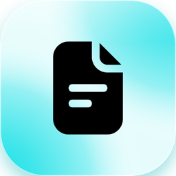
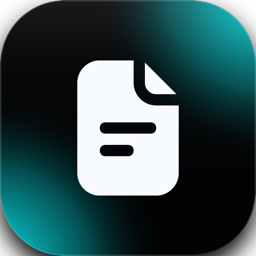
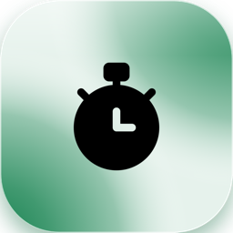
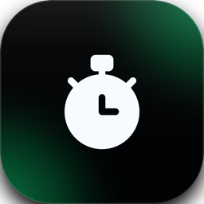

Each entry carries a label that says who it concerns: <Badge color="gray">Everyone</Badge> is for everything a person notices in their work, <Badge color="blue">Admins</Badge> is for changes that only administrators use or must act on.

Collabase 1.1 has a new look, brings Studio with automations, ends every meeting with a summary and
tells everyone when their instance has been updated. Times becomes one app with one access setting, and Collabase AI works
again for instances that use Infomaniak or Ollama as their AI provider.

**Supported until:** October 2027. Collabase 1 gets fixes and security updates for one year after its release, in its newest minor version.

<Warning>
  This version changes who sees Times. See [Update notice for self-hosters](#update-notice-for-self-hosters).
</Warning>

## New apps and features

- <Badge color="gray">Everyone</Badge> **New look:** one set of colours, shapes and type across the whole product, with Inter as the only typeface and Lime as the default accent. Every app uses the same controls, menus, popups, tabs, lists, detail views, dashboards, empty states, status pills and icons, in light and dark mode and in every accent colour. Edit forms open as popups, and side sheets are gone. Administrators still choose another accent under **Settings** → **System Theme**, and each person still chooses light, dark or system.
- <Badge color="gray">Everyone</Badge> **Sign-in page:** the sign-in page comes in two designs, a centred card on a soft colour gradient and a two-column layout with a wallpaper.
- <Badge color="blue">Admins</Badge> **Update notice:** after every update, administrators see once which version the instance now runs, until when it is supported, what is new and a short update report: when the update happened, whether the services run and how many apps are installed. Afterwards the version is one click away at the bottom of the **Feedback & help** menu and on the sign-in page. [Learn more](/admin/updates#after-the-update)
- <Badge color="gray">Everyone</Badge> **Meeting summary:** when you end a meeting, a popup shows who attended and who did not, the link to the meeting notes where Docs is on, the AI recap, the topics that were not discussed and the tasks that were created. Only the person who ended the meeting sees it.
- <Badge color="gray">Everyone</Badge> **Assign to me:** press `I` in a work item to assign it to yourself.
- <Badge color="blue">Admins</Badge> **Times access:** Times is now one app with one access setting for groups, replacing Time Reports and Planner. See the [update notice](#update-notice-for-self-hosters).
- <Badge color="gray">Everyone</Badge> **Service Management:** a new app next to Projects for teams that work customer requests. A service project has request forms, queues with the tickets that need attention, SLA policies with clocks that warn before a target is missed, approvals that start when a ticket enters a workflow status, public replies and internal notes, and a customer portal where customers submit requests, follow them and share them with colleagues. Customers are their own kind of account, grouped in organizations, and can register themselves with their company address. They approve requests that need their say, search the knowledge base from the portal, and vote and comment on a public roadmap; agents see who voted, customers only the count. A ready-made Service Desk template sets up statuses, request forms, queues and SLA policies. SLA, queue and vote gadgets are available for dashboards, and tickets and customers can be exported. A ticket can also start from a mail. An administrator gives the app to groups, and it can run with or without Projects. [Learn more](/service-management/overview) Service Management starts as a beta: switch it on for yourself under **Settings** → **Profile** → **User settings** → **Collabase Lab**. An operator switches it on for the whole instance, see the [update notice](#update-notice-for-self-hosters).
- <Badge color="gray">Everyone</Badge> **Studio:** build flows that react to events in Collabase and other systems, run on a schedule, ask people for approval and use AI, with every run on record. Studio is the new name of Collabase Automation and is part of this release. Own integrations are built with the open source [Plug SDK](https://github.com/Collabase/plug-sdk) and the [plug examples](https://github.com/Collabase/plug-examples). [Learn more](/automation/overview)
- <Badge color="gray">Everyone</Badge> **Agents in Studio:** define an assistant once, with an instruction, tools and optional knowledge, and use it in chats, flows and jobs. [Learn more](/automation/agents)
- <Badge color="gray">Everyone</Badge> **Popups keep what you typed:** edit and settings popups no longer close when you click beside them. Escape and the close button still close them.

## Docs

**New features**

- <Badge color="gray">Everyone</Badge> **Page tree:** create pages and folders from a menu at the top of the tree or on any row. The new page appears under the page you have open, the parents unfold, and a new folder opens in rename mode.
- <Badge color="gray">Everyone</Badge> **Page tree search:** a search field above the tree filters pages by title. Escape restores the full tree exactly as it was.
- <Badge color="gray">Everyone</Badge> **One page menu everywhere:** the same actions are available from the tree row, a right click, the page header and the folder view: move, archive, delete (with the number of affected pages), copy link and more. Pages can also be moved with a menu step, not only by dragging.
- <Badge color="gray">Everyone</Badge> **Insert menu:** the slash menu and the **+** button now share one catalogue, so both offer the same blocks in the same order.
- <Badge color="gray">Everyone</Badge> **Table header row:** tables have a **Header row** switch. The header is shown in bold on a tinted background.
- <Badge color="gray">Everyone</Badge> **Markdown shortcuts:** Markdown you type while writing turns into formatting, for example headings, lists, quotes, code and emoji by name.
- <Badge color="gray">Everyone</Badge> **Callout variants:** a callout can be switched between variants with a new button. The PDF export keeps the variant.
- <Badge color="gray">Everyone</Badge> **On this page:** on wide screens a column next to the page lists its headings (from two headings on), and a bar below it shows where you are.
- <Badge color="gray">Everyone</Badge> **Inline comments:** select text and comment on it, also in read mode. Threads stay on their passage after saving and publishing, replies and @mentions notify the people involved, and new comments from others appear without a reload. [Learn more](/docs/comments)
- <Badge color="gray">Everyone</Badge> **Public API:** pages can be created and read through the API, in all four page types. [Learn more](/api/pages/create-page)
- <Badge color="gray">Everyone</Badge> **Export and import:** PDF and Markdown export appear with their logos in the page menu and in the **More** menu of the toolbar. Import is in the **More** menu as well.
- <Badge color="gray">Everyone</Badge> **Save and share:** the toolbar has a **Save changes** button, and the copy-link button in the page header is now called **Share**.
- <Badge color="gray">Everyone</Badge> **Embed a roadmap in a page:** the insert menu has a **Roadmap** block that shows a roadmap as a timeline in a page. Readers see it with their own rights, and a person without access to the roadmap sees a notice instead. [Learn more](/planning/roadmaps#embed-in-page)

**Improvements**

- <Badge color="gray">Everyone</Badge> The toolbar fits on one line and moves the less used actions (find and replace, indent, line height, export, import) into the **More** menu.
- <Badge color="gray">Everyone</Badge> Toolbars, menus and labels of the editor are translated into German, French, Italian and English, and the editor looks like the rest of Collabase.
- <Badge color="gray">Everyone</Badge> Tables, lists, media, links, mentions, dates, equations, columns, toggles and code blocks behave more consistently. Dates are shown in the Swiss format, for example 30.10.2026.
- <Badge color="gray">Everyone</Badge> The page tree loads in a fixed order and no longer jumps around.
- <Badge color="gray">Everyone</Badge> Menus across the app (app drawer, files, mind map, task graph, automation, registry designer and others) look and behave the same, in the dropdown and in the right-click menu.
- <Badge color="gray">Everyone</Badge> Hover and the active page in the sidebar fill the whole row, without a bar at the side.
- <Badge color="gray">Everyone</Badge> Spacing between the toolbar and the page content is more even.
- <Badge color="gray">Everyone</Badge> A copied page is placed directly below the original.

**Bug fixes**

- <Badge color="gray">Everyone</Badge> The **Turn into** menu in the toolbar no longer crashes.
- <Badge color="gray">Everyone</Badge> Image upload from the toolbar image button works again. The chosen file was dropped before.
- <Badge color="gray">Everyone</Badge> Pressing Enter on an image, a diagram or a macro opens a new line below it.
- <Badge color="gray">Everyone</Badge> The slash menu no longer closes when you press its scrollbar.
- <Badge color="gray">Everyone</Badge> Row actions in the page tree no longer cover the page title.
- <Badge color="gray">Everyone</Badge> On a page with live collaboration, the **AI** entry in the slash menu, **Ask AI** on a block and **AI commands** in the toolbar were shown but did nothing. They are hidden there now; the Collabase AI assistant still reads and changes the page. [Learn more](/docs/collaboration#ai)

## Projects

**New features**

- <Badge color="gray">Everyone</Badge> Press `I` in a work item to assign it to yourself, in the work item popup and on its page. It does not fire while you type in a field.
- <Badge color="gray">Everyone</Badge> **Assign to me** sits at the top of every assignee list, in the same row style as the people below it, and stays in place while the list scrolls.
- <Badge color="gray">Everyone</Badge> **Add to agenda:** the **Meetings** panel of a work item lets you add it to the agenda of a meeting that already exists, next to creating a new meeting. Meetings that already list the work item are greyed out.
- <Badge color="gray">Everyone</Badge> **Critical path:** the **Critical path** switch in the timeline toolbar highlights the work items and dependencies that set the finish date and shows each work item's slack in days.
- <Badge color="gray">Everyone</Badge> **Baselines:** the **Baseline** menu in the timeline toolbar captures the current dates of a project as a baseline and compares the timeline with it, with a shadow bar under each work item and its slip in days.
- <Badge color="gray">Everyone</Badge> **Scenarios:** the **Scenario** menu in the timeline toolbar lets you try out new dates, estimates and assignees without touching the live plan. Review the changes against the live plan and adopt the ones you want. [Learn more](/planning/baselines-and-scenarios#scenarios)
- <Badge color="gray">Everyone</Badge> **Programme health:** a portfolio shows the worst traffic light of the latest approved status reports of all projects below it. The portfolio owner can override it with a reason, and the suggestion from the projects stays visible beside it.
- <Badge color="gray">Everyone</Badge> **Programme risks:** a portfolio has a **Risks** tab with its own risks, kept in the risk register of a space you choose, and beside them the open and critical risks of the projects below it.
- <Badge color="gray">Everyone</Badge> **Programme reports:** a portfolio has a **Reports** tab with a monthly programme report that the portfolio owner writes, submits and has approved, with one row per project and frozen figures once approved.
- <Badge color="gray">Everyone</Badge> **Reminder when a status report is due:** on the fifth working day of the month, project leads and portfolio owners get one notification listing the reports of the month before that are still missing. [Learn more](/projects/reports#reminders)
- <Badge color="gray">Everyone</Badge> **PDF export for status reports:** a status report and a programme report have an **Export** button that downloads the report as a PDF in A4 portrait, in your language. A programme report lists only the projects you can see. [Learn more](/projects/reports#export-pdf)
- <Badge color="gray">Everyone</Badge> **Gantt export (PDF and PNG):** the **Export** button in the timeline toolbar of a project and of a portfolio downloads the Gantt as a PDF in A4 or A3 landscape or as a PNG. It shows the work items you may see, with the baseline, critical path and scenario that are switched on. [Learn more](/projects/timeline#gantt-export)

**Improvements**

- <Badge color="gray">Everyone</Badge> Links in comments and descriptions open in a new tab, so the work item stays open.
- <Badge color="gray">Everyone</Badge> A web address typed at the end of a comment is now clickable, and so is a link written without `https://`, such as `www.example.ch`. This also fixes older comments.
- <Badge color="gray">Everyone</Badge> Gantt: year view. The timeline offers **Year** next to **Quarter**, with the months under each year.

**Bug fixes**

- <Badge color="gray">Everyone</Badge> Writing a comment now has a **Cancel** button that discards the draft.
- <Badge color="gray">Everyone</Badge> In comments and descriptions, **Backspace** at the start of an indented line takes the indent back, as in a text editor. Before, only Shift+Tab did.
- <Badge color="gray">Everyone</Badge> A title and description handed to the **Create work item** popup, for example from the tasks macro on a page, were dropped. They are kept now.
- <Badge color="gray">Everyone</Badge> Syncing repositories from GitHub failed for a GitHub App created through Collabase, so no repository could be linked to a project. It works now.

## Meetings

**New features**

- <Badge color="gray">Everyone</Badge> **Summary when a meeting ends:** a popup for the person who ends the meeting. It shows who attended, who did not and whose attendance was not recorded, the link to the meeting notes (only where Docs is on, and while the note is being written it says so), the AI recap when the note has one, the topics that were not discussed and the tasks that were created.
- <Badge color="gray">Everyone</Badge> **Duplicate agenda items and sections:** duplicate an item below itself or a whole section with its items. Notes, owner, estimate and linked work items come along; decisions and recorded results do not.
- <Badge color="gray">Everyone</Badge> **Previous topic:** a running meeting has a button to go back to the topic before the running one. The running topic is not marked as done.
- <Badge color="gray">Everyone</Badge> **Presentation mode:** it now shows the agenda with its sections and, for each topic, who is responsible with name and photo. Tasks can be recorded in presentation mode, without leaving it.
- <Badge color="gray">Everyone</Badge> **Work item form for tasks:** a task recorded in a meeting becomes a work item through the same popup as everywhere else, filled with its text, responsible person and due date, so every field the project needs can be filled in.

**Improvements**

- <Badge color="gray">Everyone</Badge> New meetings start with **Participants may edit the agenda** and **Topics go straight to the agenda** switched on. Existing meetings keep their settings.

**Changed behaviour**

- <Badge color="gray">Everyone</Badge> A meeting records only tasks now. The outcome type **Information** is gone, and the AI no longer suggests information. Existing information notes stay visible.
- <Badge color="gray">Everyone</Badge> In a space where Docs is off, a meeting offers no pages under **Add agenda item** or when linking, and it writes, shows and publishes no meeting note. A note that was written while Docs was on is hidden until Docs is on again.

**Bug fixes**

- <Badge color="gray">Everyone</Badge> People invited to one date of a series were missing from the next dates. Participants now belong to the whole series: someone you invite, remove or give another role changes on every upcoming date, and new dates start with them. A series that was created before this update has the participants it had when it was created, so invite someone once to bring the list up to date.

## Time Tracking

**Changed behaviour**

- <Badge color="blue">Admins</Badge> The **Times** entry in the sidebar appears only for people whose group has the **Times** app. Administrators always see it. Booking time on work items does not depend on it.
- <Badge color="gray">Everyone</Badge> Inside Times, **My times** and the planner are open to every role of the app, and **Time Reporting** needs the Manager role or higher.

## <Icon icon="route" size={20} /> Roadmaps

**New features**

- <Badge color="gray">Everyone</Badge> **Roadmaps:** the new **Roadmaps** app lists every roadmap you may see, with its number of initiatives and the date of the last change. Create a roadmap with a name and a description, rename it or delete it. Deleted roadmaps move to the trash of the system administration, where they wait 30 days to be restored. [Learn more](/planning/roadmaps)
- <Badge color="gray">Everyone</Badge> **Timeline with drag and drop:** open a roadmap to see its initiatives on a timeline, grouped in swimlanes, with phases as bands and milestones as diamonds. Drag a bar to move it, drag its ends to change its length, and drag a row to another lane or position. Zoom from year to week. Viewers see the same timeline without the drag handles. [Learn more](/planning/roadmaps#timeline)
- <Badge color="gray">Everyone</Badge> **Swimlanes, phases and milestones:** editors add, rename, recolour, reorder and delete swimlanes (initiatives of a deleted lane move to another one), add coloured phases and milestones with a right click on the timeline, and drag a milestone to another day. Viewers see them without any menu or handle. [Learn more](/planning/roadmaps#lanes)
- <Badge color="gray">Everyone</Badge> **Initiative details and conflict hints:** click a bar to open the details of an initiative. Edit name, description, status, lane, period, colour and owner right there, and link projects, work items, portfolios and pages. A link to something you may not see shows only that you have no permission. When a linked project or portfolio lies outside the initiative's period, is closed or is off track, the initiative says so and offers to adopt the period of the linked objects. [Learn more](/planning/roadmaps#edit-initiatives)
- <Badge color="gray">Everyone</Badge> **Share a roadmap:** share a roadmap with people and groups as editor or viewer. Guests can only view, and the last editor cannot be removed. New viewers and editors get a notification.
- <Badge color="gray">Everyone</Badge> **Custom statuses and relation types per roadmap:** editors rename, recolour, reorder, add and remove the statuses of a roadmap and sort each into open, active or completed. Relation types get a name, colour, line style, arrow and icon. A status or type that is still in use is replaced by another one when you remove it. [Learn more](/planning/roadmaps#statuses)
- <Badge color="gray">Everyone</Badge> **Relations between initiatives:** editors connect two initiatives with a typed relation, either by dragging from one bar onto another or with **Add relation** in the details. The line shows the colour, line style, arrow and icon of its type, hovering over it names the type, the label and both initiatives, and several relations between the same two initiatives are drawn side by side. [Learn more](/planning/roadmaps#relations)
- <Badge color="gray">Everyone</Badge> **Linked items on the timeline:** an initiative with links unfolds into read-only rows for its linked projects, work items, portfolios and pages, with their real period, traffic light and status. A portfolio unfolds into its sub-portfolios and projects. A warning symbol marks a row that starts before or ends after the initiative, one button unfolds or folds everything, and the PDF and PNG export can include the rows. [Learn more](/planning/roadmaps#linked-rows)
- <Badge color="gray">Everyone</Badge> **Ask Collabase AI about roadmaps:** ask which initiatives are planned in a quarter, what the status of one is or which ones are overdue. Collabase AI only reads, and only roadmaps you may open. [Learn more](/planning/roadmaps#ai)
- <Badge color="gray">Everyone</Badge> **Search and gadget:** find roadmaps and initiatives in search, and show a roadmap as a dashboard gadget. Both show only roadmaps you may open. [Learn more](/planning/roadmaps#search-gadget)
- <Badge color="gray">Everyone</Badge> **Export a roadmap as PDF or PNG:** the **Export** button in the roadmap toolbar downloads the timeline with lanes, phases, milestones and relations as a PDF in A4 or A3 landscape or as a PNG, in your language. While you compare with a snapshot or look at a scenario, the file shows that comparison or scenario: the snapshot dates appear as shadow bars under the initiatives. A link to something you may not see shows no name. [Learn more](/planning/roadmaps#export)
- <Badge color="gray">Everyone</Badge> **Reminders for overdue initiatives and conflicts:** the owner of an initiative gets a notification when its planned end has passed, and when a linked project or portfolio newly falls outside the period, is closed or turns red. Each case is reported once. [Learn more](/planning/roadmaps#reminders)
- <Badge color="gray">Everyone</Badge> **Snapshots: freeze a roadmap and compare it with today:** editors freeze a roadmap under a name, and everyone who may open it can look at the frozen state or set it against the plan of today, with shadow bars under the moved initiatives and a count of what is new, removed, moved or has a new status. A snapshot cannot be changed. [Learn more](/planning/roadmaps#snapshots)
- <Badge color="gray">Everyone</Badge> **Scenarios: try out changes and adopt them:** editors create a scenario on a roadmap, drag initiatives to other dates, move them to another swimlane or give them another status, and look at the result next to the live plan. **Review changes** lists every change, and only the ones you choose go into the roadmap, all or nothing. Viewers can look at scenarios but not change them. [Learn more](/planning/roadmaps#scenarios)
- <Badge color="gray">Everyone</Badge> **Comments and activity on initiatives:** open an initiative to discuss it in **Comments**, with answers and @mentions of people who may open the roadmap, and to follow in **Activity** who changed which field and when. Viewers write comments too. [Learn more](/planning/roadmaps#comments)
- <Badge color="gray">Everyone</Badge> **Turn an initiative into a project:** editors who may create projects in a space turn an initiative into a project from its details. The project takes the period of the initiative and its owner as lead, the initiative links to it, and linked pages appear in the project as web links. A key that is already taken is reported at the field. [Learn more](/planning/roadmaps#convert)

## <Icon icon="life-buoy" size={20} /> Service Management (beta in Collabase Lab)

Service Management is a beta feature and shows up in **Collabase Lab**. It stays off, with no app in the sidebar and no service desk template, until you switch it on under **Settings** → **Profile** → **User settings** → **Collabase Lab**. The switch is yours alone. An operator can switch it on for the whole instance, see the [update notice](#update-notice-for-self-hosters).

**What you get**

- <Badge color="gray">Everyone</Badge> **Service projects:** a project becomes a service project, or you start one from the **Service Desk** template with statuses, request forms, queues and SLA policies already in place.
- <Badge color="blue">Admins</Badge> **Customers and organizations:** customers are their own kind of account, grouped in organizations. Administrators invite them, edit them and give them access per project. Customers can also register themselves with their company address.
- <Badge color="gray">Everyone</Badge> **Request forms:** each request type has its own form with the fields of its work item type, its own name and a start status.
- <Badge color="gray">Everyone</Badge> **Customer portal:** customers submit requests, follow them, answer and share them with colleagues or their organization. Organization admins see all requests of the organization and approve where needed. `/portal` lists every portal a customer may open.
- <Badge color="gray">Everyone</Badge> **Queues and SLAs:** queues show the tickets that need attention with live counts. SLA policies run clocks on working calendars and warn before a target is missed.
- <Badge color="gray">Everyone</Badge> **Replies and notes:** agents choose per comment whether it is public in the portal or private. Reply templates speed up the answers.
- <Badge color="gray">Everyone</Badge> **Approvals:** approvals sit on a workflow status. A ticket that enters the status waits for the decision of the named people or of the customer's organization admin.
- <Badge color="gray">Everyone</Badge> **Knowledge base and search:** a space, or a page with everything below it, is the knowledge base in the portal. Customers search articles and request forms while they write a request.
- <Badge color="gray">Everyone</Badge> **Public roadmap:** the portal shows a roadmap of the work items you choose, with votes. Customers see only the number of votes, never who voted.
- <Badge color="gray">Everyone</Badge> **More:** open a ticket from a customer mail, dashboard gadgets for SLA, queues and votes, export of tickets and customers, optional AI triage and reply drafts, and a portal agent that answers from the knowledge base. The AI features are off until an administrator switches them on per project.

**Beta limits**

- <Badge color="gray">Everyone</Badge> Customers and background work follow the instance switch: without it customers see no portal, and SLA clocks, the mail intake and the notifications do not run.
- <Badge color="gray">Everyone</Badge> The beta can change before it is generally available.

## <Icon icon="hand" size={20} /> Studio

**New features**

- <Badge color="gray">Everyone</Badge> **Flows:** a flow starts from a trigger, such as a new work item, a call from another system or a time of day, and runs its steps one after the other. Each step is an action of a plug: create a work item, send a notification and more. A flow has a draft you edit and a published version that runs. [Learn more](/automation/building-flows)
- <Badge color="gray">Everyone</Badge> **Automation workspaces:** a team owns a group of flows with its own members, connections, runs, audit trail and analytics. The team sees every flow, every run and every change in one list, and a failed run says which step failed and why. [Learn more](/automation/overview)
- <Badge color="gray">Everyone</Badge> **Runs on record:** every run keeps the log of each step. Open a run to see what went in and out of a step and where it stopped. [Learn more](/automation/debugging-runs)
- <Badge color="gray">Everyone</Badge> **Plugs and connections:** plugs add triggers and actions for an app or service. Collabase plugs come with the product, administrators install core and community plugs. Connection values are stored encrypted and never shown again. [Learn more](/automation/plugs)
- <Badge color="gray">Everyone</Badge> **Plug SDK and plug examples (open source):** build your own integrations as plugs. The [Plug SDK](https://github.com/Collabase/plug-sdk) and the [plug examples](https://github.com/Collabase/plug-examples) are open source, and the [developer page](https://collabase.ch/platform/developers/plug-sdk) shows how to start. In this documentation, [Build a plug](/automation/build-a-plug) walks through it.
- <Badge color="gray">Everyone</Badge> **Safe by design:** a flow acts with the rights of its workspace's service account, never with more. Plugs that Collabase did not write run in an isolated sandbox with no route to your internal systems.
- <Badge color="gray">Everyone</Badge> **People stay in control:** a step can ask a named person to approve before the flow goes on, and a sensitive space needs a second administrator before a flow is published or switched on. [Learn more](/automation/flow-approvals)
- <Badge color="gray">Everyone</Badge> **Works without AI:** everything except the AI steps, building a step from a sentence and the Collabase AI tools works without an AI provider.
- <Badge color="gray">Everyone</Badge> **Editor:** add a step anywhere with the plus on every connection, choose it in a step list with the tabs **Explore**, **Apps** and **Utility** and a search, and use the step menu to replace, copy, duplicate, skip, move or delete it, with shortcuts. A bar at the bottom zooms, fits the view, switches between select and hand and shows a minimap. Branches show their names, steps can be renamed, and the settings of a step save on their own. [Learn more](/automation/editor)
- <Badge color="gray">Everyone</Badge> **If / else:** split a flow into branches with rules. 22 operators for text, numbers, dates and lists, and a choice between the first matching branch and all matching branches. [Learn more](/automation/editor#branch-the-flow)
- <Badge color="gray">Everyone</Badge> **Test as you build:** **Test flow** runs the draft, each card shows its state and time, and the latest runs sit under the canvas. A trigger can use a recent event, wait for the next one, take your own sample data, offer a test address for webhooks or load examples from a plug. [Learn more](/automation/triggers#test-a-trigger)
- <Badge color="gray">Everyone</Badge> **Data from earlier steps:** the switch **Dynamic value** lets dropdowns, checkboxes and lists take a value from an earlier step, the data picker offers the current item of a loop, and `{{step.field}}` and `{{step.output.field}}` both work. Publishing checks references and values, lists every problem and opens the step when you select it. [Learn more](/automation/passing-data)
- <Badge color="gray">Everyone</Badge> **Versions and lists:** look at an earlier version before you restore it, confirm what a restore replaces and discard the draft. The flow list searches, sorts, renames and duplicates, and **Approvals** lists the decisions waiting for you. [Learn more](/automation/version-history)
- <Badge color="gray">Everyone</Badge> **Runs you can read:** the output of a step opens as a tree with search and copy, a failed step offers **Copy for AI** with secrets hidden, and the run list filters by status, flow, period and failed step. Several runs can be cancelled at once. [Learn more](/automation/debugging-runs)
- <Badge color="gray">Everyone</Badge> **Run limits:** a run may compute for 24 hours in all, keep a log of 16 MB and use the memory the sandbox allows, and ends as **Timed out**, **Log too large** or **Out of memory** when it goes over. [Learn more](/automation/limits#runs)
- <Badge color="gray">Everyone</Badge> **Webhooks:** require a login (Basic, a header or an HMAC signature), accept up to 5 files per call, send an `Idempotency-Key` so a repeated call starts one run, and test with a separate address. One flow takes 120 calls a minute. [Learn more](/automation/webhooks)
- <Badge color="gray">Everyone</Badge> **More triggers:** cron patterns with a time zone, **A flow run finished**, app webhooks on one fixed address per app, and a visible **Trigger error** with a notification when a trigger cannot work. [Learn more](/automation/triggers)
- <Badge color="gray">Everyone</Badge> **Plugs:** a plug update inside the same major version reaches published flows at once, and a step offers **Update to version x** with a list of changed inputs. New Collabase plugs **S3 storage**, **Crypto** and **Email** (**Send email** through your instance's mail account). The step list shows only what your instance can run. [Learn more](/automation/plugs)
- <Badge color="gray">Everyone</Badge> **Connections:** OAuth2 also connects without a sign-in page, takes extra values, reconnects without changing the flows and shows **Signed in as**. Collabase asks the plug whether the credentials work before it saves them. Files can be uploaded into file inputs. [Learn more](/automation/connections)
- <Badge color="gray">Everyone</Badge> **Secrets stay hidden:** people who may only read a flow see `********` in secret inputs, and an export or a Git push leaves them empty. Use `{{variables['NAME']}}` to keep a secret out of the flow. [Learn more](/automation/step-inputs#secrets)
- <Badge color="gray">Everyone</Badge> **Studio API:** the runs list pages with a cursor, newest first, and the webhook addresses answer `401`, `413`, `415` and `429`. A test address and an address for app events are new. [Learn more](/api/automation/overview)

## <Icon icon="bot-message-square" size={20} /> Agents in Studio

**New features**

- <Badge color="gray">Everyone</Badge> **Define an agent once:** an agent has an instruction, tools, optional knowledge and its own conversation starters. Describe it in a sentence and Collabase writes the draft, which needs an AI model on your instance. [Learn more](/automation/agent-editor)
- <Badge color="gray">Everyone</Badge> **Use it everywhere:** chat with an agent in the docked AI chat, run it in a flow with the **Agent** step, or let it work on its own in jobs under its own identity. An agent can be held to the approval rule for each tool it uses. [Learn more](/automation/agents)
- <Badge color="gray">Everyone</Badge> **Share it and set limits:** share an agent with people and groups, set a monthly token limit and read its usage.
- <Badge color="gray">Everyone</Badge> **Limits:** guests cannot use agents.

## <Icon icon="sparkles" size={20} /> Collabase AI

**Bug fixes**

- <Badge color="gray">Everyone</Badge> With Infomaniak or Ollama as the AI provider, the provider refused requests that offered Collabase AI its tools, so the assistant answered with an error. It works again.

## Critical bug fixes

Errors that stopped a feature or lost input, fixed in this version.

| App | What was wrong |
|---|---|
| Collabase AI | With Infomaniak or Ollama as the AI provider, the provider refused requests that offered Collabase AI its tools, so the assistant answered with an error. |
| Projects | Syncing repositories from GitHub failed for a GitHub App created through Collabase, so no repository could be linked to a project. |
| Meetings | People invited to one date of a series were missing from the next dates. |
| Docs | Image upload from the toolbar image button dropped the chosen file. |

## Administration

<Badge color="blue">Admins</Badge>

- **Times app:** under **Admin** → **Roles & App Access**, the apps **Time Reports** and **Planner** are replaced by one app, **Times**, with the roles User, Manager and Admin. User opens My times, reviews and the planner, Manager adds Time Reporting for the spaces the person manages, and Admin adds all reports and the billing settings. [Learn more](/admin/users-groups)
- The time sum gadget on dashboards needs a role on **Times**.
- Deleted roadmaps are removed for good after 30 days. Deleting a user also removes the roadmaps only that person could open.
- **Studio health:** `/api/health` reports `automation-queue` as degraded, with the reason, when a run has waited in the queue for more than 5 minutes. [Learn more](/admin/automation-operations#runs-that-stay-queued)
- **Studio sandbox:** the sandbox image installs the packages of the Collabase plugs and checks their licences, and `SANDBOX_MEMORY_MB` sets the memory of a plug process. [Learn more](/admin/automation-sandbox)
- **Helm chart:** the chart starts the release it was packed for, because `image.tag` is empty by default instead of `latest`. The upload volumes get their own group (`app.fsGroup`, default `1001`). [Learn more](/installation-kubernetes)
- **Offline bundle:** the Docker bundle for hosts without internet access also contains the sandbox image, because the sandbox starts with every install and update. [Learn more](/admin/airgapped-installation)
- **Plan your servers:** new pages on the [system requirements](/admin/system-requirements) and on [scaling](/admin/scaling) with a sizing calculator, and a rewritten [Kubernetes installation](/installation-kubernetes).

## Update notice for self-hosters

<Badge color="blue">Admins</Badge>

**Breaking changes**

- **Times access.** A group that had Time Reports or Planner keeps access under **Times**: it gets the highest role it had there. A group that had neither no longer sees Times in the sidebar, although everyone saw it before. Booking time on work items keeps working for them.
- A group with the Manager role on Time Reports now also sees the planner, which shows the workload of other people.
- **Service desk portal.** The old customer portal of service projects is replaced by the new portal under the same address. Its request forms are converted automatically. Portal settings, the `serviceDesk` project setting and the old portal API (`config`, `tickets`, `submit`, `categories`) are removed; integrations that call them must use the new portal. After the update, logo and banner of every enabled portal show on the sign-in page.
- **Meeting outcomes in the API.** Creating a meeting outcome of type `INFORMATION` through the API or an AI tool is refused with a validation error; send `TASK` or leave `type` out. Existing information outcomes stay readable.

**Before you update**

- Studio and its agents are on from this version. To use **Service Management** for everyone on your instance, set `FEATURE_FLAG_OVERRIDES="SERVICE_MANAGEMENT=true"` before you start the update. Without it, people switch it on for themselves in Collabase Lab. Customers reach the portal of Service Management only when the instance switch is on.
- Decide which groups that had neither Time Reports nor Planner should still use Times, and give them the **Times** app under **Admin** → **Roles & App Access**, before the update or right after it.
- **Helm.** The chart now runs the release it was packed for, so install and upgrade with the chart from the release ZIP. An `image.tag` you set yourself still wins; remove a pinned `latest` if you want the release of the chart. The upload volumes get the group `1001` by default. On platforms that assign the group themselves, such as OpenShift, set `app.fsGroup` to `null`.

**What the update does**

- Adds one column to the user table that records which version's notice a person has closed. The migration runs on start and needs no step from you.
- Everyone who used Collabase before the update sees the update notice once.
- Adds one column to the comment table that remembers where an inline comment sits. The migration runs on start.
- Adds the **Times** app to the list of apps and copies each group's rights on Time Reports and Planner to it. The old rows stay for one release, so a rollback loses no access. Both migrations run on start.
- Adds three additive migrations for Studio: columns for the latest trigger error of a flow and for the account behind a connection, and a table that routes the events of apps to flows. They run on start and need no step from you.
- Replaces the sandbox image. It carries the packages of the Collabase plugs **S3 storage** and **Crypto**, so update the sandbox together with the application. The secrets stay as they are.

- Instances on the default colour preset now show Lime instead of the previous brand colour. Other presets keep their name and colour family.
- Instances that used the sign-in designs Liquid Glass or Standard now show the two-column design. Pick the centred card under **Settings** → **Login screen** if you prefer it.
- The Outfit typeface is no longer used. Headings use Inter.
- Commenting on a page now needs the comment permission instead of the edit permission, so people who may only read and comment can now comment. Guests can no longer comment.

**Supported platforms**

| Component | Supported |
|---|---|
| Docker | Version 24 or later with Docker Compose v2 |
| Kubernetes | Version 1.26 or later, Helm 3.10 or later |
| Linux (Docker install) | Ubuntu 22.04 or later, Debian 12 or later, RHEL 9 or later |
| PostgreSQL | Version 16 or later with `pgvector` (bundled: `pgvector/pgvector:pg16`) |
| Redis | Version 7 (bundled: `redis:7-alpine`) |
| Application runtime | Node.js 24 LTS, inside the image |

See the [system requirements](/admin/system-requirements) for sizing and ports.

**Configuration**

- No new environment variable has to be set. The app events of a plug use a workspace variable named `APP_EVENT_SECRET_<APP>`, which you create in Studio when you use such a trigger.
