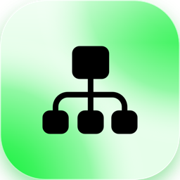
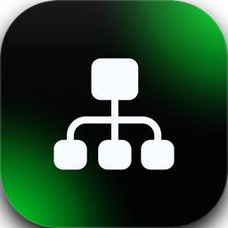

Each entry carries a label that says who it concerns: <Badge color="gray">Everyone</Badge> is for everything a person notices in their work, <Badge color="blue">Admins</Badge> is for changes that only administrators use or must act on.

Collabase 1.2 brings the CRM, a new app for companies, people and deals that runs next to Projects and Service Management and works on its own. Meetings and Studio work with it, and Collabase AI writes a summary of every company. The CRM starts as a beta in Collabase Lab: it is off until a person switches it on.

**Supported until:** October 2027. Collabase 1 gets fixes and security updates for one year after its release, in its newest minor version.

## New apps and features

- <Badge color="gray">Everyone</Badge> **CRM (beta in Collabase Lab):** keep companies, people and deals in one app, with notes, tasks, files and a timeline on every record. Work in lists with filters, columns and saved views, move deals on a board, collect records in lists for an action, and import from or export to CSV. Mail and appointments from your own mailbox show on the records, and meetings, flows and the AI work with them. An administrator gives the app to groups and sets what each CRM role sees and changes per object type. [Learn more](/crm/overview) The CRM starts as a beta: switch it on for yourself under **Settings** → **Profile** → **User settings** → **Collabase Lab**. An operator switches it on for the whole instance, see the [update notice](#update-notice-for-self-hosters).
- <Badge color="gray">Everyone</Badge> **Meetings from the CRM:** create a meeting from a company or a person, see customer meetings on the timeline, and read a briefing on the company page before the next meeting. [Learn more](/crm/meetings)
- <Badge color="gray">Everyone</Badge> **Company summary:** every company starts with a short summary written in the background by Collabase AI, and the chat answers questions about your CRM records. [Learn more](/crm/ai)
- <Badge color="blue">Admins</Badge> **CRM API:** read and write records, notes, tasks and lists from another system with an API token. [Learn more](/api/crm/overview)

## <Icon icon="video" size={20} /> Meetings

**New features**

- <Badge color="gray">Everyone</Badge> **Briefing with what other apps know:** the briefing of a meeting can include what the CRM knows about the company of the guests, such as open tasks, open deals and the titles of notes everyone may read. It shows only what the person reading it may see. [Learn more](/crm/meetings#briefing)
- <Badge color="gray">Everyone</Badge> **Meetings in the CRM:** a meeting is matched with the companies and people of its guests when it ends or changes its guests, and shows on their timeline. [Learn more](/crm/meetings#matching)

**Improvements**

- <Badge color="gray">Everyone</Badge> The briefing is also written in advance for meetings that another app has something to say about, not only for meetings with a guest without a Collabase account. [Learn more](/meetings/ai-and-privacy#ai-briefing-before-a-meeting)

## <Icon icon="address-book" size={20} /> CRM (beta in Collabase Lab)

The CRM is a beta feature and shows up in **Collabase Lab**. It stays off, with no app in the sidebar, until you switch it on under **Settings** → **Profile** → **User settings** → **Collabase Lab**. An operator can switch it on for the whole instance, see the [update notice](#update-notice-for-self-hosters).

**New features**

- <Badge color="gray">Everyone</Badge> **Companies and people:** lists with a filter bar, sortable columns that you choose and reorder, and the first 50 rows with **Load more**. The record page edits fields in place, shows relations and the owner, and warns when a colleague changed the same field. A company shows its logo, looked up from its domain in the background. [Learn more](/crm/objects)
- <Badge color="gray">Everyone</Badge> **Deal pipeline:** see opportunities as a board, move a deal from stage to stage and say why one was lost. [Learn more](/crm/board)
- <Badge color="gray">Everyone</Badge> **Notes:** write notes on one or more records, mention colleagues, and decide who reads each note: everyone who may read the records, chosen people, or only you. [Learn more](/crm/notes)
- <Badge color="gray">Everyone</Badge> **Tasks:** put tasks on companies, people and deals, give them to colleagues and get a notice on the day they are due. **My tasks** lists your open ones. [Learn more](/crm/tasks)
- <Badge color="gray">Everyone</Badge> **Timeline:** one list of what happened on a record, with changes, stage moves, notes, tasks, appointments, meetings and mail. [Learn more](/crm/timeline)
- <Badge color="gray">Everyone</Badge> **Saved views and lists:** save filter, sort order and columns as a view and share it, or collect records in a list for an action with your own columns and groups in the sidebar. [Learn more](/crm/views)
- <Badge color="gray">Everyone</Badge> **Files and links:** attach contracts and other documents to a record, and link projects, pages and registry objects. An opportunity can become a work item. [Learn more](/crm/files)
- <Badge color="gray">Everyone</Badge> **Mailbox and calendar:** connect your own Google or Microsoft mailbox. The CRM reads mail and appointments, never sends, and you decide what others see of it. Mail shows as threads on the **Mail** tab, and an appointment can become a Collabase meeting with **Plan agenda**. [Learn more](/crm/mailbox)
- <Badge color="gray">Everyone</Badge> **Duplicates and merging:** find records entered twice and merge them, choosing which values to keep. [Learn more](/crm/duplicates)
- <Badge color="gray">Everyone</Badge> **Import and export:** bring in companies, people and deals from a CSV file and take them out again. The data of one person can be exported on a request. [Learn more](/crm/import-export)
- <Badge color="gray">Everyone</Badge> **Trash and anonymisation:** deleted records stay in the trash for 30 days. A person can be anonymised on a privacy request. [Learn more](/crm/trash)
- <Badge color="gray">Everyone</Badge> **CRM gadgets:** five gadgets for dashboards and the home page: the pipeline, won and lost, due opportunities, your tasks and new companies. [Learn more](/crm/gadgets)
- <Badge color="gray">Everyone</Badge> **Search and notifications:** the global search finds CRM records, notes and tasks that you may read, and the CRM has its own notification category. [Learn more](/crm/overview#search)

**Beta limits**

- <Badge color="gray">Everyone</Badge> The beta can change before it is generally available.
- <Badge color="gray">Everyone</Badge> A person without a CRM role sees nothing, even when the app is available to them.

## <Icon icon="hand" size={20} /> Studio

**New features**

- <Badge color="gray">Everyone</Badge> **CRM plug:** flows start when a record changes, a deal is won or lost, a task is due, a meeting is attached to records or an import ends, and flows create records, tasks, notes and list entries. A flow acts with the CRM roles of the person who published it. [Learn more](/crm/automation)

## <Icon icon="sparkles" size={20} /> Collabase AI

**New features**

- <Badge color="gray">Everyone</Badge> **CRM in the chat:** ask about companies, people and deals and get only what you may see. After you approve it, the chat can create a task or change a record. The AI index can include notes for everyone. [Learn more](/crm/ai)

## Projects

**New features**

- <Badge color="gray">Everyone</Badge> **Milestones led by a work item:** a new milestone comes with a work item of the type Milestone. Its title and due date are the milestone's, and the milestone is reached when the work item is finished. Milestones made before keep working without one.
- <Badge color="gray">Everyone</Badge> **A gate waits for its milestone:** a phase gate can name a milestone. The phase can only be released once that milestone is reached, a rejection stays possible at any time. Choose it in the gate settings of the phase.
- <Badge color="gray">Everyone</Badge> **Status report shows risks that happened:** the risk figure, the risks section and the export show only risks with the status Occurred, and nothing when none has occurred. Reports approved before keep their figures but no longer show the risk tile.
- <Badge color="blue">Admins</Badge> **Templates offer everything a project has:** the template editor lists the same views and features as the project settings, including costs, phases and gates, risks and attachments.

**Improvements**

- <Badge color="gray">Everyone</Badge> The note that a project follows its template no longer shows on the project home. It stays in the project settings.

**Bug fixes**

- <Badge color="gray">Everyone</Badge> Creating a project from a template without phases, such as Scrum or Kanban, no longer warns that parts of the template could not be copied.
- <Badge color="gray">Everyone</Badge> In the workflow editor and in the relation graph of a work item, the connection points show again when you move the mouse over a status or a work item, so you can draw a transition or a relation. [Learn more](/admin/workflows)

## Registry

**New features**

- <Badge color="blue">Admins</Badge> **Relations in the Project Governance template:** a new schema made from the template links its object types: an assumption to its risks and decisions, and a risk to its decisions. Schemas made before are not changed.

**Bug fixes**

- <Badge color="gray">Everyone</Badge> In the schema designer, the connection points of an object type show again when you move the mouse over it, so you can create a relation to another object type by dragging from one point to another. Since 1.1.0 they showed only when you pointed exactly at the edge of the type. [Learn more](/registry/schema-designer)
- <Badge color="gray">Everyone</Badge> The relation graph of a registry object shows its connection points again on mouse over.

## <Icon icon="list-check" size={20} /> Test management

**New features**

- <Badge color="blue">Admins</Badge> **Test cycle in a project:** through the API, a test cycle can name the project it belongs to, such as the factory acceptance test of a customer project. The project must be in the same space as the test project.

## <Icon icon="magnifying-glass" size={20} /> Search

**Bug fixes**

- <Badge color="gray">Everyone</Badge> Searching, filtering and grouping by work item type works again. Conditions such as `type = Bug` failed with an error, and with them the dashboard gadgets, saved filters and boards that filter by type.

## Critical bug fixes

These fixes concern errors that stopped a feature.

| App | What was wrong |
|---|---|
| Registry | Relations between object types could hardly be created in the schema designer, because the connection points stayed invisible. They show on mouse over again. |
| Search | A condition on the work item type failed with an error, and so did the gadgets, filters and boards that use it. It works again. |

## Administration

<Badge color="blue">Admins</Badge>

- **CRM access:** under **Administration** → **Groups** → **App access**, give groups the **CRM** app with the roles User or Admin. [Learn more](/crm/getting-started#groups)
- **CRM roles and settings:** create roles, set per object type what each role reads and changes, hide single fields, and set the instance settings such as how long mail stays and how far mail may create contacts. [Learn more](/crm/roles)
- **CRM model:** add your own object types, fields and pipeline stages, and change a field type. [Learn more](/crm/model)
- On Kubernetes, the Helm chart can roll out without downtime, spread instances over nodes, pass pull secrets and a node selector to every pod, use a Redis password and encrypt files in S3 with your own key. [Learn more](/installation-kubernetes#rollout)
- The chart now sets small CPU requests by default (250m for the app, 100m each for the document processor, the sandbox and the collaboration relay), and the documentation gains guidance on sizing a Kubernetes installation with measured and extrapolated figures. [Learn more](/admin/scaling#size-a-kubernetes-installation)
- The Helm chart can set a security context on every workload except the plug sandbox (`securityContext.enabled: true`, off by default), so they meet the Kubernetes Pod Security Standard `restricted`: non-root with the user ID of the image, no privilege escalation, all capabilities dropped, default seccomp profile. The per-workload values adjust it. [Learn more](/installation-kubernetes#pod-security)
- The health check names `storage` as degraded when the S3 bucket does not answer within three seconds. [Learn more](/admin/file-storage)
- The Helm chart gains `migrations.seed`. With `false` there is no first-run seed job and no admin from the secret: the first visit to `/setup` creates the admin, the title and the language. The default stays `true`. [Learn more](/installation-kubernetes#install)
- **Logo service:** an optional address with `{domain}` for company logos. Without it no third party is contacted.

## Performance & stability

- <Badge color="gray">Everyone</Badge> The CRM loads lists in pages of 50 rows and keeps the page usable while logos, summaries and mail sync work in the background.
- <Badge color="gray">Everyone</Badge> Switching a Collabase Lab feature on or off works again after a feature has left Collabase Lab. Before, the setting was rejected as a whole.

## Update notice for self-hosters

<Badge color="blue">Admins</Badge>

**Before you update**

- The CRM is off until someone switches it on. To use it for everyone on your instance, set `FEATURE_FLAG_OVERRIDES="CRM=true"` in the `.env` file before you start the update. Without it, people switch it on for themselves in Collabase Lab. [Learn more](/admin/hosting#features-in-development)
- Mail and calendar need a Google or Microsoft app of your own. Enter its client ID and secret under **CRM settings** after the update. Without it, mailboxes cannot be connected, and the rest of the CRM works.

**What the update does**

- Adds the **CRM** app to the list of apps. The migration cannot be rolled back, so keep a database backup.
- Adds tables for records, roles, notes, tasks, the timeline, lists, files, imports, meeting links, AI summaries, mailboxes and links to other apps. They are additive and run on start. No step is needed from you.
- Starts background jobs for logos, task notices, meeting matching, summaries, mail and calendar sync, and the trash. They need Redis, which every install already has. Without the worker, `/api/health` reports the CRM task notices as degraded.
- Stores company logos and CRM files with the same storage as other files, under the new folder `crm`.
- Adds three optional columns, one on gates, one on milestones and one on test cycles. They are additive and run on start. The system work item type **Milestone** is made when the first milestone is created.

**Supported platforms**

| Component | Supported |
|---|---|
| Docker | Version 24 or later with Docker Compose v2 |
| Kubernetes | Version 1.26 or later, Helm 3.10 or later |
| Linux (Docker install) | Ubuntu 22.04 or later, Debian 12 or later, RHEL 9 or later |
| PostgreSQL | Version 16 or later with `pgvector` (bundled: `pgvector/pgvector:pg16`) |
| Redis | Version 7 (bundled: `redis:7-alpine`) |
| Application runtime | Node.js 24 LTS, inside the image |

See the [system requirements](/admin/system-requirements) for sizing and ports.

**Configuration**

- The CRM is a beta in Collabase Lab and off by default. `FEATURE_FLAG_OVERRIDES="CRM=true"` switches it on for the whole instance.
- No other variable is new. Google and Microsoft app credentials are entered in the CRM settings, not in the `.env` file.
