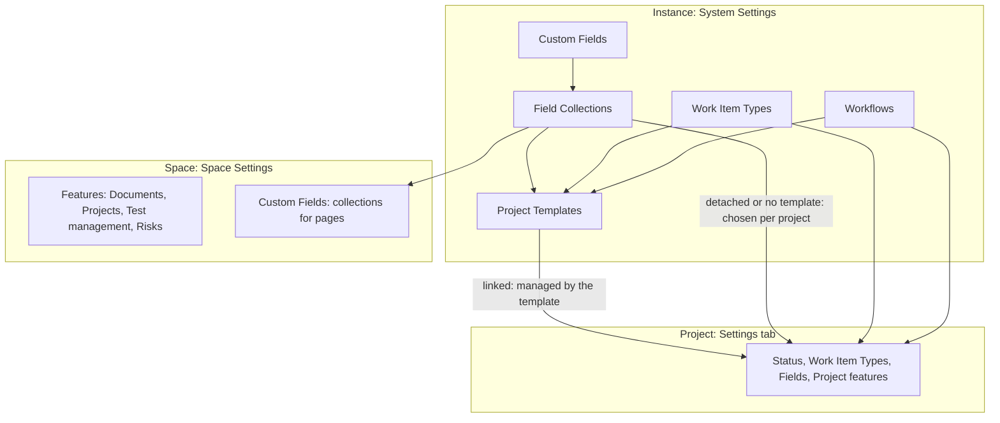

Collabase keeps work configuration in three places. Administrators build the shared parts once: fields, work item types, workflows and project templates. A <Tooltip tip="The top-level container in Collabase, with its own members, apps and content." cta="Glossary" href="/glossary#space">Space</Tooltip> decides which apps it uses. Each project then picks from the shared parts, either by itself or through a linked template.

There is no split into two kinds of projects. Every project uses the same building blocks; what differs is whether a template keeps them in step.

## The three levels {#levels}

The diagram shows where each building block is defined and who uses it. Arrows point from the place where something is defined to the place where it is used.

| Level | Where | Who | What it holds |
|---|---|---|---|
| **Instance** | **System Settings → Content & Organization** | System administrators | [Custom fields and field collections](/admin/custom-fields), [work item types](/admin/work-item-types), [workflows](/admin/workflows), [project templates](/projects/templates) |
| **Space** | **Space Settings** | Members with the permission to manage space settings | Which apps the Space uses ([Features](/concepts/space-settings#features)), which field collections apply to pages, the Permission Scheme |
| **Project** | The project's **Settings** tab | Members with the permission to edit project settings | Which workflows and field collections the project uses, its own work item types, its views and features, its members ([Project settings](/projects/project-settings)) |

Open **System Settings** from your avatar menu or from **Settings** at the bottom of the app sidebar. The entry appears only for system administrators.

## Linked and detached projects {#linked-and-detached}

A project created from a <Tooltip tip="A reusable configuration of workflows, work item types, field collections and views for new projects." cta="Glossary" href="/glossary#project-template">project template</Tooltip> stays linked to it. While it is linked, the template decides the project's workflows, work item types, field collections and views, and the project settings show those sections read-only. When an administrator saves the template, linked projects receive the change in the background.

Detach a project when its team needs to change these settings itself. Detaching cannot be undone. The project keeps its current configuration and stops receiving template changes.

| | Linked project | Detached project |
|---|---|---|
| **Workflows, work item types, field collections, views** | Read-only in project settings, set by the template | Edited in project settings |
| **Template changes** | Applied after each template save | Not applied |
| **Name, description, members, planning settings** | Edited in project settings | Edited in project settings |

How propagation works in detail: [Project templates](/projects/templates#propagation).

## What is fixed {#what-is-fixed}

Some things that other tools let you configure are fixed in Collabase. Plan around them instead of looking for a setting.

| Topic | How Collabase handles it |
|---|---|
| **Priorities** | A fixed list: **Low**, **Medium**, **High**, **Highest**, **Blocker**. There is no screen to add, rename or reorder priorities. |
| **Resolutions** | There is no separate resolution field. A work item counts as finished when its status belongs to the category **Done** or **Closed**. Add a custom field if you need to record a reason. |
| **Components** | Not available. Use a **Single choice** custom field or tags to group work items within a project. |
| **Tags** | Created inline on a work item or page and shared by the whole Space. There is no screen to rename or delete them. |
| **Versions and releases** | Versions exist in Test Management for test coverage. Work items have no fix version field. Use [milestones](/projects/approvals#phases) or a custom field to plan releases. |
| **Security levels on single work items** | Not available. Restrict a whole project instead: [private projects](/projects/project-settings#private-projects). |

## Limits {#limits}

These limits are fixed. An administrator cannot change them in the interface.

| Item | Limit |
|---|---|
| **Workflow name** | 100 characters |
| **Status name** | 60 characters |
| **Transition name** | 100 characters |
| **Work item type name in a project** | 60 characters |
| **Project template name** | 100 characters, description 500 characters |
| **Project fields per template** | 30 |
| **Phases per template** | 50, with up to 20 milestones per phase |
| **Attachment upload** | 25 MB |
| **Work items moved at once, including sub-items** | 200 |
| **Board: hide completed work items after** | 1 to 365 days, default 14 |

There is no fixed limit on the number of custom fields, field collections, choices, statuses, transitions or work item types.

## Related pages

<CardGroup cols={2}>
  <Card title="Custom fields" icon="square-pen" href="/admin/custom-fields">
    Build the field library and group fields into collections.
  </Card>
  <Card title="Workflows" icon="git-branch" href="/admin/workflows">
    Design statuses, transitions and the rules on them.
  </Card>
  <Card title="Project templates" icon="layout-template" href="/projects/templates">
    Bundle the configuration for new projects.
  </Card>
  <Card title="Set up projects for a team" icon="list-checks" href="/projects/project-setup">
    The order in which to build it all.
  </Card>
</CardGroup>
