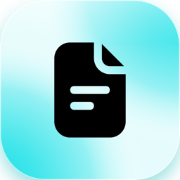
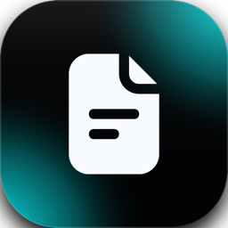
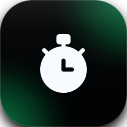

Jeder Eintrag trägt eine Markierung, für wen er gilt: <Badge color="gray">Alle</Badge> steht für alles, was eine Person in ihrer Arbeit bemerkt, <Badge color="blue">Admins</Badge> für Änderungen, die nur Administratoren nutzen oder beachten müssen.

Collabase 1.1 hat ein neues Aussehen, bringt Studio mit Automationen, beendet jedes Meeting mit
einer Zusammenfassung und zeigt allen, wenn ihre Instanz aktualisiert wurde. Times wird eine App mit einer Zugriffseinstellung,
und Collabase AI funktioniert wieder für Instanzen, die Infomaniak oder Ollama als KI-Anbieter
nutzen.

**Unterstützt bis:** Oktober 2027. Collabase 1 erhält ein Jahr nach dem Release Fehlerbehebungen und Sicherheitsupdates, in der neuesten Minor-Version.

<Warning>
  Diese Version ändert, wer Times sieht. Siehe [Update-Hinweis für Self-Hoster](#update-hinweis-fuer-self-hoster).
</Warning>

## Neue Apps und Funktionen

- <Badge color="gray">Alle</Badge> **Neues Aussehen:** ein gemeinsamer Satz an Farben, Formen und Schrift für das ganze Produkt, mit Inter als einziger Schrift und Lime als Standard-Akzent. Jede App nutzt dieselben Bedienelemente, Menüs, Popups, Tabs, Listen, Detailansichten, Dashboards, Leerzustände, Status-Pillen und Icons, im hellen und dunklen Modus und in jeder Akzentfarbe. Bearbeitungsformulare öffnen als Popups, seitliche Sheets gibt es nicht mehr. Administratoren wählen weiterhin einen anderen Akzent unter **Einstellungen** → **System-Theme**, und jede Person wählt weiterhin hell, dunkel oder System.
- <Badge color="gray">Alle</Badge> **Anmeldeseite:** die Anmeldeseite gibt es in zwei Designs, einer zentrierten Karte auf einem weichen Farbverlauf und einem zweispaltigen Layout mit Wallpaper.
- <Badge color="blue">Admins</Badge> **Update-Hinweis:** Nach jedem Update sehen Admins einmal, welche Version die Instanz jetzt hat, bis wann sie unterstützt wird, was neu ist und einen kurzen Update-Bericht: wann aktualisiert wurde, ob die Dienste laufen und wie viele Apps installiert sind. Danach ist die Version mit einem Klick erreichbar, unten im Menü **Feedback & help** und auf der Anmeldeseite. [Mehr erfahren](/admin/updates#after-the-update)
- <Badge color="gray">Alle</Badge> **Meeting-Zusammenfassung:** Beim Beenden eines Meetings erscheint ein Popup. Es zeigt, wer da war und wer nicht, den Link zu den Meeting-Notizen, wo Docs aktiv ist, die KI-Zusammenfassung, die nicht besprochenen Themen und die erstellten Aufgaben. Nur wer das Meeting beendet, sieht es.
- <Badge color="gray">Alle</Badge> **Mir zuweisen:** Mit `I` in einem Work Item weist du es dir selbst zu.
- <Badge color="blue">Admins</Badge> **Times-Zugriff:** Times ist jetzt eine App mit einer Zugriffseinstellung für Gruppen und ersetzt Time Reports und Planner. Siehe [Update-Hinweis](#update-hinweis-fuer-self-hoster).
- <Badge color="gray">Alle</Badge> **Service Management:** eine neue App neben Projects für Teams, die Anfragen von Kundinnen und Kunden bearbeiten. Ein Service-Projekt hat Anliegen-Formulare, Queues mit den Tickets, die Aufmerksamkeit brauchen, SLA-Policies mit Uhren, die warnen, bevor ein Ziel verpasst wird, Genehmigungen, die starten, wenn ein Ticket einen Workflow-Status erreicht, öffentliche Antworten und interne Notizen sowie ein Kundenportal, in dem Kundinnen und Kunden Anfragen einreichen, verfolgen und mit Kolleginnen und Kollegen teilen. Kunden sind eine eigene Art von Konto, in Organisationen gruppiert, und können sich mit ihrer Firmenadresse selbst registrieren. Sie genehmigen Anliegen, die ihre Zustimmung brauchen, durchsuchen die Wissensbasis im Portal und stimmen auf einer öffentlichen Roadmap ab und kommentieren sie; Agents sehen, wer abgestimmt hat, Kunden nur die Anzahl. Eine fertige Service-Desk-Vorlage richtet Status, Anliegen-Formulare, Queues und SLA-Policies ein. Für Dashboards gibt es SLA-, Queue- und Vote-Gadgets, Tickets und Kunden lassen sich exportieren. Ein Ticket kann auch aus einer Mail entstehen. Eine Administratorin oder ein Administrator gibt die App an Gruppen, und sie läuft mit oder ohne Projects. [Mehr erfahren](/service-management/overview) Service Management startet als Beta: Schalte es für dich unter **Einstellungen** → **Profil** → **Benutzereinstellungen** → **Collabase Lab** ein. Ein Betreiber schaltet es für die ganze Instanz ein, siehe [Update-Hinweis](#update-hinweis-fuer-self-hoster).
- <Badge color="gray">Alle</Badge> **Studio:** baue Abläufe (Flows), die auf Ereignisse in Collabase und anderen Systemen reagieren, nach Zeitplan laufen, Menschen um Freigabe bitten und KI nutzen, jeder Lauf nachvollziehbar. Studio ist der neue Name von Collabase Automation und Teil dieses Releases. Eigene Integrationen entstehen mit dem Open-Source-[Plug SDK](https://github.com/Collabase/plug-sdk) und den [Plug-Beispielen](https://github.com/Collabase/plug-examples). [Mehr erfahren](/automation/overview)
- <Badge color="gray">Alle</Badge> **Agents in Studio:** definiere einen Assistenten einmal, mit Anweisung, Werkzeugen und optionalem Wissen, und nutze ihn in Chats, Flows und Jobs. [Mehr erfahren](/automation/agents)
- <Badge color="gray">Alle</Badge> **Popups behalten deine Eingaben:** Bearbeitungs- und Einstellungs-Popups schliessen sich nicht mehr, wenn du daneben klickst. Escape und die Schliessen-Schaltfläche schliessen sie weiterhin.

## Docs

**Neue Funktionen**

- <Badge color="gray">Alle</Badge> **Seitenbaum:** Seiten und Ordner lassen sich über ein Menü oben im Baum oder an jeder Zeile anlegen. Die neue Seite erscheint unter der geöffneten Seite, die übergeordneten Einträge klappen auf, und ein neuer Ordner öffnet sich im Umbenennen-Modus.
- <Badge color="gray">Alle</Badge> **Suche im Seitenbaum:** Ein Suchfeld über dem Baum filtert Seiten nach Titel. Mit Escape ist der volle Baum genau so wieder da, wie er war.
- <Badge color="gray">Alle</Badge> **Ein Seitenmenü überall:** Dieselben Aktionen stehen an der Baumzeile, im Rechtsklick, im Seitenkopf und in der Ordneransicht bereit: verschieben, archivieren, löschen (mit der Zahl betroffener Seiten), Link kopieren und mehr. Seiten lassen sich auch per Menüschritt verschieben, nicht nur durch Ziehen.
- <Badge color="gray">Alle</Badge> **Einfügen-Menü:** Das Slash-Menü und die **+**-Schaltfläche teilen sich jetzt einen Katalog und bieten dieselben Blöcke in derselben Reihenfolge an.
- <Badge color="gray">Alle</Badge> **Kopfzeile in Tabellen:** Tabellen haben einen Schalter **Kopfzeile**. Die Kopfzeile wird fett auf getöntem Hintergrund dargestellt.
- <Badge color="gray">Alle</Badge> **Markdown-Kürzel:** Markdown, das du beim Schreiben tippst, wird zu Formatierung, zum Beispiel Überschriften, Listen, Zitate, Code und Emoji per Name.
- <Badge color="gray">Alle</Badge> **Callout-Varianten:** Ein Callout lässt sich mit einer neuen Schaltfläche zwischen Varianten wechseln. Der PDF-Export behält die Variante bei.
- <Badge color="gray">Alle</Badge> **Auf dieser Seite:** Auf breiten Bildschirmen listet eine Spalte neben der Seite ihre Überschriften auf (ab zwei Überschriften), und eine Leiste darunter zeigt, wo du gerade bist.
- <Badge color="gray">Alle</Badge> **Inline-Kommentare:** Text markieren und kommentieren, auch im Lesemodus. Threads bleiben nach dem Speichern und Veröffentlichen an ihrer Stelle, Antworten und @Erwähnungen benachrichtigen die Beteiligten, und neue Kommentare anderer erscheinen ohne Neuladen. [Mehr erfahren](/docs/comments)
- <Badge color="gray">Alle</Badge> **Öffentliche API:** Seiten lassen sich über die API anlegen und lesen, in allen vier Seitentypen. [Mehr erfahren](/api/pages/create-page)
- <Badge color="gray">Alle</Badge> **Export und Import:** PDF- und Markdown-Export erscheinen mit ihren Logos im Seitenmenü und im Menü **Mehr** der Toolbar. Der Import steht ebenfalls im Menü **Mehr**.
- <Badge color="gray">Alle</Badge> **Speichern und Teilen:** Die Toolbar hat eine Schaltfläche **Änderungen speichern**, und die Schaltfläche zum Link-Kopieren im Seitenkopf heisst jetzt **Teilen**.
- <Badge color="gray">Alle</Badge> **Roadmap in eine Seite einbetten:** Das Einfügen-Menü hat einen Block **Roadmap**, der eine Roadmap als Zeitachse in einer Seite zeigt. Leserinnen und Leser sehen sie mit ihren eigenen Rechten, wer keinen Zugriff auf die Roadmap hat, sieht stattdessen einen Hinweis. [Mehr erfahren](/planning/roadmaps#embed-in-page)

**Verbesserungen**

- <Badge color="gray">Alle</Badge> Die Toolbar passt in eine Zeile und verschiebt seltener genutzte Aktionen (Suchen und Ersetzen, Einzug, Zeilenhöhe, Export, Import) ins Menü **Mehr**.
- <Badge color="gray">Alle</Badge> Toolbars, Menüs und Beschriftungen des Editors sind auf Deutsch, Französisch, Italienisch und Englisch übersetzt, und der Editor sieht aus wie der Rest von Collabase.
- <Badge color="gray">Alle</Badge> Tabellen, Listen, Medien, Links, Erwähnungen, Daten, Formeln, Spalten, Toggles und Codeblöcke verhalten sich einheitlicher. Daten erscheinen im Schweizer Format, zum Beispiel 30.10.2026.
- <Badge color="gray">Alle</Badge> Der Seitenbaum lädt in fester Reihenfolge und springt nicht mehr herum.
- <Badge color="gray">Alle</Badge> Menüs in der ganzen App (App-Drawer, Dateien, Mindmap, Aufgaben-Graph, Automation, Registry-Designer und weitere) sehen gleich aus und verhalten sich gleich, im Dropdown und im Rechtsklick.
- <Badge color="gray">Alle</Badge> Hover und aktive Seite in der Seitenleiste füllen die ganze Zeile, ohne Balken am Rand.
- <Badge color="gray">Alle</Badge> Der Abstand zwischen Toolbar und Seiteninhalt ist gleichmässiger.
- <Badge color="gray">Alle</Badge> Eine kopierte Seite steht direkt unter dem Original.

**Fehlerbehebungen**

- <Badge color="gray">Alle</Badge> Das Menü **Umwandeln in** in der Toolbar stürzt nicht mehr ab.
- <Badge color="gray">Alle</Badge> Der Bild-Upload über die Bild-Schaltfläche der Toolbar funktioniert wieder. Die gewählte Datei ging bisher verloren.
- <Badge color="gray">Alle</Badge> Enter auf einem Bild, einem Diagramm oder einem Makro öffnet eine neue Zeile darunter.
- <Badge color="gray">Alle</Badge> Das Slash-Menü schliesst sich nicht mehr, wenn du auf seine Bildlaufleiste klickst.
- <Badge color="gray">Alle</Badge> Zeilenaktionen im Seitenbaum überdecken den Seitentitel nicht mehr.
- <Badge color="gray">Alle</Badge> Auf einer Seite mit Live-Zusammenarbeit wurden der Eintrag **AI** im Slash-Menü, **Ask AI** an einem Block und **AI commands** in der Toolbar angezeigt, taten aber nichts. Dort sind sie jetzt ausgeblendet; der Collabase-AI-Assistent liest und ändert die Seite weiterhin. [Mehr erfahren](/docs/collaboration#ai)

## Projects

**Neue Funktionen**

- <Badge color="gray">Alle</Badge> Mit `I` in einem Work Item weist du es dir selbst zu, im Work-Item-Popup und auf seiner Seite. Beim Tippen in einem Feld löst es nicht aus.
- <Badge color="gray">Alle</Badge> **Mir zuweisen** steht ganz oben in jeder Assignee-Liste, im gleichen Zeilenstil wie die Personen darunter, und bleibt beim Scrollen der Liste an seinem Platz.
- <Badge color="gray">Alle</Badge> **Zur Agenda hinzufügen:** Im Bereich **Meetings** eines Work Items fügst du es der Agenda eines bestehenden Meetings hinzu, neben dem Anlegen eines neuen Meetings. Meetings, die das Work Item schon führen, sind ausgegraut.
- <Badge color="gray">Alle</Badge> **Kritischer Pfad:** Der Schalter **Kritischer Pfad** in der Timeline-Toolbar hebt die Work Items und Abhängigkeiten hervor, die den Endtermin bestimmen, und zeigt den Puffer jedes Work Items in Tagen.
- <Badge color="gray">Alle</Badge> **Baselines:** Das Menü **Baseline** in der Timeline-Toolbar hält die aktuellen Termine eines Projekts als Baseline fest und vergleicht die Timeline damit, mit einem Schattenbalken unter jedem Work Item und seinem Verzug in Tagen.
- <Badge color="gray">Alle</Badge> **Szenarien:** Das Menü **Szenario** in der Timeline-Toolbar spielt neue Termine, Schätzungen und Bearbeiter durch, ohne den Ist-Plan anzutasten. Die Änderungen werden gegen den Ist-Plan geprüft, und die gewünschten lassen sich übernehmen. [Mehr erfahren](/planning/baselines-and-scenarios#scenarios)
- <Badge color="gray">Alle</Badge> **Programm-Ampel:** Ein Portfolio zeigt die schlechteste Ampel der zuletzt freigegebenen Statusberichte aller Projekte darunter. Die Portfolio-Owner übersteuern sie mit einer Begründung, der Vorschlag aus den Projekten bleibt daneben sichtbar.
- <Badge color="gray">Alle</Badge> **Programmrisiken:** Ein Portfolio hat einen Tab **Risiken** mit eigenen Risiken, die im Risikoregister eines gewählten Spaces liegen, und daneben den offenen und kritischen Risiken der Projekte darunter.
- <Badge color="gray">Alle</Badge> **Programmberichte:** Ein Portfolio hat einen Tab **Berichte** mit einem monatlichen Programmbericht, den die Portfolio-Owner schreiben, einreichen und freigeben lassen, mit einer Zeile pro Projekt und eingefrorenen Zahlen nach der Freigabe.
- <Badge color="gray">Alle</Badge> **Erinnerung, wenn ein Statusbericht fällig ist:** Am fünften Arbeitstag des Monats erhalten Projektleitungen und Portfolio-Owner eine einzige Benachrichtigung mit den Berichten des Vormonats, die noch fehlen. [Mehr erfahren](/projects/reports#reminders)
- <Badge color="gray">Alle</Badge> **PDF-Export für Statusberichte:** Ein Statusbericht und ein Programmbericht haben einen Knopf **Export**, der den Bericht als PDF im Hochformat A4 in deiner Sprache herunterlädt. Ein Programmbericht listet nur die Projekte, die du siehst. [Mehr erfahren](/projects/reports#export-pdf)
- <Badge color="gray">Alle</Badge> **Gantt-Export (PDF und PNG):** Der Knopf **Export** in der Timeline-Toolbar eines Projekts und eines Portfolios lädt das Gantt als PDF im Querformat A4 oder A3 oder als PNG herunter. Es zeigt die Work Items, die du sehen darfst, mit der eingeschalteten Baseline, dem kritischen Pfad und dem Szenario. [Mehr erfahren](/projects/timeline#gantt-export)

**Verbesserungen**

- <Badge color="gray">Alle</Badge> Links in Kommentaren und Beschreibungen öffnen in einem neuen Tab, damit das Work Item offen bleibt.
- <Badge color="gray">Alle</Badge> Eine am Ende eines Kommentars getippte Webadresse ist jetzt anklickbar, ebenso ein Link ohne `https://`, etwa `www.example.ch`. Das behebt auch ältere Kommentare.
- <Badge color="gray">Alle</Badge> Gantt: Jahresansicht. Die Timeline bietet neben **Quartal** auch **Jahr**, mit den Monaten unter jedem Jahr.

**Fehlerbehebungen**

- <Badge color="gray">Alle</Badge> Beim Schreiben eines Kommentars gibt es jetzt **Abbrechen**, das den Entwurf verwirft.
- <Badge color="gray">Alle</Badge> In Kommentaren und Beschreibungen nimmt **Backspace** am Anfang einer eingerückten Zeile den Einzug zurück, wie in einem Texteditor. Vorher ging das nur mit Shift+Tab.
- <Badge color="gray">Alle</Badge> Ein Titel und eine Beschreibung, die dem Popup **Work Item erstellen** mitgegeben wurden, zum Beispiel vom Aufgaben-Makro auf einer Seite, gingen verloren. Sie bleiben jetzt erhalten.
- <Badge color="gray">Alle</Badge> Das Synchronisieren von Repositories aus GitHub schlug bei einer über Collabase angelegten GitHub App fehl, deshalb liess sich kein Repository mit einem Projekt verknüpfen. Es funktioniert jetzt.

## Meetings

**Neue Funktionen**

- <Badge color="gray">Alle</Badge> **Zusammenfassung beim Beenden:** ein Popup für die Person, die das Meeting beendet. Es zeigt, wer da war, wer nicht und bei wem die Anwesenheit nicht erfasst wurde, den Link zu den Meeting-Notizen (nur wo Docs aktiv ist, und solange die Notiz geschrieben wird, steht das da), die KI-Zusammenfassung, wenn die Notiz eine hat, die nicht besprochenen Themen und die erstellten Aufgaben.
- <Badge color="gray">Alle</Badge> **Agenda-Punkte und Abschnitte duplizieren:** Ein Punkt lässt sich unter sich selbst duplizieren, ein ganzer Abschnitt mit seinen Punkten. Notizen, Verantwortliche, Schätzung und verknüpfte Work Items kommen mit, Beschlüsse und erfasste Ergebnisse nicht.
- <Badge color="gray">Alle</Badge> **Vorheriges Thema:** Ein laufendes Meeting hat eine Schaltfläche, um zum Thema vor dem laufenden zurückzugehen. Das laufende Thema wird nicht als erledigt markiert.
- <Badge color="gray">Alle</Badge> **Präsentationsmodus:** Er zeigt jetzt die Agenda mit ihren Abschnitten und zu jedem Thema, wer verantwortlich ist, mit Name und Foto. Aufgaben lassen sich im Präsentationsmodus erfassen, ohne ihn zu verlassen.
- <Badge color="gray">Alle</Badge> **Work-Item-Formular für Aufgaben:** Eine im Meeting erfasste Aufgabe wird über dasselbe Popup wie überall zum Work Item, gefüllt mit Text, verantwortlicher Person und Fälligkeit, sodass sich alle Felder ausfüllen lassen, die das Projekt braucht.

**Verbesserungen**

- <Badge color="gray">Alle</Badge> Neue Meetings starten mit eingeschaltetem **Teilnehmende dürfen die Agenda bearbeiten** und **Themen direkt auf die Agenda**. Bestehende Meetings behalten ihre Einstellungen.

**Geändertes Verhalten**

- <Badge color="gray">Alle</Badge> Ein Meeting erfasst nur noch Aufgaben. Der Ergebnistyp **Information** entfällt, und die KI schlägt keine Information mehr vor. Vorhandene Informationsnotizen bleiben sichtbar.
- <Badge color="gray">Alle</Badge> In einem Space, in dem Docs aus ist, bietet ein Meeting unter **Agenda-Punkt hinzufügen** und beim Verknüpfen keine Seiten an und schreibt, zeigt und veröffentlicht keine Meeting-Notiz. Eine Notiz, die bei aktivem Docs entstanden ist, bleibt ausgeblendet, bis Docs wieder aktiv ist.

**Fehlerbehebungen**

- <Badge color="gray">Alle</Badge> Personen, die zu einem Termin einer Serie eingeladen wurden, fehlten bei den nächsten Terminen. Teilnehmende gehören jetzt zur ganzen Serie: Wen du einlädst, entfernst oder mit einer anderen Rolle versiehst, ändert sich bei allen kommenden Terminen, und neue Termine starten mit diesen Personen. Eine Serie, die vor diesem Update angelegt wurde, hat die Teilnehmenden vom Zeitpunkt ihrer Anlage. Lade einmal jemanden ein, damit die Liste wieder stimmt.

## Time Tracking

**Geändertes Verhalten**

- <Badge color="blue">Admins</Badge> Der Eintrag **Times** in der Seitenleiste erscheint nur für Personen, deren Gruppe die App **Times** hat. Administratoren sehen ihn immer. Zeit auf Work Items buchen hängt nicht davon ab.
- <Badge color="gray">Alle</Badge> In Times stehen **Meine Zeiten** und der Planner jeder Rolle der App offen, und **Time Reporting** braucht die Rolle Manager oder höher.

## <Icon icon="route" size={20} /> Roadmaps

**Neue Funktionen**

- <Badge color="gray">Alle</Badge> **Roadmaps:** Die neue App **Roadmaps** listet alle Roadmaps, die du sehen darfst, mit der Anzahl Initiativen und dem Datum der letzten Änderung. Lege eine Roadmap mit Name und Beschreibung an, benenne sie um oder lösche sie. Gelöschte Roadmaps landen im Papierkorb der Systemverwaltung und lassen sich dort 30 Tage lang wiederherstellen. [Mehr erfahren](/planning/roadmaps)
- <Badge color="gray">Alle</Badge> **Zeitachse mit Drag & Drop:** Öffne eine Roadmap und sieh ihre Initiativen auf einer Zeitachse, gruppiert in Swimlanes, mit Phasen als Bändern und Meilensteinen als Rauten. Ziehe einen Balken, um ihn zu verschieben, ziehe seine Enden, um die Länge zu ändern, und ziehe eine Zeile in eine andere Lane oder an eine andere Stelle. Zoome von Jahr bis Woche. Viewer sehen dieselbe Zeitachse ohne Ziehgriffe. [Mehr erfahren](/planning/roadmaps#timeline)
- <Badge color="gray">Alle</Badge> **Swimlanes, Phasen und Meilensteine:** Editoren legen Swimlanes an, benennen, färben, sortieren und löschen sie (die Initiativen einer gelöschten Lane wechseln in eine andere), setzen farbige Phasen und Meilensteine per Rechtsklick auf die Zeitachse und ziehen einen Meilenstein auf einen anderen Tag. Viewer sehen sie ohne Menü und Ziehgriff. [Mehr erfahren](/planning/roadmaps#lanes)
- <Badge color="gray">Alle</Badge> **Initiative-Details und Konflikthinweise:** Klicke auf einen Balken, um die Details einer Initiative zu öffnen. Bearbeite Name, Beschreibung, Status, Lane, Zeitraum, Farbe und Verantwortliche direkt dort und verknüpfe Projekte, Arbeitselemente, Portfolios und Seiten. Eine Verknüpfung auf etwas, das du nicht sehen darfst, zeigt nur, dass dir die Berechtigung fehlt. Liegt ein verknüpftes Projekt oder Portfolio ausserhalb des Zeitraums der Initiative, ist es abgeschlossen oder steht auf Rot, weist die Initiative darauf hin und bietet an, den Zeitraum der verknüpften Objekte zu übernehmen. [Mehr erfahren](/planning/roadmaps#edit-initiatives)
- <Badge color="gray">Alle</Badge> **Roadmap teilen:** Teile eine Roadmap mit Personen und Gruppen als Editor oder Viewer. Gäste können nur ansehen, und der letzte Editor lässt sich nicht entfernen. Neue Viewer und Editoren erhalten eine Benachrichtigung.
- <Badge color="gray">Alle</Badge> **Eigene Status und Beziehungstypen pro Roadmap:** Editoren benennen die Status einer Roadmap um, färben sie ein, sortieren sie, fügen welche hinzu oder entfernen sie und ordnen jeden als offen, aktiv oder abgeschlossen ein. Beziehungstypen erhalten Name, Farbe, Linienstil, Pfeil und Symbol. Ein Status oder Typ, der noch verwendet wird, wird beim Entfernen durch einen anderen ersetzt. [Mehr erfahren](/planning/roadmaps#statuses)
- <Badge color="gray">Alle</Badge> **Beziehungen zwischen Initiativen:** Editoren verbinden zwei Initiativen mit einer typisierten Beziehung, entweder durch Ziehen von einem Balken auf einen anderen oder mit **Beziehung hinzufügen** in den Details. Die Linie zeigt Farbe, Linienstil, Pfeil und Symbol ihres Typs, beim Darüberfahren nennt sie Typ, Label und beide Initiativen, und mehrere Beziehungen zwischen denselben Initiativen werden nebeneinander gezeichnet. [Mehr erfahren](/planning/roadmaps#relations)
- <Badge color="gray">Alle</Badge> **Verknüpfte Objekte auf der Zeitachse:** Eine Initiative mit Verknüpfungen klappt in schreibgeschützte Zeilen für ihre verknüpften Projekte, Arbeitselemente, Portfolios und Seiten auf, mit ihrem tatsächlichen Zeitraum, der Ampel und dem Status. Ein Portfolio klappt in seine Unterportfolios und Projekte auf. Ein Warnsymbol markiert eine Zeile, die vor der Initiative beginnt oder nach ihr endet, eine Schaltfläche klappt alles auf oder zu, und der PDF- und PNG-Export kann die Zeilen enthalten. [Mehr erfahren](/planning/roadmaps#linked-rows)
- <Badge color="gray">Alle</Badge> **Collabase AI zu Roadmaps fragen:** Frage, welche Initiativen in einem Quartal geplant sind, wie der Stand einer Initiative ist oder welche überfällig sind. Collabase AI liest nur und nur Roadmaps, die du öffnen darfst. [Mehr erfahren](/planning/roadmaps#ai)
- <Badge color="gray">Alle</Badge> **Suche und Gadget:** Finde Roadmaps und Initiativen in der Suche und zeige eine Roadmap als Dashboard-Gadget. Beides zeigt nur Roadmaps, die du öffnen darfst. [Mehr erfahren](/planning/roadmaps#search-gadget)
- <Badge color="gray">Alle</Badge> **Roadmap als PDF oder PNG exportieren:** Der Knopf **Export** in der Roadmap-Toolbar lädt die Timeline mit Swimlanes, Phasen, Meilensteinen und Beziehungen als PDF im Querformat A4 oder A3 oder als PNG herunter, in deiner Sprache. Solange du mit einem Snapshot vergleichst oder ein Szenario ansiehst, zeigt die Datei diesen Vergleich bzw. das Szenario: Die Termine des Snapshots erscheinen als Schattenbalken unter den Initiativen. Eine Verknüpfung auf etwas, das du nicht sehen darfst, zeigt keinen Namen. [Mehr erfahren](/planning/roadmaps#export)
- <Badge color="gray">Alle</Badge> **Erinnerungen an überfällige Initiativen und Konflikte:** Die Owner einer Initiative erhalten eine Benachrichtigung, wenn das geplante Ende verstrichen ist und wenn ein verknüpftes Projekt oder Portfolio neu ausserhalb des Zeitraums liegt, abgeschlossen ist oder auf Rot steht. Jeder Fall wird nur einmal gemeldet. [Mehr erfahren](/planning/roadmaps#reminders)
- <Badge color="gray">Alle</Badge> **Snapshots: Roadmap einfrieren und mit heute vergleichen:** Editoren frieren eine Roadmap unter einem Namen ein, und alle, die sie öffnen dürfen, sehen den eingefrorenen Stand oder vergleichen ihn mit dem heutigen Plan, mit Schattenbalken unter den verschobenen Initiativen und der Anzahl neuer, entfernter, verschobener und im Status geänderter Initiativen. Ein Snapshot lässt sich nicht ändern. [Mehr erfahren](/planning/roadmaps#snapshots)
- <Badge color="gray">Alle</Badge> **Szenarien: Änderungen durchspielen und übernehmen:** Editoren legen auf einer Roadmap ein Szenario an, ziehen Initiativen auf andere Termine, setzen sie in eine andere Swimlane oder geben ihnen einen anderen Status und sehen das Ergebnis neben dem Ist-Stand. **Änderungen prüfen** listet jede Änderung auf, und nur die gewählten gehen in die Roadmap, ganz oder gar nicht. Viewer sehen Szenarien, ändern sie aber nicht. [Mehr erfahren](/planning/roadmaps#scenarios)
- <Badge color="gray">Alle</Badge> **Kommentare und Aktivität an Initiativen:** Öffne eine Initiative, um sie unter **Kommentare** zu besprechen, mit Antworten und @Erwähnungen von Personen, die die Roadmap öffnen dürfen, und unter **Aktivität** zu sehen, wer wann welches Feld geändert hat. Auch Viewer schreiben Kommentare. [Mehr erfahren](/planning/roadmaps#comments)
- <Badge color="gray">Alle</Badge> **Initiative in ein Projekt umwandeln:** Editoren, die in einem Space Projekte anlegen dürfen, wandeln eine Initiative in den Details in ein Projekt um. Das Projekt übernimmt den Zeitraum der Initiative und deren Owner als Projektleitung, die Initiative verweist darauf, und verknüpfte Seiten erscheinen im Projekt als Weblinks. Ein bereits vergebener Schlüssel wird am Feld gemeldet. [Mehr erfahren](/planning/roadmaps#convert)

## <Icon icon="life-buoy" size={20} /> Service Management (Beta in Collabase Lab)

Service Management ist eine Beta-Funktion und erscheint im **Collabase Lab**. Es bleibt aus, ohne App in der Seitenleiste und ohne Service-Desk-Vorlage, bis du es unter **Einstellungen** → **Profil** → **Benutzereinstellungen** → **Collabase Lab** einschaltest. Der Schalter gilt nur für dich. Ein Betreiber kann es für die ganze Instanz einschalten, siehe [Update-Hinweis](#update-hinweis-fuer-self-hoster).

**Das bekommst du**

- <Badge color="gray">Alle</Badge> **Service-Projekte:** ein Projekt wird zum Service-Projekt, oder du startest eines aus der Vorlage **Service Desk** mit Status, Anliegen-Formularen, Queues und SLA-Policies.
- <Badge color="blue">Admins</Badge> **Kunden und Organisationen:** Kunden sind eine eigene Art von Konto, in Organisationen gruppiert. Administratorinnen und Administratoren laden sie ein, bearbeiten sie und geben ihnen Zugriff pro Projekt. Kunden können sich auch mit ihrer Firmenadresse selbst registrieren.
- <Badge color="gray">Alle</Badge> **Anliegen-Formulare:** jede Anliegen-Art hat ein eigenes Formular mit den Feldern ihres Work-Item-Typs, eigenem Namen und einem Start-Status.
- <Badge color="gray">Alle</Badge> **Kundenportal:** Kunden reichen Anliegen ein, verfolgen sie, antworten und teilen sie mit Kollegen oder ihrer Organisation. Organisations-Admins sehen alle Anliegen der Organisation und genehmigen bei Bedarf. `/portal` listet jedes Portal, das ein Kunde öffnen darf.
- <Badge color="gray">Alle</Badge> **Queues und SLAs:** Queues zeigen die Tickets, die Aufmerksamkeit brauchen, mit Live-Zahlen. SLA-Policies lassen Uhren auf Arbeitskalendern laufen und warnen, bevor ein Ziel verpasst wird.
- <Badge color="gray">Alle</Badge> **Antworten und Notizen:** Agents wählen pro Kommentar, ob er im Portal öffentlich oder privat ist. Antwortvorlagen beschleunigen die Antworten.
- <Badge color="gray">Alle</Badge> **Genehmigungen:** Genehmigungen liegen an einem Workflow-Status. Ein Ticket, das in den Status kommt, wartet auf die Entscheidung der genannten Personen oder der Organisations-Admins des Kunden.
- <Badge color="gray">Alle</Badge> **Wissensdatenbank und Suche:** ein Space oder eine Seite mit allem darunter ist die Wissensdatenbank im Portal. Kunden suchen Artikel und Anliegen-Formulare, während sie ein Anliegen schreiben.
- <Badge color="gray">Alle</Badge> **Öffentliche Roadmap:** das Portal zeigt eine Roadmap der Work Items, die du wählst, mit Votes. Kunden sehen nur die Anzahl der Votes, nie wer abgestimmt hat.
- <Badge color="gray">Alle</Badge> **Weiteres:** ein Ticket aus einer Kunden-Mail eröffnen, Dashboard-Gadgets für SLA, Queues und Votes, Export von Tickets und Kunden, optionale KI-Triage und Antwortentwürfe und ein Portal-Agent, der aus der Wissensdatenbank antwortet. Die KI-Funktionen bleiben aus, bis eine Administration sie pro Projekt einschaltet.

**Grenzen der Beta**

- <Badge color="gray">Alle</Badge> Kunden und Hintergrundarbeit folgen dem Instanz-Schalter: ohne ihn sehen Kunden kein Portal, und SLA-Uhren, der Mail-Eingang und die Benachrichtigungen laufen nicht.
- <Badge color="gray">Alle</Badge> Die Beta kann sich ändern, bevor sie allgemein verfügbar ist.

## <Icon icon="hand" size={20} /> Studio

**Neue Funktionen**

- <Badge color="gray">Alle</Badge> **Flows:** ein Flow startet mit einem Auslöser, etwa einem neuen Work Item, einem Aufruf aus einem anderen System oder einer Uhrzeit, und führt seine Schritte nacheinander aus. Jeder Schritt ist eine Aktion eines Plugs: ein Work Item anlegen, eine Benachrichtigung senden und mehr. Ein Flow hat einen Entwurf, den du bearbeitest, und eine veröffentlichte Version, die läuft. [Mehr erfahren](/automation/building-flows)
- <Badge color="gray">Alle</Badge> **Automation-Arbeitsbereiche:** ein Team besitzt eine Gruppe von Flows mit eigenen Mitgliedern, Verbindungen, Läufen, Audit-Spur und Auswertungen. Das Team sieht jeden Flow, jeden Lauf und jede Änderung in einer Liste, und ein fehlgeschlagener Lauf sagt, welcher Schritt scheiterte und warum. [Mehr erfahren](/automation/overview)
- <Badge color="gray">Alle</Badge> **Läufe nachvollziehbar:** jeder Lauf behält das Protokoll jedes Schritts. Öffne einen Lauf, um zu sehen, was in einen Schritt hinein- und herausging und wo er stoppte. [Mehr erfahren](/automation/debugging-runs)
- <Badge color="gray">Alle</Badge> **Plugs und Verbindungen:** Plugs fügen Auslöser und Aktionen für eine App oder einen Dienst hinzu. Collabase-Plugs gehören zum Produkt, Administratorinnen und Administratoren installieren Core- und Community-Plugs. Verbindungswerte werden verschlüsselt gespeichert und nie wieder angezeigt. [Mehr erfahren](/automation/plugs)
- <Badge color="gray">Alle</Badge> **Plug-SDK und Plug-Beispiele (Open Source):** baue eigene Integrationen als Plugs. Das [Plug SDK](https://github.com/Collabase/plug-sdk) und die [Plug-Beispiele](https://github.com/Collabase/plug-examples) sind Open Source, und die [Entwicklerseite](https://collabase.ch/platform/developers/plug-sdk) zeigt den Einstieg. In dieser Dokumentation führt [Ein Plug bauen](/automation/build-a-plug) Schritt für Schritt durch.
- <Badge color="gray">Alle</Badge> **Sicher gebaut:** ein Flow handelt mit den Rechten des Service-Kontos seines Arbeitsbereichs, nie mit mehr. Plugs, die Collabase nicht geschrieben hat, laufen in einer isolierten Sandbox ohne Weg zu deinen internen Systemen.
- <Badge color="gray">Alle</Badge> **Menschen behalten die Kontrolle:** ein Schritt kann eine benannte Person um Freigabe bitten, bevor der Flow weiterläuft, und ein sensibler Space braucht eine zweite Administration, bevor ein Flow veröffentlicht oder eingeschaltet wird. [Mehr erfahren](/automation/flow-approvals)
- <Badge color="gray">Alle</Badge> **Funktioniert ohne KI:** alles ausser den KI-Schritten, dem Bauen eines Schritts aus einem Satz und den Collabase-AI-Werkzeugen funktioniert ohne KI-Anbieter.
- <Badge color="gray">Alle</Badge> **Editor:** füge einen Schritt überall ein, mit dem Plus auf jeder Verbindung, wähle ihn in einer Schrittliste mit den Reitern **Explore**, **Apps** und **Utility** und einer Suche und nutze das Schrittmenü, um ihn zu ersetzen, zu kopieren, zu duplizieren, zu überspringen, zu verschieben oder zu löschen, mit Tastenkürzeln. Eine Leiste unten zoomt, passt die Ansicht ein, wechselt zwischen Auswahl und Hand und zeigt eine Minimap. Zweige zeigen ihre Namen, Schritte lassen sich umbenennen, und die Einstellungen eines Schritts speichern sich selbst. [Mehr erfahren](/automation/editor)
- <Badge color="gray">Alle</Badge> **If / else:** teile einen Flow mit Regeln in Zweige. 22 Operatoren für Text, Zahlen, Daten und Listen und die Wahl zwischen dem ersten passenden Zweig und allen passenden Zweigen. [Mehr erfahren](/automation/editor#branch-the-flow)
- <Badge color="gray">Alle</Badge> **Testen beim Bauen:** **Test flow** führt den Entwurf aus, jede Karte zeigt Zustand und Dauer, und die letzten Läufe stehen unter dem Canvas. Ein Auslöser kann ein jüngstes Ereignis verwenden, auf das nächste warten, deine eigenen Beispieldaten nehmen, für Webhooks eine Testadresse anbieten oder Beispiele von einem Plug laden. [Mehr erfahren](/automation/triggers#test-a-trigger)
- <Badge color="gray">Alle</Badge> **Daten aus früheren Schritten:** der Schalter **Dynamic value** lässt Dropdowns, Checkboxen und Listen einen Wert aus einem früheren Schritt übernehmen, der Daten-Selektor bietet das aktuelle Element einer Schleife an, und `{{step.field}}` und `{{step.output.field}}` funktionieren beide. Das Veröffentlichen prüft Verweise und Werte, listet jedes Problem auf und öffnet den Schritt, wenn du es anwählst. [Mehr erfahren](/automation/passing-data)
- <Badge color="gray">Alle</Badge> **Versionen und Listen:** sieh dir eine frühere Version an, bevor du sie wiederherstellst, bestätige, was eine Wiederherstellung ersetzt, und verwirf den Entwurf. Die Flow-Liste sucht, sortiert, benennt um und dupliziert, und **Approvals** listet die Entscheidungen, die auf dich warten. [Mehr erfahren](/automation/version-history)
- <Badge color="gray">Alle</Badge> **Lesbare Läufe:** die Ausgabe eines Schritts öffnet sich als Baum mit Suche und Kopieren, ein fehlgeschlagener Schritt bietet **Copy for AI** mit versteckten Geheimnissen, und die Laufliste filtert nach Status, Flow, Zeitraum und fehlgeschlagenem Schritt. Mehrere Läufe lassen sich auf einmal abbrechen. [Mehr erfahren](/automation/debugging-runs)
- <Badge color="gray">Alle</Badge> **Lauf-Grenzen:** ein Lauf darf insgesamt 24 Stunden rechnen, ein Protokoll von 16 MB führen und den Speicher nutzen, den die Sandbox erlaubt, und endet als **Timed out**, **Log too large** oder **Out of memory**, wenn er darüber geht. [Mehr erfahren](/automation/limits#runs)
- <Badge color="gray">Alle</Badge> **Webhooks:** verlange eine Anmeldung (Basic, einen Header oder eine HMAC-Signatur), nimm bis zu 5 Dateien pro Aufruf an, sende einen `Idempotency-Key`, damit ein wiederholter Aufruf nur einen Lauf startet, und teste mit einer eigenen Adresse. Ein Flow nimmt 120 Aufrufe pro Minute an. [Mehr erfahren](/automation/webhooks)
- <Badge color="gray">Alle</Badge> **Weitere Auslöser:** Cron-Muster mit Zeitzone, **A flow run finished**, App-Webhooks auf einer festen Adresse pro App und ein sichtbarer **Trigger error** mit Benachrichtigung, wenn ein Auslöser nicht arbeiten kann. [Mehr erfahren](/automation/triggers)
- <Badge color="gray">Alle</Badge> **Plugs:** ein Plug-Update innerhalb derselben Hauptversion erreicht veröffentlichte Flows sofort, und ein Schritt bietet **Update to version x** mit einer Liste der geänderten Eingaben. Neu sind die Collabase-Plugs **S3 storage**, **Crypto** und **Email** (**Send email** über das Mailkonto deiner Instanz). Die Schrittliste zeigt nur, was deine Instanz ausführen kann. [Mehr erfahren](/automation/plugs)
- <Badge color="gray">Alle</Badge> **Verbindungen:** OAuth2 verbindet auch ohne Anmeldeseite, nimmt zusätzliche Werte entgegen, verbindet neu, ohne die Flows zu ändern, und zeigt **Signed in as**. Collabase fragt den Plug, ob die Zugangsdaten funktionieren, bevor es sie speichert. In Datei-Eingaben lassen sich Dateien hochladen. [Mehr erfahren](/automation/connections)
- <Badge color="gray">Alle</Badge> **Geheimnisse bleiben verborgen:** wer einen Flow nur lesen darf, sieht in geheimen Eingaben `********`, und ein Export oder ein Git-Push lässt sie leer. Mit `{{variables['NAME']}}` hältst du ein Geheimnis aus dem Flow heraus. [Mehr erfahren](/automation/step-inputs#secrets)
- <Badge color="gray">Alle</Badge> **Studio-API:** die Laufliste blättert mit einem Cursor, neueste zuerst, und die Webhook-Adressen antworten mit `401`, `413`, `415` und `429`. Neu sind eine Testadresse und eine Adresse für App-Ereignisse. [Mehr erfahren](/api/automation/overview)

## <Icon icon="bot-message-square" size={20} /> Agents in Studio

**Neue Funktionen**

- <Badge color="gray">Alle</Badge> **Einmal definieren:** ein Agent hat eine Anweisung, Werkzeuge, optionales Wissen und eigene Gesprächsanfänge. Beschreibe ihn in einem Satz, und Collabase schreibt den Entwurf. Dafür braucht deine Instanz ein KI-Modell. [Mehr erfahren](/automation/agent-editor)
- <Badge color="gray">Alle</Badge> **Überall nutzbar:** sprich mit einem Agent im angedockten KI-Chat, führe ihn in einem Flow mit dem Schritt **Agent** aus oder lass ihn in Jobs unter eigener Identität selbstständig arbeiten. Ein Agent kann für jedes Werkzeug an die Freigaberegel gebunden werden. [Mehr erfahren](/automation/agents)
- <Badge color="gray">Alle</Badge> **Teilen und begrenzen:** teile einen Agent mit Personen und Gruppen, setze ein monatliches Token-Limit und lies seine Nutzung ab.
- <Badge color="gray">Alle</Badge> **Grenzen:** Gäste können keine Agents nutzen.

## <Icon icon="sparkles" size={20} /> Collabase AI

**Fehlerbehebungen**

- <Badge color="gray">Alle</Badge> Mit Infomaniak oder Ollama als KI-Anbieter hat der Anbieter Anfragen abgelehnt, die Collabase AI ihre Werkzeuge mitgaben, und der Assistent antwortete mit einem Fehler. Das funktioniert wieder.

## Kritische Fehlerbehebungen

Fehler, die eine Funktion stoppten oder Eingaben verloren, in dieser Version behoben.

| App | Was falsch war |
|---|---|
| Collabase AI | Mit Infomaniak oder Ollama als KI-Anbieter lehnte der Anbieter Anfragen ab, die Collabase AI seine Werkzeuge anboten, und der Assistent antwortete mit einem Fehler. |
| Projects | Das Synchronisieren von Repositories aus GitHub schlug für eine über Collabase erstellte GitHub-App fehl, sodass sich kein Repository mit einem Projekt verknüpfen liess. |
| Meetings | Personen, die zu einem Termin einer Serie eingeladen waren, fehlten bei den folgenden Terminen. |
| Docs | Das Hochladen eines Bildes über die Bildschaltfläche der Werkzeugleiste verwarf die gewählte Datei. |

## Administration

<Badge color="blue">Admins</Badge>

- **Times-App:** Unter **Admin** → **Roles & App Access** werden die Apps **Time Reports** und **Planner** durch eine App ersetzt, **Times**, mit den Rollen User, Manager und Admin. User öffnet Meine Zeiten, Prüfungen und den Planner, Manager ergänzt Time Reporting für die Spaces, die die Person verwaltet, und Admin ergänzt alle Berichte und die Abrechnungseinstellungen. [Mehr erfahren](/admin/users-groups)
- Das Zeitsummen-Gadget in Dashboards braucht eine Rolle auf **Times**.
- Gelöschte Roadmaps werden nach 30 Tagen endgültig entfernt. Wird ein Benutzer gelöscht, verschwinden auch die Roadmaps, die nur diese Person öffnen konnte.
- **Studio-Zustand:** `/api/health` meldet `automation-queue` als degraded, mit dem Grund, wenn ein Lauf länger als 5 Minuten in der Warteschlange wartet. [Mehr erfahren](/admin/automation-operations#runs-that-stay-queued)
- **Studio-Sandbox:** das Sandbox-Image installiert die Pakete der Collabase-Plugs und prüft ihre Lizenzen, und `SANDBOX_MEMORY_MB` legt den Speicher eines Plug-Prozesses fest. [Mehr erfahren](/admin/automation-sandbox)
- **Helm-Chart:** der Chart startet das Release, für das er gepackt wurde, weil `image.tag` standardmässig leer ist statt `latest`. Die Upload-Volumes bekommen eine eigene Gruppe (`app.fsGroup`, Standard `1001`). [Mehr erfahren](/de/installation-kubernetes)
- **Offline-Bundle:** das Docker-Bundle für Hosts ohne Internetzugang enthält auch das Sandbox-Image, weil die Sandbox bei jeder Installation und jedem Update startet. [Mehr erfahren](/admin/airgapped-installation)
- **Server planen:** neue Seiten zu den [Systemvoraussetzungen](/de/admin/system-requirements) und zur [Skalierung](/de/admin/scaling) mit einem Rechner für die Dimensionierung sowie eine neu geschriebene [Kubernetes-Installation](/de/installation-kubernetes).

## Update-Hinweis für Self-Hoster {#update-hinweis-fuer-self-hoster}

<Badge color="blue">Admins</Badge>

**Breaking Changes**

- **Times-Zugriff.** Eine Gruppe, die Time Reports oder Planner hatte, behält den Zugriff unter **Times**: Sie bekommt die höchste Rolle, die sie dort hatte. Eine Gruppe, die keines von beiden hatte, sieht Times in der Seitenleiste nicht mehr, obwohl es vorher alle gesehen haben. Zeit auf Work Items zu buchen funktioniert für sie weiter.
- Eine Gruppe mit der Rolle Manager auf Time Reports sieht jetzt auch den Planner, der die Auslastung anderer Personen zeigt.
- **Service-Desk-Portal.** Das alte Kundenportal der Service-Projekte wird durch das neue Portal unter derselben Adresse ersetzt. Die Anliegen-Formulare werden automatisch umgestellt. Portal-Einstellungen, die Projekteinstellung `serviceDesk` und die alte Portal-API (`config`, `tickets`, `submit`, `categories`) entfallen; Integrationen, die sie aufrufen, müssen das neue Portal nutzen. Nach dem Update zeigt die Anmeldeseite Logo und Banner jedes eingeschalteten Portals.
- **Meeting-Ergebnisse in der API.** Ein Meeting-Ergebnis vom Typ `INFORMATION` über die API oder ein KI-Werkzeug anzulegen wird mit einem Validierungsfehler abgelehnt; sende `TASK` oder lass `type` weg. Vorhandene Informationsergebnisse bleiben lesbar.

**Vor dem Update**

- Studio und seine Agents sind ab dieser Version an. Damit alle deiner Instanz **Service Management** nutzen, setze vor dem Update `FEATURE_FLAG_OVERRIDES="SERVICE_MANAGEMENT=true"`. Ohne das schalten Personen es für sich in Collabase Lab ein. Kundinnen und Kunden erreichen das Portal von Service Management nur, wenn der Instanz-Schalter an ist.
- Entscheide, welche Gruppen, die weder Time Reports noch Planner hatten, Times trotzdem nutzen sollen, und gib ihnen die App **Times** unter **Admin** → **Roles & App Access**, vor dem Update oder direkt danach.
- **Helm.** Der Chart startet jetzt das Release, für das er gepackt wurde. Installiere und aktualisiere deshalb mit dem Chart aus dem Release-ZIP. Ein `image.tag`, den du selbst setzt, gilt weiterhin; entferne ein festgesetztes `latest`, wenn du das Release des Charts willst. Die Upload-Volumes bekommen standardmässig die Gruppe `1001`. Auf Plattformen, die die Gruppe selbst vergeben, etwa OpenShift, setze `app.fsGroup` auf `null`.

**Was das Update macht**

- Ergänzt die Benutzertabelle um eine Spalte, die festhält, welchen Versionshinweis eine Person geschlossen hat. Die Migration läuft beim Start und braucht keinen Schritt von dir.
- Alle, die Collabase schon vor dem Update genutzt haben, sehen den Update-Hinweis einmal.
- Ergänzt die Kommentartabelle um eine Spalte, die festhält, wo ein Inline-Kommentar sitzt. Die Migration läuft beim Start.
- Ergänzt die App **Times** in der Liste der Apps und kopiert die Rechte jeder Gruppe auf Time Reports und Planner dorthin. Die alten Zeilen bleiben ein Release lang, damit ein Rollback keinen Zugriff verliert. Beide Migrationen laufen beim Start.
- Ergänzt drei additive Migrationen für Studio: Spalten für den letzten Auslöser-Fehler eines Flows und für das Konto hinter einer Verbindung sowie eine Tabelle, die die Ereignisse von Apps zu Flows leitet. Sie laufen beim Start und brauchen keinen Schritt von dir.
- Ersetzt das Sandbox-Image. Es enthält die Pakete der Collabase-Plugs **S3 storage** und **Crypto**, aktualisiere die Sandbox also zusammen mit der Anwendung. Die Secrets bleiben, wie sie sind.

- Instanzen mit dem Standard-Farbschema zeigen jetzt Lime statt der bisherigen Markenfarbe. Die anderen Farbschemata behalten Namen und Farbfamilie.
- Instanzen, die die Anmeldedesigns Liquid Glass oder Standard genutzt haben, zeigen jetzt das zweispaltige Design. Die zentrierte Karte wählst du unter **Einstellungen** → **Anmeldeseite**, wenn du sie lieber hast.
- Die Schrift Outfit wird nicht mehr genutzt. Überschriften verwenden Inter.
- Kommentieren auf einer Seite braucht neu das Kommentarrecht statt des Bearbeitungsrechts. Wer lesen und kommentieren darf, kann jetzt also kommentieren. Gäste können nicht mehr kommentieren.

**Unterstützte Plattformen**

| Komponente | Unterstützt |
|---|---|
| Docker | Version 24 oder neuer mit Docker Compose v2 |
| Kubernetes | Version 1.26 oder neuer, Helm 3.10 oder neuer |
| Linux (Docker-Installation) | Ubuntu 22.04 oder neuer, Debian 12 oder neuer, RHEL 9 oder neuer |
| PostgreSQL | Version 16 oder neuer mit `pgvector` (mitgeliefert: `pgvector/pgvector:pg16`) |
| Redis | Version 7 (mitgeliefert: `redis:7-alpine`) |
| Laufzeit der Anwendung | Node.js 24 LTS, im Image enthalten |

Grössen und Ports stehen in den [Systemvoraussetzungen](/de/admin/system-requirements).

**Konfiguration**

- Es muss keine neue Umgebungsvariable gesetzt werden. Die App-Ereignisse eines Plugs nutzen eine Arbeitsbereich-Variable namens `APP_EVENT_SECRET_<APP>`, die du in Studio anlegst, wenn du einen solchen Auslöser verwendest.
