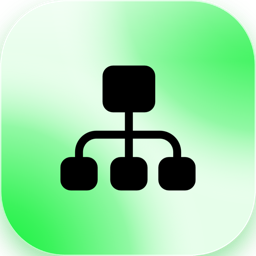
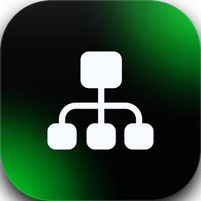

Jeder Eintrag trägt eine Markierung, für wen er gilt: <Badge color="gray">Alle</Badge> steht für alles, was eine Person in ihrer Arbeit bemerkt, <Badge color="blue">Admins</Badge> für Änderungen, die nur Administratoren nutzen oder beachten müssen.

Collabase 1.2 bringt das CRM, eine neue App für Firmen, Personen und Deals, die neben Projects und Service Management läuft und für sich allein funktioniert. Meetings und Studio arbeiten mit ihr zusammen, und Collabase AI schreibt zu jeder Firma eine Zusammenfassung. Das CRM startet als Beta in Collabase Lab: Es ist aus, bis eine Person es einschaltet.

**Unterstützt bis:** Oktober 2027. Collabase 1 erhält ein Jahr nach dem Release Fehlerbehebungen und Sicherheitsupdates, in der neuesten Minor-Version.

## Neue Apps und Funktionen

- <Badge color="gray">Alle</Badge> **CRM (Beta in Collabase Lab):** halte Firmen, Personen und Deals in einer App, mit Notizen, Aufgaben, Dateien und einer Timeline an jedem Datensatz. Arbeite in Listen mit Filtern, Spalten und gespeicherten Ansichten, verschiebe Deals auf einem Board, sammle Datensätze für eine Aktion in Listen und importiere aus CSV oder exportiere dorthin. Mails und Termine aus deinem eigenen Postfach erscheinen an den Datensätzen, und Meetings, Flows und die KI arbeiten mit ihnen. Ein Administrator gibt die App Gruppen und legt fest, was jede CRM-Rolle pro Objekttyp sieht und ändert. [Mehr erfahren](/crm/overview) Das CRM startet als Beta: schalte es für dich unter **Settings** → **Profile** → **User settings** → **Collabase Lab** ein. Ein Betreiber schaltet es für die ganze Instanz ein, siehe [Update-Hinweis](#update-hinweis-fuer-self-hoster).
- <Badge color="gray">Alle</Badge> **Meetings aus dem CRM:** lege ein Meeting an einer Firma oder Person an, sieh Kundenmeetings in der Timeline und lies auf der Firmenseite ein Briefing vor dem nächsten Meeting. [Mehr erfahren](/crm/meetings)
- <Badge color="gray">Alle</Badge> **Firmenzusammenfassung:** Jede Firma beginnt mit einer kurzen Zusammenfassung, die Collabase AI im Hintergrund schreibt, und der Chat beantwortet Fragen zu deinen CRM-Datensätzen. [Mehr erfahren](/crm/ai)
- <Badge color="blue">Admins</Badge> **CRM-API:** lies und schreibe Datensätze, Notizen, Aufgaben und Listen aus einem anderen System mit einem API-Token. [Mehr erfahren](/api/crm/overview)

## <Icon icon="video" size={20} /> Meetings

**Neue Funktionen**

- <Badge color="gray">Alle</Badge> **Briefing mit dem Wissen anderer Apps:** Das Briefing eines Meetings kann enthalten, was das CRM über die Firma der Gäste weiss, zum Beispiel offene Aufgaben, offene Deals und die Titel von Notizen, die alle lesen dürfen. Es zeigt nur, was die lesende Person sehen darf. [Mehr erfahren](/crm/meetings#briefing)
- <Badge color="gray">Alle</Badge> **Meetings im CRM:** Ein Meeting wird beim Beenden oder bei geänderten Gästen den Firmen und Personen seiner Gäste zugeordnet und erscheint in deren Timeline. [Mehr erfahren](/crm/meetings#matching)

**Verbesserungen**

- <Badge color="gray">Alle</Badge> Das Briefing wird auch im Voraus für Meetings geschrieben, zu denen eine andere App etwas beizutragen hat, nicht nur für Meetings mit einem Gast ohne Collabase-Konto. [Mehr erfahren](/meetings/ai-and-privacy#ai-briefing-before-a-meeting)

## <Icon icon="address-book" size={20} /> CRM (Beta in Collabase Lab)

Das CRM ist eine Beta-Funktion und erscheint in **Collabase Lab**. Es bleibt ausgeschaltet, ohne App in der Seitenleiste, bis du es unter **Settings** → **Profile** → **User settings** → **Collabase Lab** einschaltest. Ein Betreiber kann es für die ganze Instanz einschalten, siehe [Update-Hinweis](#update-hinweis-fuer-self-hoster).

**Neue Funktionen**

- <Badge color="gray">Alle</Badge> **Firmen und Personen:** Listen mit Filterleiste, sortierbaren Spalten, die du auswählst und ordnest, und den ersten 50 Zeilen mit **Load more**. Die Datensatzseite bearbeitet Felder direkt, zeigt Beziehungen und den Besitzer und warnt, wenn eine Kollegin dasselbe Feld geändert hat. Eine Firma zeigt ihr Logo, das im Hintergrund aus ihrer Domain gesucht wird. [Mehr erfahren](/crm/objects)
- <Badge color="gray">Alle</Badge> **Deal-Pipeline:** sieh Opportunities als Board, verschiebe einen Deal von Stufe zu Stufe und gib an, warum einer verloren ging. [Mehr erfahren](/crm/board)
- <Badge color="gray">Alle</Badge> **Notizen:** schreibe Notizen an einen oder mehrere Datensätze, erwähne Kolleginnen und Kollegen und bestimme, wer jede Notiz liest: alle, die die Datensätze lesen dürfen, ausgewählte Personen oder nur du. [Mehr erfahren](/crm/notes)
- <Badge color="gray">Alle</Badge> **Aufgaben:** setze Aufgaben an Firmen, Personen und Deals, gib sie Kolleginnen und Kollegen und erhalte am Fälligkeitstag eine Benachrichtigung. **My tasks** listet deine offenen. [Mehr erfahren](/crm/tasks)
- <Badge color="gray">Alle</Badge> **Timeline:** eine Liste von allem, was an einem Datensatz passiert ist, mit Änderungen, Stufenwechseln, Notizen, Aufgaben, Terminen, Meetings und Mails. [Mehr erfahren](/crm/timeline)
- <Badge color="gray">Alle</Badge> **Gespeicherte Ansichten und Listen:** speichere Filter, Sortierung und Spalten als Ansicht und teile sie, oder sammle Datensätze für eine Aktion in einer Liste mit eigenen Spalten und Gruppen in der Seitenleiste. [Mehr erfahren](/crm/views)
- <Badge color="gray">Alle</Badge> **Dateien und Verknüpfungen:** hänge Verträge und andere Dokumente an einen Datensatz und verknüpfe Projekte, Seiten und Registry-Objekte. Eine Opportunity kann zu einem Work Item werden. [Mehr erfahren](/crm/files)
- <Badge color="gray">Alle</Badge> **Postfach und Kalender:** verbinde dein eigenes Google- oder Microsoft-Postfach. Das CRM liest Mails und Termine, sendet nie etwas, und du bestimmst, was andere davon sehen. Mails erscheinen als Verläufe im Reiter **E-Mails**, und aus einem Termin wird mit **Agenda planen** ein Collabase-Meeting. [Mehr erfahren](/crm/mailbox)
- <Badge color="gray">Alle</Badge> **Duplikate und Zusammenführen:** finde doppelt erfasste Datensätze und führe sie zusammen, und wähle, welche Werte bleiben. [Mehr erfahren](/crm/duplicates)
- <Badge color="gray">Alle</Badge> **Import und Export:** hole Firmen, Personen und Deals aus einer CSV-Datei und exportiere sie wieder. Die Daten einer Person lassen sich auf Anfrage exportieren. [Mehr erfahren](/crm/import-export)
- <Badge color="gray">Alle</Badge> **Papierkorb und Anonymisieren:** gelöschte Datensätze bleiben 30 Tage im Papierkorb. Eine Person lässt sich auf eine Datenschutzanfrage anonymisieren. [Mehr erfahren](/crm/trash)
- <Badge color="gray">Alle</Badge> **CRM-Gadgets:** fünf Gadgets für Dashboards und die Startseite: die Pipeline, gewonnen und verloren, fällige Opportunities, deine Aufgaben und neue Firmen. [Mehr erfahren](/crm/gadgets)
- <Badge color="gray">Alle</Badge> **Suche und Benachrichtigungen:** Die globale Suche findet CRM-Datensätze, Notizen und Aufgaben, die du lesen darfst, und das CRM hat eine eigene Benachrichtigungskategorie. [Mehr erfahren](/crm/overview#search)

**Beta-Einschränkungen**

- <Badge color="gray">Alle</Badge> Die Beta kann sich ändern, bevor sie allgemein verfügbar ist.
- <Badge color="gray">Alle</Badge> Wer keine CRM-Rolle hat, sieht nichts, auch wenn die App für die Person verfügbar ist.

## <Icon icon="hand" size={20} /> Studio

**Neue Funktionen**

- <Badge color="gray">Alle</Badge> **CRM-Plug:** Flows starten, wenn sich ein Datensatz ändert, ein Deal gewonnen oder verloren wird, eine Aufgabe fällig ist, ein Meeting an Datensätze angehängt wird oder ein Import endet, und Flows legen Datensätze, Aufgaben, Notizen und Listeneinträge an. Ein Flow handelt mit den CRM-Rollen der Person, die ihn veröffentlicht hat. [Mehr erfahren](/crm/automation)

## <Icon icon="sparkles" size={20} /> Collabase AI

**Neue Funktionen**

- <Badge color="gray">Alle</Badge> **CRM im Chat:** frage nach Firmen, Personen und Deals und erhalte nur, was du sehen darfst. Nach deiner Freigabe kann der Chat eine Aufgabe anlegen oder einen Datensatz ändern. Der KI-Index kann Notizen für alle einschliessen. [Mehr erfahren](/crm/ai)

## Projects

**Neue Funktionen**

- <Badge color="gray">Alle</Badge> **Meilensteine mit führendem Work Item:** Ein neuer Meilenstein bekommt ein Work Item vom Typ Meilenstein. Titel und Fälligkeit sind die des Meilensteins, und der Meilenstein ist erreicht, wenn das Work Item abgeschlossen ist. Frühere Meilensteine funktionieren weiter ohne eines.
- <Badge color="gray">Alle</Badge> **Ein Gate wartet auf seinen Meilenstein:** Ein Phasen-Gate kann einen Meilenstein nennen. Die Phase lässt sich erst freigeben, wenn dieser Meilenstein erreicht ist. Eine Ablehnung bleibt jederzeit möglich. Du wählst ihn in den Gate-Einstellungen der Phase.
- <Badge color="gray">Alle</Badge> **Statusbericht zeigt eingetretene Risiken:** Die Risikozahl, der Abschnitt Risiken und der Export zeigen nur Risiken mit dem Status Eingetreten, und nichts, wenn keines eingetreten ist. Früher freigegebene Berichte behalten ihre Zahlen, zeigen die Risikokachel aber nicht mehr.
- <Badge color="blue">Admins</Badge> **Vorlagen bieten alles, was ein Projekt hat:** Der Vorlagen-Editor listet dieselben Ansichten und Funktionen wie die Projekt-Einstellungen, auch Kosten, Phasen und Gates, Risiken und Anhänge.

**Verbesserungen**

- <Badge color="gray">Alle</Badge> Der Hinweis, dass ein Projekt seiner Vorlage folgt, erscheint nicht mehr auf der Projekt-Startseite. Er bleibt in den Projekt-Einstellungen.

**Fehlerbehebungen**

- <Badge color="gray">Alle</Badge> Beim Erstellen eines Projekts aus einer Vorlage ohne Phasen, etwa Scrum oder Kanban, erscheint keine Warnung mehr, dass Teile der Vorlage nicht kopiert werden konnten.
- <Badge color="gray">Alle</Badge> Im Workflow-Editor und im Relationsgraph eines Work Items erscheinen die Verbindungspunkte wieder, wenn du die Maus über einen Status oder ein Work Item bewegst. So kannst du wieder einen Übergang oder eine Relation ziehen. [Mehr erfahren](/admin/workflows)

## Registry

**Neue Funktionen**

- <Badge color="blue">Admins</Badge> **Relationen in der Vorlage Projekt-Governance:** Ein neues Schema aus der Vorlage verknüpft seine Objekttypen: eine Annahme mit ihren Risiken und Entscheidungen und ein Risiko mit seinen Entscheidungen. Frühere Schemas bleiben unverändert.

**Fehlerbehebungen**

- <Badge color="gray">Alle</Badge> Im Schema-Designer erscheinen die Verbindungspunkte eines Objekttyps wieder, wenn du die Maus darüber bewegst. Eine Relation zu einem anderen Objekttyp erstellst du, indem du von einem Punkt zum anderen ziehst. Seit 1.1.0 erschienen die Punkte nur, wenn du genau auf den Rand des Typs gezeigt hast. [Mehr erfahren](/registry/schema-designer)
- <Badge color="gray">Alle</Badge> Der Relationsgraph eines Registry-Objekts zeigt seine Verbindungspunkte bei Mouseover wieder.

## <Icon icon="list-check" size={20} /> Testmanagement

**Neue Funktionen**

- <Badge color="blue">Admins</Badge> **Testzyklus in einem Projekt:** Über die API kann ein Testzyklus das Projekt nennen, zu dem er gehört, etwa den Werksabnahmetest eines Kundenprojekts. Das Projekt muss im selben Space liegen wie das Testprojekt.

## <Icon icon="magnifying-glass" size={20} /> Suche

**Fehlerbehebungen**

- <Badge color="gray">Alle</Badge> Suchen, Filtern und Gruppieren nach dem Typ eines Work Items funktioniert wieder. Bedingungen wie `type = Bug` endeten mit einem Fehler, und mit ihnen die Dashboard-Gadgets, gespeicherten Filter und Boards, die nach Typ filtern.

## Kritische Fehlerbehebungen

Diese Korrekturen betreffen Fehler, die eine Funktion lahmgelegt haben.

| App | Was falsch war |
|---|---|
| Registry | Relationen zwischen Objekttypen liessen sich im Schema-Designer kaum erstellen, weil die Verbindungspunkte unsichtbar blieben. Sie erscheinen wieder bei Mouseover. |
| Suche | Eine Bedingung auf den Typ eines Work Items endete mit einem Fehler, ebenso die Gadgets, Filter und Boards, die sie nutzen. Sie funktioniert wieder. |

## Administration

<Badge color="blue">Admins</Badge>

- **CRM-Zugriff:** gib Gruppen unter **Administration** → **Groups** → **App access** die App **CRM** mit den Rollen User oder Admin. [Mehr erfahren](/crm/getting-started#groups)
- **CRM-Rollen und Einstellungen:** lege Rollen an, bestimme pro Objekttyp, was jede Rolle liest und ändert, blende einzelne Felder aus und setze die Instanzeinstellungen, etwa wie lange Mails bleiben und wie weit Mails Kontakte anlegen dürfen. [Mehr erfahren](/crm/roles)
- **CRM-Modell:** füge eigene Objekttypen, Felder und Pipeline-Stufen hinzu und ändere einen Feldtyp. [Mehr erfahren](/crm/model)
- Auf Kubernetes kann das Helm-Chart ohne Ausfall ausrollen, Instanzen auf Nodes verteilen, Pull-Secrets und einen Node-Selector an jeden Pod geben, ein Redis-Passwort verwenden und Dateien in S3 mit einem eigenen Schlüssel verschlüsseln. [Mehr erfahren](/de/installation-kubernetes#ausrollen)
- Das Chart setzt jetzt standardmässig kleine CPU-Requests (250m für die App, je 100m für Dokument-Prozessor, Sandbox und Kollaborations-Relay), und die Dokumentation erhält eine Anleitung zur Dimensionierung einer Kubernetes-Installation mit gemessenen und hochgerechneten Zahlen. [Mehr erfahren](/de/admin/scaling#kubernetes-installation-dimensionieren)
- Die Health-Prüfung nennt `storage` als beeinträchtigt, wenn der S3-Bucket nicht innerhalb von drei Sekunden antwortet. [Mehr erfahren](/admin/file-storage)
- Das Helm-Chart hat den neuen Wert `migrations.seed`. Mit `false` gibt es keinen Seed-Job beim ersten Start und keinen Admin aus dem Secret: Der erste Besuch von `/setup` legt Admin, Titel und Sprache an. Der Standard bleibt `true`. [Mehr erfahren](/de/installation-kubernetes#installieren)
- Das Helm-Chart kann für jede Workload ausser der Plug-Sandbox einen Security Context setzen (`securityContext.enabled: true`, standardmässig aus), sodass sie den Kubernetes Pod Security Standard `restricted` erfüllen: Nicht-Root mit der Benutzer-ID des Images, keine Rechteausweitung, alle Capabilities entfernt, Standard-Seccomp-Profil. Die Werte je Workload passen es an. [Mehr erfahren](/de/installation-kubernetes#pod-security)
- **Logo-Dienst:** eine optionale Adresse mit `{domain}` für Firmenlogos. Ohne sie wird kein Dritter kontaktiert.

## Leistung & Stabilität

- <Badge color="gray">Alle</Badge> Das CRM lädt Listen in Seiten zu 50 Zeilen und hält die Seite bedienbar, während Logos, Zusammenfassungen und der Mailabgleich im Hintergrund arbeiten.
- <Badge color="gray">Alle</Badge> Ein Collabase-Lab-Feature ein- oder auszuschalten funktioniert wieder, nachdem ein Feature Collabase Lab verlassen hat. Vorher wurde die Einstellung als Ganzes abgelehnt.

## Update-Hinweis für Self-Hoster

<Badge color="blue">Admins</Badge>

**Vor dem Update**

- Das CRM ist aus, bis jemand es einschaltet. Damit alle auf deiner Instanz es nutzen, setze `FEATURE_FLAG_OVERRIDES="CRM=true"` in der `.env`-Datei, bevor du das Update startest. Ohne das schalten Personen es für sich in Collabase Lab ein. [Mehr erfahren](/admin/hosting#features-in-development)
- Mail und Kalender brauchen eine eigene Google- oder Microsoft-App. Trage ihre Client-ID und das Secret nach dem Update unter **CRM settings** ein. Ohne sie lassen sich keine Postfächer verbinden, der Rest des CRM funktioniert.

**Was das Update macht**

- Fügt die App **CRM** zur Liste der Apps hinzu. Die Migration lässt sich nicht zurückrollen, halte deshalb eine Datenbanksicherung bereit.
- Fügt Tabellen für Datensätze, Rollen, Notizen, Aufgaben, die Timeline, Listen, Dateien, Importe, Meeting-Zuordnungen, KI-Zusammenfassungen, Postfächer und Verknüpfungen zu anderen Apps hinzu. Sie sind additiv und laufen beim Start. Du musst nichts tun.
- Startet Hintergrundjobs für Logos, Aufgabenmeldungen, Meeting-Zuordnung, Zusammenfassungen, Mail- und Kalenderabgleich und den Papierkorb. Sie brauchen Redis, das jede Installation schon hat. Ohne den Worker meldet `/api/health` die CRM-Aufgabenmeldungen als degradiert.
- Speichert Firmenlogos und CRM-Dateien im selben Speicher wie andere Dateien, im neuen Ordner `crm`.
- Fügt drei optionale Spalten hinzu, je eine bei Gates, Meilensteinen und Testzyklen. Sie sind additiv und laufen beim Start. Der System-Work-Item-Typ **Meilenstein** entsteht, wenn der erste Meilenstein angelegt wird.

**Unterstützte Plattformen**

| Komponente | Unterstützt |
|---|---|
| Docker | Version 24 oder neuer mit Docker Compose v2 |
| Kubernetes | Version 1.26 oder neuer, Helm 3.10 oder neuer |
| Linux (Docker-Installation) | Ubuntu 22.04 oder neuer, Debian 12 oder neuer, RHEL 9 oder neuer |
| PostgreSQL | Version 16 oder neuer mit `pgvector` (mitgeliefert: `pgvector/pgvector:pg16`) |
| Redis | Version 7 (mitgeliefert: `redis:7-alpine`) |
| Anwendungs-Laufzeit | Node.js 24 LTS, im Image |

Grösse und Ports stehen in den [Systemanforderungen](/admin/system-requirements).

**Konfiguration**

- Das CRM ist eine Beta in Collabase Lab und standardmäßig aus. `FEATURE_FLAG_OVERRIDES="CRM=true"` schaltet es für die ganze Instanz ein.
- Keine weitere Variable ist neu. Die Zugangsdaten der Google- und Microsoft-App werden in den CRM-Einstellungen eingetragen, nicht in der `.env`-Datei.
