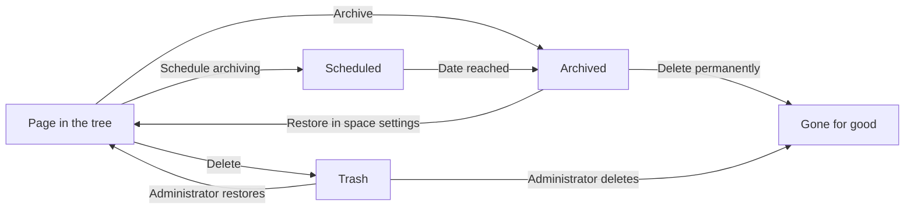

The page tree is the table of contents of a Space. This page shows how to arrange pages in it, how to move pages between Spaces, and what happens when you archive or delete a page.

## The page tree {#page-tree}

Click **Docs** in the left rail. The panel **Documents** opens next to it with the page tree of the current Space.

- Click the arrow in front of a page to show or hide its subpages.
- Type in **Search...** at the top of the panel to filter the tree by title.
- Click **Create Page** at the top of the panel to add a page at the top level.
- A folder has an extra icon, **Open folder view**, that opens the folder as a page.

## Reorder and nest pages {#reorder-and-nest}

Drag a page in the tree and drop it where it belongs.

| Where you drop | Result |
|---|---|
| On the upper or lower edge of a page | The page moves before or after it, on the same level |
| On the middle of a page | The page becomes a subpage of it. Any page can hold subpages, not only folders. |
| On the empty area below the tree | The page moves to the top level of the Space |

Subpages move with their parent. Reordering and nesting need the right to move pages in the Space, see [Permissions](/concepts/permissions).

## Rename a page in the tree {#rename}

Double-click the page title in the tree, type the new title and press **Enter**. The right-click menu of a page also has a rename entry with a pencil icon. To rename a page you have open, see [Pages](/docs/pages#title-and-icon).

## Move a page to another place {#move}

Use **Move Page** to move a page to a parent far away in the tree, or to another Space.

<Steps>
  <Step title="Open the move dialog">
    Open the page, click the **...** menu at the top right and click **Move Page**. In the tree you can also right-click the page and click **Move**.
  </Step>
  <Step title="Choose the Space">
    Under **Target Space**, pick the Space the page should go to. The current Space is selected by default.
  </Step>
  <Step title="Choose the parent">
    Under **Parent Location**, search with **Search target folder or page...** and click the new parent. Choose **Space Root** to place the page at the top level.
  </Step>
  <Step title="Move">
    Click **Move Now**. The page appears at its new place.
  </Step>
</Steps>

Space administrators can move any page of the Space from the space settings, see [Restructure a Space from the content map](#content-map).

<Note>
  Pages that are shared with project guests can become visible to other guests after a move. The move dialog warns you when the new parent is shared with guests. See [Share a page with project guests](/docs/page-restrictions#guests).
</Note>

## Group pages in folders {#folders}

A folder groups pages under one heading and can restrict who sees them.

<Steps>
  <Step title="Create the folder">
    Click **Create**, then **Folder**. A folder called **New Folder** appears at the top level of the page tree.
  </Step>
  <Step title="Name and describe it">
    Click **Open folder view** next to the folder in the tree. Double-click the title to rename it, and click **Add description** to say what belongs in it.
  </Step>
  <Step title="Add pages">
    Click **Create Page** in the folder view to create a page inside it, or drag existing pages onto the folder in the tree.
  </Step>
</Steps>

The folder view lists the pages inside the folder. It also has **Copy link**, a banner image and **Permissions**, which restricts the folder to selected people and groups, see [Restrict access to pages](/docs/page-restrictions).

## Archive a page {#archive}

Archive a page when its content is outdated but should not be lost. An archived page leaves the page tree, keeps its content and versions, and can be restored.

<Steps>
  <Step title="Open the archive dialog">
    Open the page, click the **...** menu at the top right and click **Archive**.
  </Step>
  <Step title="Give a reason">
    Enter a **Reason for archiving**, for example "Project completed". The reason is required and is shown later in the list of archived pages.
  </Step>
  <Step title="Archive now or later">
    Click **Archive Now** to archive the page immediately. To archive it later, fill in **Schedule Archiving (Optional)** with a date and a time and click **Schedule**.
  </Step>
</Steps>

**Archive Now** is shown only to the owner and the administrators of the Space. Other members with the right to archive pages see **Collaborators can only schedule archiving.** and can only schedule.

If a page is already scheduled, the dialog shows the badge **Scheduled** and the planned date. Change the fields and click **Schedule** again to move the date.

## Restore an archived page {#archived-pages}

Archived pages are listed in the space settings. You need access to the space settings, see [Space settings](/concepts/space-settings).

<Steps>
  <Step title="Open the archived pages">
    Open the Space, go to its settings and click **Archived pages** in the **Content** group.
  </Step>
  <Step title="Restore or delete">
    Each row shows the page, who archived it, when and why. Click **Restore** to put the page back into the tree. Click **Delete permanently** and confirm in the dialog **Delete page permanently?** to remove it for good.
  </Step>
</Steps>

<Danger>
  **Delete permanently** in the list of archived pages cannot be undone. The page does not go to the trash.
</Danger>

## Delete a page {#delete}

<Steps>
  <Step title="Delete the page">
    Open the page, click the **...** menu at the top right and click **Delete**. In the tree you can also right-click the page and click **Delete**.
  </Step>
  <Step title="Confirm">
    From the **...** menu, the dialog **Delete Page?** opens: click **Move to Trash**. From the tree, the dialog **Delete page?** opens: click **Delete**. In both cases the page and all its subpages move to the trash.
  </Step>
</Steps>

Deleted pages go to the trash of your Collabase instance. Only an administrator can restore a page from the trash or empty it. Ask your administrator if you deleted a page by mistake.

## A page's way from draft to deletion {#lifecycle}

The diagram shows where a page can go and which way leads back.

The [page status](/docs/pages#page-status), such as **Draft** or **Published**, is independent of this path. It describes how ready the content is, not where the page lives.

## Restructure a Space from the content map {#content-map}

Space administrators see every page of the Space in one list and can move any of them.

<Steps>
  <Step title="Open the content map">
    Open the Space, go to its settings and click **Content map** in the **Content** group. The section **Page structure** lists all pages.
  </Step>
  <Step title="Move a page">
    Click **Move page** on the row of the page. Choose the **Target space** and the **Parent page**, or **No parent (top level)**, and confirm.
  </Step>
</Steps>

## Related

<CardGroup cols={3}>
  <Card title="Pages" icon="file-text" href="/docs/pages">
    Create pages, whiteboards and folders.
  </Card>
  <Card title="Restrict access to pages" icon="lock" href="/docs/page-restrictions">
    Limit a folder to selected people.
  </Card>
  <Card title="Version history" icon="history" href="/docs/version-history">
    Go back to an earlier state of a page.
  </Card>
</CardGroup>
