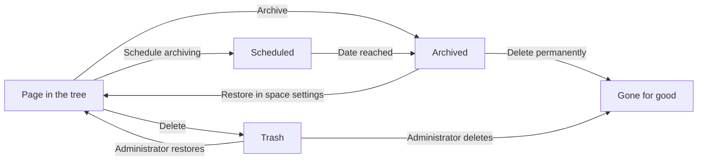

The page tree is the table of contents of a Space. This page shows how to create, find and arrange pages in it, how to move pages between Spaces, and what happens when you archive or delete a page.

## The page tree {#page-tree}

Click **Docs** in the left rail. The panel **Documents** opens next to it with the page tree of the current Space.

- Click the arrow in front of a page to show or hide its subpages.
- Type in **Search pages** at the top of the panel to filter the tree by title, see [Search the page tree](#search).
- Click **+** at the top of the panel to create a page, a folder or a whiteboard, see [Create pages in the tree](#create).
- Point at a row to show two buttons at its end: **+** (**Create below this page**) and **...** (**Page actions**). A folder also has **Open folder view**, which opens the folder as a page.
- Right-click a row to open the same menu as **...**, see [The page menu](#page-menu).

## Create pages in the tree {#create}

The **+** buttons need the right to create pages in the Space, see [Permissions](/concepts/permissions). Without it they are not shown.

<Steps>
  <Step title="Choose where it goes">
    Open the page that should hold the new one, or open none to work at the top level. Click **+** at the top of the panel to create below the open page. Click **+** (**Create below this page**) on a row to create below that page.
  </Step>
  <Step title="Choose the kind">
    Click **Page**, **Folder** or **Whiteboard**. The branch of the parent page opens, and the new row appears in the tree.
  </Step>
  <Step title="Name it">
    A page or whiteboard opens in edit mode with the title **Unnamed Page** or **Whiteboard**. A folder stays in the tree with its name field open: type the name and press **Enter**.
  </Step>
</Steps>

If the page cannot be created, the row disappears again and a message says so.

## Search the page tree {#search}

Type in **Search pages** above the tree. The filter starts with the first character and runs in your browser, so it does not wait for the server.

- The tree shows the pages whose title contains your text, together with all pages above them. The branches open so that every hit is visible, and the matching text is highlighted.
- Upper and lower case and accents do not matter: **ubersicht** finds **Übersicht**, and **ecole** finds **École**.
- Press **Escape** or click **Clear search** to leave the search. The tree is as you left it before, with the same branches open.
- If no page matches, the panel says **No pages found**.

The search covers the titles of the pages you can see. Pages you may not open are not listed, not even as a parent. To search the content of pages, use the global search, see [Search](/concepts/search).

## The page menu {#page-menu}

Every page row has one menu. Open it with **...** at the end of the row or by right-clicking the row. The same menu is in the **...** at the top right of an open page and in the list of pages inside a folder.

| Entry | What it does |
|---|---|
| **Rename** | Edits the title in the row, see [Rename a page in the tree](#rename). Not shown in the menu of an open page or a folder view. |
| **Copy link** | Copies the link to the page and confirms with **Link copied**. |
| **Move…** | Opens the move dialog, see [Move a page to another place](#move). |
| **Move up** / **Move down** | Swaps the page with its neighbour on the same level. Off for the first and the last page of a level. |
| **Duplicate** | Copies the page next to the original with **(Copy)** after its title and the status **Draft**. Subpages are not copied. |
| **Archive** | Opens the archive dialog, see [Archive a page](#archive). |
| **Delete** | Asks for confirmation and moves the page and its subpages to the trash, see [Delete a page](#delete). |

The menu of an open page also has **Share with guests** (when the page can be shared), **Attachments** and **Export**, between **Duplicate** and **Archive**.

An entry you may not use stays in the menu but is dimmed. Point at it to see why.

| Entry | You need |
|---|---|
| **Rename**, **Move up**, **Move down**, **Duplicate** | The right to edit the page |
| **Move…** | The right to move pages in the Space, and to edit the page |
| **Archive**, **Delete** | The right to delete pages in the Space |

Guests see only **Copy link**. The rights come from your role in the Space, see [Permissions](/concepts/permissions). A page with its own access list can still refuse an action, and the page then returns to its place with a message.

## Reorder and nest pages {#reorder-and-nest}

Drag a page in the tree and drop it where it belongs.

| Where you drop | Result |
|---|---|
| On the upper or lower edge of a page | The page moves before or after it, on the same level |
| On the middle of a page | The page becomes a subpage of it. Any page can hold subpages, not only folders. |
| On the empty area below the tree | The page moves to the top level of the Space |

Subpages move with their parent. Nesting a page under another one needs the right to move pages in the Space, see [Permissions](/concepts/permissions).

To change the place of a page by one step, use **Move up** or **Move down** in the [page menu](#page-menu). A step among the pages of the same level needs only the right to edit the page.

## Rename a page in the tree {#rename}

Double-click the page title in the tree, or click **Rename** in the [page menu](#page-menu). Type the new title and press **Enter**. Press **Escape** to keep the old title.

A title cannot be empty: the message **A page needs a title.** appears and the old title stays. If the save fails, the old title comes back with the message **The page could not be renamed.** To rename a page you have open, see [Pages](/docs/pages#title-and-icon).

## Move a page to another place {#move}

Use **Move…** to move a page to a parent far away in the tree, or to another Space.

<Steps>
  <Step title="Open the move dialog">
    Open the page, click the **...** menu at the top right and click **Move…**. In the tree, click **...** on the row or right-click the page and click **Move…**.
  </Step>
  <Step title="Choose the Space">
    Under **Target Space**, pick the Space the page should go to. The current Space is selected by default.
  </Step>
  <Step title="Choose the parent">
    Under **Parent Location**, search with **Search target folder or page...** and click the new parent. Choose **Space Root** to place the page at the top level.
  </Step>
  <Step title="Move">
    Click **Move Now**. The page appears at its new place.
  </Step>
</Steps>

Space administrators can move any page of the Space from the space settings, see [Restructure a Space from the content map](#content-map).

<Note>
  Pages that are shared with project guests can become visible to other guests after a move. The move dialog warns you when the new parent is shared with guests. See [Share a page with project guests](/docs/page-restrictions#guests).
</Note>

## Group pages in folders {#folders}

A folder groups pages under one heading and can restrict who sees them.

<Steps>
  <Step title="Create the folder">
    Click **+** above the tree, then **Folder**, as described in [Create pages in the tree](#create). Type the name and press **Enter**.
  </Step>
  <Step title="Name and describe it">
    Click **Open folder view** next to the folder in the tree. Click **Add description** to say what belongs in it. To rename the folder later, double-click it in the tree.
  </Step>
  <Step title="Add pages">
    Click **Create Page** in the folder view to create a page inside it, or drag existing pages onto the folder in the tree.
  </Step>
</Steps>

The folder view lists the pages inside the folder, each row with the same [page menu](#page-menu) except **Rename**. It also has **Copy link**, a banner image and **Permissions**, which restricts the folder to selected people and groups, see [Restrict access to pages](/docs/page-restrictions).

## Archive a page {#archive}

Archive a page when its content is outdated but should not be lost. An archived page leaves the page tree, keeps its content and versions, and can be restored.

<Steps>
  <Step title="Open the archive dialog">
    Open the page, click the **...** menu at the top right and click **Archive**. In the tree, use **...** on the row or right-click the page.
  </Step>
  <Step title="Give a reason">
    Enter a **Reason for archiving**, for example "Project completed". The reason is required and is shown later in the list of archived pages.
  </Step>
  <Step title="Archive now or later">
    Click **Archive Now** to archive the page immediately. To archive it later, fill in **Schedule Archiving (Optional)** with a date and a time and click **Schedule**.
  </Step>
</Steps>

**Archive Now** is shown only to the owner and the administrators of the Space. Other members with the right to archive pages see **Collaborators can only schedule archiving.** and can only schedule.

If a page is already scheduled, the dialog shows the badge **Scheduled** and the planned date. Change the fields and click **Schedule** again to move the date.

## Restore an archived page {#archived-pages}

Archived pages are listed in the space settings. You need access to the space settings, see [Space settings](/concepts/space-settings).

<Steps>
  <Step title="Open the archived pages">
    Open the Space, go to its settings and click **Archived pages** in the **Content** group.
  </Step>
  <Step title="Restore or delete">
    Each row shows the page, who archived it, when and why. Click **Restore** to put the page back into the tree. Click **Delete permanently** and confirm in the dialog **Delete page permanently?** to remove it for good.
  </Step>
</Steps>

<Danger>
  **Delete permanently** in the list of archived pages cannot be undone. The page does not go to the trash.
</Danger>

## Delete a page {#delete}

<Steps>
  <Step title="Delete the page">
    Open the page, click the **...** menu at the top right and click **Delete**. In the tree, use **...** on the row or right-click the page.
  </Step>
  <Step title="Confirm">
    The dialog **Delete page?** opens and names the page. If the page has subpages, it also gives their number. Click **Delete**: the page and all its subpages move to the trash. Click **Cancel** to keep them.
  </Step>
</Steps>

If you delete the page you have open, or a page above it, Collabase takes you to your home page. Deleted pages go to the trash of your Collabase instance. Only an administrator can restore a page from the trash or empty it. Ask your administrator if you deleted a page by mistake.

## A page's way from draft to deletion {#lifecycle}

The diagram shows where a page can go and which way leads back.

The [page status](/docs/pages#page-status), such as **Draft** or **Published**, is independent of this path. It describes how ready the content is, not where the page lives.

## Restructure a Space from the content map {#content-map}

Space administrators see every page of the Space in one list and can move any of them.

<Steps>
  <Step title="Open the content map">
    Open the Space, go to its settings and click **Content map** in the **Content** group. The section **Page structure** lists all pages.
  </Step>
  <Step title="Move a page">
    Click **Move page** on the row of the page. Choose the **Target space** and the **Parent page**, or **No parent (top level)**, and confirm.
  </Step>
</Steps>

## Related

<CardGroup cols={3}>
  <Card title="Pages" icon="file-text" href="/docs/pages">
    Create pages, whiteboards and folders.
  </Card>
  <Card title="Restrict access to pages" icon="lock" href="/docs/page-restrictions">
    Limit a folder to selected people.
  </Card>
  <Card title="Version history" icon="history" href="/docs/version-history">
    Go back to an earlier state of a page.
  </Card>
</CardGroup>
