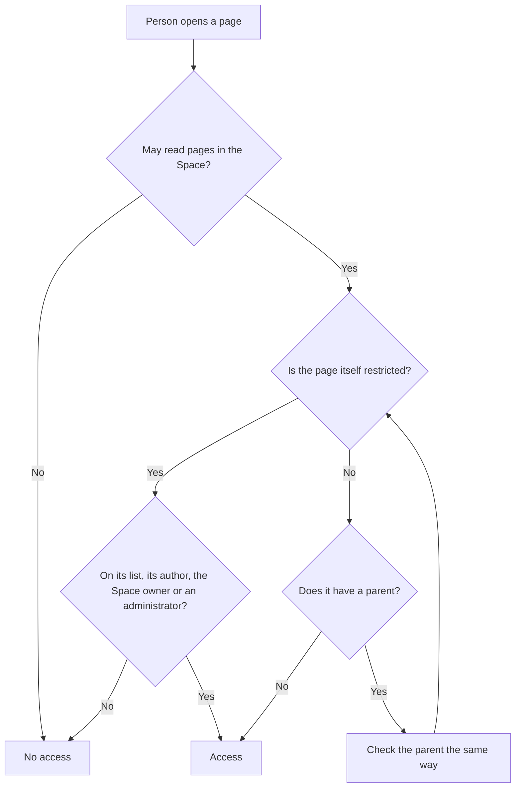

By default, every <Tooltip tip="A person with a Collabase account. Inside a Space, each member has a space role that decides what they can do there." cta="Glossary" href="/glossary#member">member</Tooltip> of a Space can read every page in it. When some pages must stay with a smaller circle, such as HR notes or a confidential bid, put them in a private folder. Only the people and groups on the folder's list see it and the pages inside.

## How access to a page is decided {#how-it-works}

Collabase checks access from the Space down to the page:

| Level | Decides | Where it is set |
|---|---|---|
| **Space** | Who can read and edit pages in the Space at all, through the space role and the <Tooltip tip="A reusable template that defines what Managers, Members and Viewers can do in a Space." cta="Glossary" href="/glossary#permission-scheme">Permission Scheme</Tooltip> | Space settings, see [Permissions](/concepts/permissions) |
| **Private folder** | Who can open the folder and every page below it | The folder's **Permissions**, described on this page |

The diagram shows how Collabase decides whether a person can open a page.

A restriction therefore applies to everything below it. A page in a private folder, and every subpage of that page, is hidden from people who cannot open the folder.

<Note>
  The author of a folder, the owner of the Space and the administrators of your Collabase instance always see restricted content. You cannot hide a folder from them.
</Note>

## Make a folder private {#make-private}

<Steps>
  <Step title="Open the folder">
    In the page tree, click **Open folder view** next to the folder. To create a folder first, see [Group pages in folders](/docs/organize-pages#folders).
  </Step>
  <Step title="Open the permissions">
    Click **Permissions** in the folder header. The panel **Folder access** opens. The button is shown when you can edit the folder.
  </Step>
  <Step title="Switch to private">
    Turn on the switch so it reads **Private Folder**: "Only the people and groups listed below can open it."
  </Step>
  <Step title="Add people and groups">
    Under **People & groups**, type in **Add person or group…** and pick a person or a group. Each entry starts with **View**.
  </Step>
  <Step title="Give edit rights where needed">
    Change an entry from **View** to **Edit** if that person or group should change the pages. Click **Remove** to take someone off the list.
  </Step>
</Steps>

The changes apply at once, there is no save button. A person you add receives a notification that the folder was shared with them. Members of an added group do not get a notification.

| Access | What the person can do |
|---|---|
| **View** | Open and read the folder and the pages inside |
| **Edit** | Also change the folder and the pages inside |

<Warning>
  Adding and removing people needs the right to manage members in the Space, which Space administrators have. If you only have edit rights, you can switch a folder to private, but you cannot fill its list. Ask a Space administrator before you switch, or the folder may disappear for everyone not listed.
</Warning>

## Open a folder to the whole Space again {#make-public}

Open the folder's **Permissions** and turn the switch back so it reads **Public to Space**: "Every member of the space can see this folder." The list of people and groups is deleted. If you make the folder private again later, start a new list.

## Find all restricted content in a Space {#zones}

Space administrators see every restricted folder and page of a Space in one place.

<Steps>
  <Step title="Open the zones">
    Open the Space, go to its settings and click **Zones** in the **Access** group. The section **Restricted zones** lists **Restricted folders and pages**.
  </Step>
  <Step title="Act on a zone">
    Click **Give me access** to add yourself to the list with edit rights, for example to clean up a folder whose owner left. Click **Make public** and confirm to remove all restrictions of that folder or page.
  </Step>
</Steps>

When the list shows **No restricted zones**, all content in the Space is visible to its members.

## Share a page with project guests {#guests}

Guests are external people who work in one project, see [Guests](/projects/guests). They see no page unless you share it with their project.

<Steps>
  <Step title="Open the share dialog">
    Open the page, click the **...** menu at the top right and click **Share with guests**. The entry is shown when the Space has projects with guests.
  </Step>
  <Step title="Pick the projects">
    Switch on each project whose guests should read the page. Guests of the selected projects can read this page and its subpages, if their access allows reading docs.
  </Step>
</Steps>

A shared page shows the badge **Shared with guests** next to the **...** menu. Guests never see pages in **Draft** or archived pages, even when they are shared.

## Related

<CardGroup cols={3}>
  <Card title="Permissions" icon="shield" href="/concepts/permissions">
    Space roles and Permission Schemes.
  </Card>
  <Card title="Organize pages" icon="folder-tree" href="/docs/organize-pages">
    Create folders and move pages.
  </Card>
  <Card title="Notifications" icon="bell" href="/concepts/notifications">
    What you hear about when content is shared.
  </Card>
</CardGroup>
