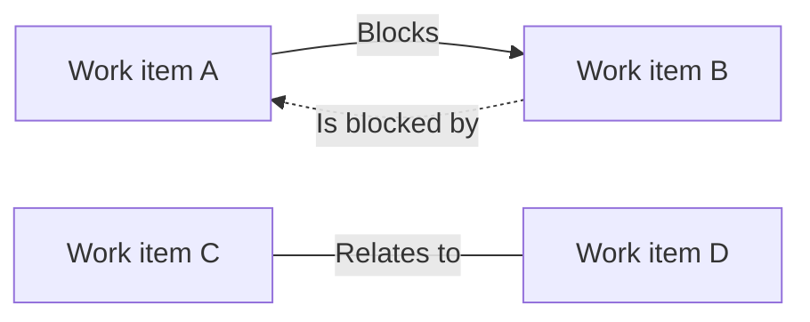

A dependency records that one work item has to finish before another can proceed. In Collabase a dependency is a **Blocks** relation between two work items. It can connect work items in the same project or in different projects and Spaces.

## Dependency types {#types}

| Relation | Is a dependency | Drawn on the Timeline |
|---|---|---|
| **Blocks** / **Is blocked by** | Yes | Always, as an arrow |
| **Relates to** | No | Only with **Show related links** switched on |
| **Duplicates** / **Is duplicated by** | No | No |

Dependencies created in Collabase are **Finish to start**: the blocked work starts when the blocking work is done.

## Create a dependency {#create}

<Tabs>
  <Tab title="On the Timeline">
    Drag from the dot at the end of one bar to another bar. See [Timeline dependencies](/projects/roadmap#dependencies).
  </Tab>
  <Tab title="In the work item">
    Open the work item, click **Add** under **Relations**, choose **Blocks** or **Is blocked by** as the **Relation type**, find the other work item and confirm with **Link work item**. The other work item can be in any project you can see.
  </Tab>
</Tabs>

Both ways need the **Link task** permission.

## See dependencies {#see}

| Where | What you see |
|---|---|
| **Relations** in the work item | Every relation, in both directions |
| **Graph** in the work item | The **Relation Graph** with relations up to four steps deep, across projects |
| Project **Timeline** | Arrows between bars of the same timeline |
| [Portfolio Gantt](/planning/portfolios#gantt) | No arrows |

<Note>
  An arrow is drawn only when both work items are on the same timeline. A dependency on a work item in another project shows in **Relations** and in the **Relation Graph**, not as an arrow.
</Note>

## What Collabase does not do {#limits}

- It does not move dependent work items when you reschedule the blocking one.
- It does not warn when a blocked work item starts before its blocker ends.
- It has no critical path.

Check dependencies yourself after moving dates, for example with the **Relation Graph**.

## Related

<CardGroup cols={2}>
  <Card title="Timeline" icon="calendar" href="/projects/roadmap">
    Draw and see dependencies in one project.
  </Card>
  <Card title="Work items" icon="circle-check" href="/projects/tasks#relations">
    Relations and the relation graph.
  </Card>
</CardGroup>
