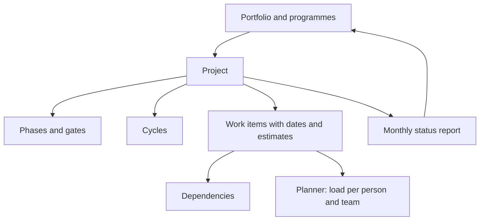

Planning in Collabase works on the real projects and work items, not on a separate plan. Portfolios group projects, the Planner sets people's time against their work, and each project carries its own timeline, phases and status reports. A change you make in one place is visible in all others at once.

## The building blocks {#building-blocks}

## Which tool for which question {#which-tool}

| Question | Tool |
|---|---|
| Which projects need management attention? | [Portfolios](/planning/portfolios), **Overview** tab |
| How do all projects of a programme lie in time? | [Portfolios](/planning/portfolios#gantt), **Gantt** tab |
| Who is overloaded in the next four weeks? | [Planner](/planning/planner-capacity) |
| What blocks what? | [Dependencies](/planning/dependencies) |
| When is each work item of one project scheduled? | Project [Timeline](/projects/roadmap) |
| Where is the project in its lifecycle? | [Phases and gates](/projects/approvals) |
| What does the project manager report this month? | [Status reports](/projects/reports#status-reports) |
| What could go wrong? | [Risk register](/projects/risks) |

## Get started {#get-started}

<Steps>
  <Step title="Give work items dates and estimates">
    The Planner and the timelines only place work that has a start date, a due date and, for the Planner, an estimate.
  </Step>
  <Step title="Set up workload plans">
    An administrator gives each person or team a workload plan, so capacity is right. See [Holiday and workload schemes](/time-tracking/holiday-workload-schemes).
  </Step>
  <Step title="Build the portfolio tree">
    Create portfolios and assign projects to them under **Settings → Portfolio and budget**.
  </Step>
  <Step title="Switch on what the projects need">
    Under **Settings → Project features**, switch on **Phases and gates**, **Risks** or **Costs** per project.
  </Step>
</Steps>

## What Collabase does not offer {#not-available}

| Need | Situation in Collabase |
|---|---|
| Scenarios or a sandbox plan | Not available. Every change applies to the real work items |
| Automatic scheduling from dependencies | Not available |
| A program board | Not available. A programme is a portfolio with a parent |
| Releases or fix versions on work items | Not available. Versions exist in Test Management only |
| Exporting a plan | Not available |

## Next steps

<CardGroup cols={2}>
  <Card title="Portfolios" icon="folder-tree" href="/planning/portfolios">
    Group projects and compare them.
  </Card>
  <Card title="Planner and capacity" icon="users" href="/planning/planner-capacity">
    Plan people against their time.
  </Card>
  <Card title="Dependencies" icon="git-branch" href="/planning/dependencies">
    Record what blocks what.
  </Card>
  <Card title="Phases and gates" icon="milestone" href="/projects/approvals">
    Run a project through a lifecycle.
  </Card>
</CardGroup>
