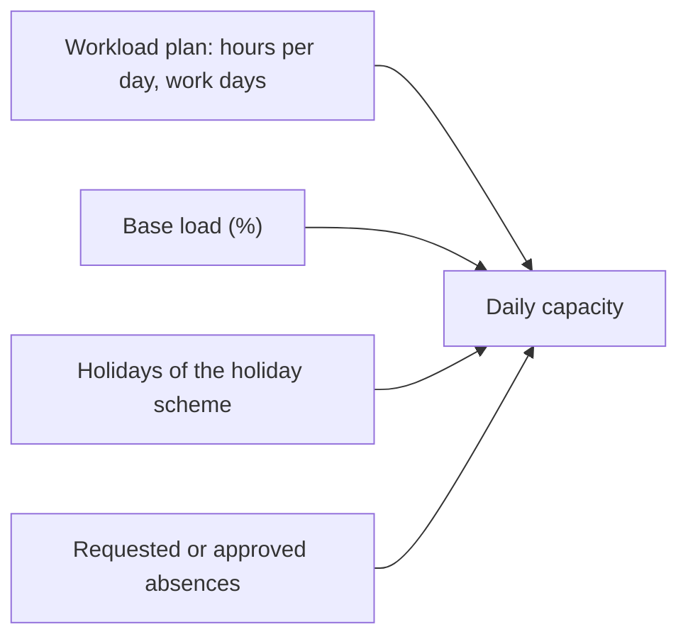

The **Planner** shows, for the next four weeks, how much time each person or team has and how much work is planned for them, across every project. Use it to find who is overloaded, who has room, and to move work to the person who can take it.

## Who can use it {#access}

| | |
|---|---|
| **Access** | The app right **Planner**, granted per group by an administrator. System administrators always have it |
| **Where** | **Times → Planner** in the sidebar |

Changing a work item from the Planner also needs the right to edit that work item.

## Read the Planner {#read}

The page is titled **Workload**. Choose **People** or **Teams** under **View mode**, and narrow teams with **Filter by team**.

Each row shows:

| Figure | Meaning |
|---|---|
| **Capacity** | Hours the person or team can work in the period |
| **Planned** | Hours of work planned in the period |
| **Free** or **Overload** | Capacity minus planned. **Overload** appears in red when planned work exceeds capacity |
| Hours per week, for example **40h / week** | The weekly working time from the workload plan |

The timeline draws the daily load against a dashed capacity line, with work item and project bars and absences. Team rows add up their members and show unassigned team work as **Team pool**. Expand a team row to see its members.

Move through time with **Prev**, **Today** and **Next**. The Planner always shows 28 days starting on a Monday, and **Prev** and **Next** move by one week.

## How capacity is calculated {#capacity}

Capacity comes from the person's workload plan, which an administrator sets up in Time Tracking.

| Input | Effect |
|---|---|
| Hours per day and work days | The working time of each day |
| **Base load (%)** | Share of the working time taken by operations. The Planner only fills the rest |
| Holidays | Count as zero hours |
| Absences | Requested and approved absences reduce the day |

Without a personal plan, the team's plan applies. Without either, Collabase assumes 8 hours a day, Monday to Friday. A row without a plan shows **No workload plan**, a team with members missing one shows **Incomplete workload plans**. Workload plans and holiday schemes are described in [Holiday and workload schemes](/time-tracking/holiday-workload-schemes).

### What counts as planned work {#planned-work}

- **Open work items with a start date, a due date and an estimate.** The estimate is spread evenly over the working days between the dates.
- **Project shares**, a percentage of a project's hour budget.
- For project leads, the hour budget of projects they lead that nobody holds a share of.

Work items without an estimate are shown but add no load (**No estimate: shown, but adds no load**). Work items without dates are counted as **… without dates**; click **Schedule** to give them dates.

## Assign work {#assign}

<Steps>
  <Step title="Open the dialog">
    Click **Assign work** on a person, or **Assign project** on a team.
  </Step>
  <Step title="Choose a work item or a project share">
    For a person, the **Work item** tab finds a work item with **Search work items**; confirm with **Assign**. The **Project** tab gives a share of a project in **Share in %**.
  </Step>
  <Step title="Check the row">
    **Planned** and **Free** update. A work item without start and end is refused until both are set.
  </Step>
</Steps>

You can also **drag a work item bar** to other days or onto another person's row. Team rows do not accept drops. If you may not change the work item, the bar returns and you see **You may not change this work item. It was put back.**

To hand out team pool work, click an item in **Team pool**. Collabase lists the members by free hours, and picking one assigns the work.

### Project shares {#project-shares}

A project share reserves a percentage of a project's hour budget for a person or team. The project needs an hour budget, a start and an end. All shares of one project together may not exceed 100 %; a larger share shows **That is more than is still free of the project.** Giving shares needs **Manage project settings** in the project's Space.

### Absences {#absences}

Add an absence for a person with **Absence** in the Planner, and remove it with **Remove absence**. It reduces that person's capacity at once.

## Limits {#limits}

- The period is fixed at four weeks. There is no zoom.
- The Planner signals one state, overload. There are no percentage thresholds.
- There are no scenarios: every change is made to the real work items.

## Related

<CardGroup cols={2}>
  <Card title="Time Tracking teams" icon="users" href="/time-tracking/teams">
    The teams the Planner groups people by.
  </Card>
  <Card title="Planning overview" icon="map" href="/planning/overview">
    Which planning tool answers which question.
  </Card>
</CardGroup>
