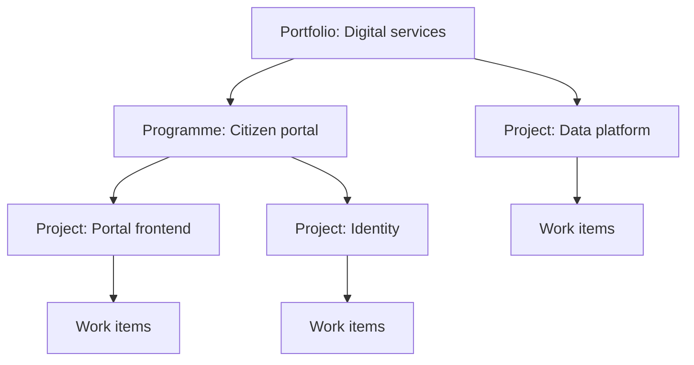

A portfolio collects projects from any Space under one owner and one budget. The **Portfolios** page shows all of them in one table, with the traffic light from each project's [status report](/projects/reports#status-reports), and on one Gantt chart. Use it to answer "which projects need management attention?" without opening each project.

## How portfolios are structured {#hierarchy}

A portfolio can sit under another portfolio. A portfolio with a parent is a programme. There is no limit to the depth.

A project belongs to one portfolio at most. Deleting a portfolio keeps its projects and the portfolios below it; they lose this parent.

## Open Portfolios {#open}

Open **Portfolios** from the app drawer. Everyone who is signed in can see the portfolio tree.

## The Overview tab {#overview}

The top table is the portfolio tree:

| Column | Content |
|---|---|
| Name | The portfolio, with the portfolios below it |
| **Owner** | The person responsible |
| **Own budget** | The budget of this portfolio |
| **Including sub-portfolios** | Its budget plus all portfolios below it. Empty when the currencies differ |
| **Projects** | The number of projects |

The second table lists the projects:

| Column | Content |
|---|---|
| **Status** | The project status |
| **Phase** | The active [phase](/projects/approvals) |
| **Traffic light** | From the latest approved status report, otherwise **No report yet** |
| **Management** | Whether the report asks for **Management attention** |
| **Next milestone** | The next open milestone |
| **Risks** | Open and critical risks from the [risk register](/projects/risks) |
| **Budget used** | Turns orange from 80 % and red from 100 % |

Narrow the list with the portfolio filter (**All portfolios** or one portfolio with its sub-portfolios) and **Needs management only**.

## The Gantt tab {#gantt}

**Gantt** shows each portfolio and project as a summary row with its work items below. Projects without a portfolio are grouped under **Without portfolio**. Use **Open Gantt** on a row to open the chart for one portfolio.

- Zoom with **Day**, **Week**, **Month** or **Quarter**.
- Drag a work item bar to change its dates. Summary rows cannot be dragged.
- The chart shows up to 5,000 work items. Beyond that, open a single portfolio.

<Note>
  The portfolio Gantt draws no dependency arrows. See [Dependencies](/planning/dependencies).
</Note>

## Create and manage portfolios {#manage}

<Steps>
  <Step title="Start a portfolio">
    Click **New portfolio**.
  </Step>
  <Step title="Fill in the form">
    Enter the **Name**, choose where it **Sits under** (or **Top level**), and add a **Description**, a **Budget** and its **Currency**.
  </Step>
  <Step title="Assign projects">
    In each project, open **Settings → Portfolio and budget** and choose the portfolio.
  </Step>
</Steps>

| Action | Who can do it |
|---|---|
| Create a top-level portfolio | A system administrator |
| Create, edit or delete a portfolio below | The owner of that portfolio or of any portfolio above it, and system administrators |
| Hand a portfolio to another owner | Someone who manages its parent |

<Note>
  The owner and the start and end dates of a portfolio cannot be set in the form today.
</Note>

## Related

<CardGroup cols={2}>
  <Card title="Planning overview" icon="map" href="/planning/overview">
    Which planning tool answers which question.
  </Card>
  <Card title="Status reports" icon="file-chart-column" href="/projects/reports#status-reports">
    Where the traffic light comes from.
  </Card>
</CardGroup>
