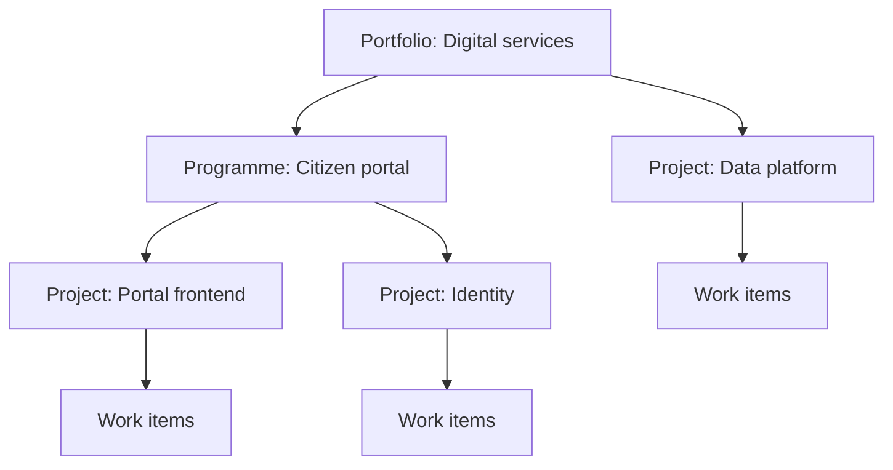

A portfolio collects projects from any Space under one owner and one budget. The **Portfolios** page shows all of them in one table, with the traffic light from each project's [status report](/projects/reports#status-reports), and on one Gantt chart. Use it to answer "which projects need management attention?" without opening each project.

## How portfolios are structured {#hierarchy}

A portfolio can sit under another portfolio. A portfolio with a parent is a programme. There is no limit to the depth.

A programme is simply a portfolio that sits under another portfolio. It uses the same screen and has the same features as any portfolio. Programme steering, with the health light, the risks and the report, is available on every portfolio that has portfolios below it.

A project belongs to one portfolio at most. Deleting a portfolio keeps its projects and the portfolios below it; they lose this parent.

## Portfolios and programmes on a roadmap {#roadmap}

A [roadmap](/planning/roadmaps) plans initiatives apart from any project. An initiative can link a portfolio or a programme, see [Links](/planning/roadmaps#links). The roadmap then shows the projects of the portfolio as read-only rows under the initiative:

- An initiative with linked projects, work items, portfolios or pages gets an expand arrow. A toolbar button expands or collapses all of them.
- A linked project shows its real period and its traffic light. A linked work item shows its dates.
- A linked portfolio shows its portfolios and projects below it, up to three levels. A linked page has no bar.
- A row you may not see shows **Link without permission** and no detail.
- A warning marker appears when a linked item runs outside the period of the initiative. The bar of the initiative itself never changes.
- The export has the option **Include linked items**.

The roadmap gives the overview across portfolios and calculates nothing. The portfolio **Gantt** tab shows the work items of the projects themselves.

## Open Portfolios {#open}

Open **Portfolios** from the app drawer. Everyone who is signed in can see the portfolio tree.

## The Overview tab {#overview}

The top table is the portfolio tree:

| Column | Content |
|---|---|
| Name | The portfolio, with the portfolios below it |
| **Owner** | The person responsible |
| **Own budget** | The budget of this portfolio |
| **Including sub-portfolios** | Its budget plus all portfolios below it. Empty when the currencies differ |
| **Projects** | The number of projects |

The second table lists the projects:

| Column | Content |
|---|---|
| **Status** | The project status |
| **Phase** | The active [phase](/projects/approvals) |
| **Traffic light** | From the latest approved status report, otherwise **No report yet** |
| **Management** | Whether the report asks for **Management attention** |
| **Next milestone** | The next open milestone |
| **Risks** | Open and critical risks from the [risk register](/projects/risks) |
| **Budget used** | Turns orange from 80 % and red from 100 % |

Narrow the list with the portfolio filter (**All portfolios** or one portfolio with its sub-portfolios) and **Needs management only**.

## Programme health {#programme-health}

Pick a portfolio in the project filter and its **Programme health** appears above the project table. The light is the worst traffic light among the latest approved [status reports](/projects/reports#status-reports) of all projects in the portfolio and in the portfolios below it. Projects without an approved report do not count. A portfolio without any report shows **No status**.

The light covers every project of the programme, including projects you cannot open. The project table below it still lists only the projects you can open, and nobody sees details of the others.

The owner of a portfolio, the owner of a portfolio above it, and administrators can set the light by hand:

<Steps>
  <Step title="Open the override">
    Select **Override health**.
  </Step>
  <Step title="Choose the light and give a reason">
    Choose a light and write a reason of 1 to 500 characters. The reason is required.
  </Step>
  <Step title="Save">
    Select **Save**.
  </Step>
</Steps>

A light set by hand is marked **Overridden**, with the reason and who set it, and the suggestion from the projects stays beside it. Select **Reset to suggestion** to hand the light back to the status reports. Everyone else sees the light but not the button.

The audit log records each change with the suggested and the chosen light, but not the reason.

## Programme risks {#programme-risks}

The **Risks** tab shows the risks of one programme. Choose a portfolio, or open the tab from the portfolio list.

Programme risks are ordinary risks in the [risk register](/projects/risks) of one space, the **risk space** of the portfolio. They have the same fields and the same rating as project risks and point at the portfolio. Each risk opens in the registry that holds it, and who may see a risk is decided by the risk space, not by the portfolio. Beneath the programme risks, **Risks of the projects** lists the open and critical risks of the projects below the portfolio. Projects you cannot open appear only as a number.

The owner of a portfolio, the owner of a portfolio above it, and administrators choose the risk space and add programme risks:

1. Select the **Risk space**. The space needs a stored risk register. If its risk type has no portfolio reference yet, Collabase adds one when you may edit the schema.
2. Select **Add programme risk**, enter a title, probability and impact, and select **Save**. You also need the right to add objects to the register of the risk space.

Everyone who may see portfolios can read the tab; without access to the risk space the programme risks stay hidden.

## The Gantt tab {#gantt}

**Gantt** shows each portfolio and project as a summary row with its work items below. Projects without a portfolio are grouped under **Without portfolio**. Use **Open Gantt** on a row to open the chart for one portfolio.

- Narrow the chart with the chips above it. They work as on the [Board](/projects/board#quick-filters) and load only the matching work items. When you open a single portfolio, its owner can click **Quick filters** to define named chips for it.
- Click **Columns** to choose which fields the left side shows. The choice is saved to your account.
- Zoom with **Day**, **Week**, **Month** or **Quarter**.
- Drag a work item bar to change its dates. Summary rows cannot be dragged.
- The chart shows up to 5,000 work items. Beyond that, open a single portfolio.

<Note>
  The portfolio Gantt draws no dependency arrows. See [Dependencies](/planning/dependencies).
</Note>

## Create and manage portfolios {#manage}

<Steps>
  <Step title="Start a portfolio">
    Click **New portfolio**.
  </Step>
  <Step title="Fill in the form">
    Enter the **Name**, choose where it **Sits under** (or **Top level**), and add a **Description**, a **Budget** and its **Currency**.
  </Step>
  <Step title="Assign projects">
    In each project, open **Settings → Portfolio and budget** and choose the portfolio.
  </Step>
</Steps>

| Action | Who can do it |
|---|---|
| Create a top-level portfolio | A system administrator |
| Create, edit or delete a portfolio below | The owner of that portfolio or of any portfolio above it, and system administrators |
| Hand a portfolio to another owner | Someone who manages its parent |

<Note>
  The owner and the start and end dates of a portfolio cannot be set in the form today.
</Note>

## Related

<CardGroup cols={2}>
  <Card title="Planning overview" icon="map" href="/planning/overview">
    Which planning tool answers which question.
  </Card>
  <Card title="Status reports" icon="file-chart-column" href="/projects/reports#status-reports">
    Where the traffic light comes from.
  </Card>
</CardGroup>
