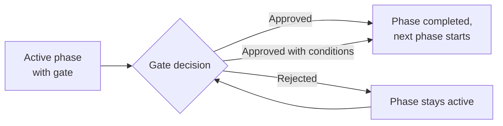

A project can run through phases, such as initiation, concept and realisation. A phase can end with a gate: a set of exit criteria that a person reviews before the next phase starts. Recording the gate decision is how Collabase handles approvals in projects. Every decision is kept with its rationale and the figures it was taken on, and cannot be changed afterwards.

**Who can do this:** shaping phases and gates needs the permission to edit project settings. Deciding a gate needs the permission **Decide phase gate** in the Space's [Permission Scheme](/concepts/permissions). The two are independent, so the person who plans the phases does not have to be the person who approves them.

## Switch on phases {#phases}

<Steps>
  <Step title="Turn on the feature">
    In the project, open **Settings → Project features** and switch on **Phases and gates**. A **Phases** tab appears, and phases show as bands on the [Timeline](/projects/roadmap).
  </Step>
  <Step title="Add phases">
    On the **Phases** tab, enter a **Phase** name with **Start** and **End**, and click **Create**. Or click **Import phase model** to copy phases, gates and milestones from a project template. They are added after any phases you already have.
  </Step>
</Steps>

Projects created from a [project template](/projects/templates) with a **Phase model** start with its phases already in place, for example the HERMES templates (see [HERMES in Collabase](/hermes/collabase-setup)).

Milestones mark fixed dates inside the plan. Open them from **Milestones** in the **Timeline** toolbar, then mark each one **Mark as reached** when it is met. Each phase shows how many of its milestones are still open.

## Set up a gate {#gate}

<Steps>
  <Step title="Add the gate">
    On the phase, click **Add gate** and give the **Gate** a name.
  </Step>
  <Step title="Write the exit criteria">
    Under **Exit criteria**, write one criterion per line, for example "Test report signed off". They are read by a person, never checked by the system.
  </Step>
</Steps>

How a phase closes depends on whether it has a gate:

| Phase | How it closes |
|---|---|
| Without a gate | **Complete phase**, or **Skip** to pass over it |
| With a gate | Only through the gate decision. The phase shows **This phase has a gate. It closes with the gate decision.** |

## Decide a gate {#decide}

The gate can be decided while its phase is active. The flow shows what each decision does.

<Steps>
  <Step title="Open the decision">
    On the phase, click **Decide**. The dialog **Gate decision** shows the criteria.
  </Step>
  <Step title="Record what you decided">
    Choose the **Decision**: **Approved**, **Approved with conditions** or **Rejected**. Write the **Rationale**, and the **Conditions** if you approve with conditions.
  </Step>
  <Step title="Save">
    Click **Record decision**. Collabase sends a notification and an email about the decision.
  </Step>
</Steps>

<Warning>
  A decision cannot be edited or removed. Changing your mind means recording a further decision.
</Warning>

Click **History** on a phase to see every decision made at its gate, with who decided, when and why. Each entry keeps the figures at that moment: milestones reached, cost and forecast, and open and critical risks. When a gate releases its phase, the next phase starts by itself, and the project status on **Settings → General** follows the phases. You do not set it by hand.

## Other approvals {#other-approvals}

| Need | Where |
|---|---|
| A required field or a review step before a work item moves | A validator or transition fields on the workflow transition, see [Design workflows](/admin/workflows#rules) |
| A suggestion on a page | [Suggestions](/docs/suggestions) |

## Related pages

<CardGroup cols={2}>
  <Card title="Project settings" icon="settings" href="/projects/project-settings#features">
    Switch on phases and gates.
  </Card>
  <Card title="Permissions" icon="shield" href="/concepts/permissions">
    Who may decide a gate.
  </Card>
  <Card title="Status reports" icon="file-chart-column" href="/projects/reports#status-reports">
    Monthly reports that show the current phase.
  </Card>
  <Card title="HERMES phases" icon="book-open" href="/hermes/phases">
    The HERMES lifecycle.
  </Card>
</CardGroup>
