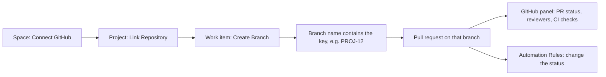

The GitHub integration shows the branch, the pull request, the reviews and the CI checks of a work item in its detail view. Developers create the branch from the work item, and the team sees the state of the code without leaving Collabase. It works with GitHub.com.

## How it fits together

A Space connects to GitHub once. A project then links the repositories it works in. Work items find their branch and pull request through the work item key.

| Level | What is connected | Who can do it |
|---|---|---|
| **Instance** | One GitHub App for the whole instance. The first **Connect GitHub** creates it in your GitHub organization | A system administrator |
| **Space** | The Space installs that App in your GitHub organization. Collabase then syncs the repositories | A Space admin |
| **Project** | One or more repositories. A repository belongs to one project at most | A project admin |

## Connect a Space {#connect-a-space}

<Steps>
  <Step title="Open the Space settings">
    Open **Space Settings** and choose **Integrations** in the **Space** group.
  </Step>
  <Step title="Connect GitHub">
    Click **Connect GitHub** and approve the App on GitHub. If the instance has no GitHub App yet, a system administrator has to do this first step.
  </Step>
  <Step title="Check the result">
    Back in Collabase, you see **GitHub connected, repositories synced** and the status **Connected**.
  </Step>
</Steps>

**Disconnect** removes the connection for the Space, including all linked repositories, branches and pull request data. This cannot be undone.

## Link a repository to a project {#link-a-repository}

<Steps>
  <Step title="Open the project settings">
    In the project, open **Settings** and choose **Integrations** in the **Project** group.
  </Step>
  <Step title="Link the repository">
    Under **Linked Repositories**, click **Link Repository**, then **Select repository**. Use **Sync** first if a new repository is missing from the list.
  </Step>
</Steps>

If the Space is not connected yet, the section says so and points to the Space settings.

## Work on a work item {#work-on-a-work-item}

Open a work item and click the **GitHub** icon in its top bar to open the panel.

<Steps>
  <Step title="Create the branch">
    Click **Create Branch**. Pick the **Repository** when the project has more than one. Leave **Custom name** empty to get a name built from your initials, the key and the title, for example `jd/proj-12-fix-login`. The branch starts from the repository's default branch.
  </Step>
  <Step title="Work on the branch">
    Use **Copy** to copy the branch name into your Git client, or **View on GitHub**.
  </Step>
  <Step title="Open the pull request">
    Click **Create Pull Request**. It opens the GitHub compare page in a new tab, where you create the pull request.
  </Step>
</Steps>

Once the pull request exists, the panel shows:

| Section | What you see |
|---|---|
| **Branch** | The branch name with **Copy** and **View on GitHub** |
| **Pull Request** | Number, title and the state **Open**, **Draft**, **Merged** or **Closed**, with **Open on GitHub** |
| **CI Checks** | The result of the checks, **Running…**, or **No checks reported** |
| **Reviewers** | Each reviewer with **Approved**, **Changes** or **Pending** |

Comments on the pull request appear as comments on the work item, written by the user **GitHub**.

### How Collabase finds the work item {#key-matching}

Collabase looks for a work item key, such as `PROJ-12`, in the branch name. For a pull request it uses the branch name first and the PR title second. Branches you create from the panel always contain the key.

<Note>
  Commit messages are not read. Collabase links branches and pull requests, not individual commits, and there are no smart commits.
</Note>

## Change the status automatically {#automation-rules}

Under **Settings → Integrations → Automation Rules**, a project admin defines which status a work item gets when a GitHub event occurs. Nothing is preset: a merged pull request does not close a work item until you add a rule.

| Trigger | Typical use |
|---|---|
| **PR opened (draft)** | Move to In Progress |
| **PR opened (ready)** | Move to In Review |
| **PR merged** | Move to Done |
| **PR closed (not merged)** | Move back to To Do |
| **CI checks failed** | Move back to In Progress |

The action is always **Select status**. For more complex reactions to GitHub events, use the [GitHub connector](/automation/connectors/github) of Automation.

## Limits

| Topic | Behavior |
|---|---|
| **Hosts** | GitHub.com only. GitHub Enterprise Server, GitLab and Bitbucket have no development panel. GitLab is available as an [Automation connector](/automation/connectors/gitlab) |
| **Pull requests per work item** | One |
| **Boards and lists** | Cards show no GitHub status. Open the work item to see it |

## Troubleshooting

| What you see | Cause | What to do |
|---|---|---|
| **Only global administrators can create the GitHub App** | The instance has no GitHub App yet | Ask a system administrator to click **Connect GitHub** once |
| **You don't have permission to connect GitHub to this space** | You are not a Space admin | Ask a Space admin |
| **No repositories linked to this project. Link one in Project Settings → Integrations.** | No repository is linked, or your role cannot read the project's integration settings | Ask a project admin to check **Linked Repositories** |
| The pull request does not appear | The branch name does not contain the key, or the branch was created before the Space was connected | Create the branch from the panel, or rename the branch to include the key |

## Related

<CardGroup cols={2}>
  <Card title="Work items" icon="circle-check" href="/projects/tasks">
    The detail view and its panels.
  </Card>
  <Card title="GitHub connector" icon="github" href="/automation/connectors/github">
    Triggers and actions for Automation.
  </Card>
</CardGroup>
