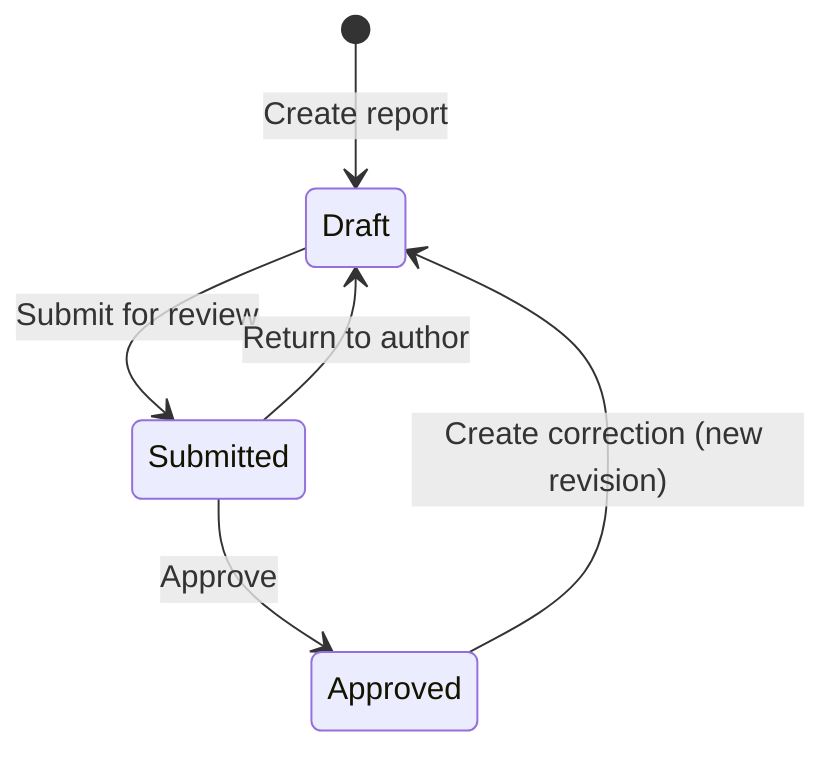

Collabase has two kinds of project reporting. Charts update themselves from the work items and show how the work is going. The monthly **status report** is written by the project manager, reviewed, and frozen once approved, so management sees a reliable picture per month.

## Charts and where to find them {#charts}

| Chart | Where | What it shows |
|---|---|---|
| **Status Overview** | Project **Home** | Work items per status |
| **Work Item Breakdown** | Project **Home** | Work items per type |
| **Assignee Workload** | Project **Home** | Work items per assignee |
| **Total Work Items**, **In Progress**, **Done**, **Overdue** | Project **Home** | Counts, with **Due This Week** |
| **Cycle Burndown** | **Cycles**, expanded cycle | Remaining work against the ideal pace. See [Cycles](/projects/sprints#follow) |
| **Velocity Chart** | **Cycles → Completed** | Committed against completed story points per cycle |
| Cycle report | **Report** on a completed cycle | Committed, delivered, completion and the scope change log |
| **Time Progress** | Project **Time** tab | Hours booked per day |
| Cost tiles and breakdowns | Project **Costs** tab | Budget, actual, remaining and forecast. Needs the **View project costs** permission |

The charts are fixed. You cannot build your own chart or add charts to a dashboard. For workload across projects, use the [Planner](/planning/planner-capacity).

## Status reports {#status-reports}

The **Reports** tab of a project holds one **HERMES status report** per month. It shows when the project uses the feature and you can view its work items.

### What a report contains

| Part | Content |
|---|---|
| **Traffic light** | **On track**, **At risk** or **Critical** |
| **Management attention** | Switch on when the project needs a decision, resources or an escalation. You must then say what the project needs |
| Text sections | **Project status overview**, **Assessment of objectives**, **Results: target, actual and forecast**, **Effort: target, actual and forecast**, **Costs: target, actual and forecast**, **Schedule: target, actual and forecast**, **Problems and measures**, **Risks**, **Outlook** |
| Figures | Budget, effort, milestones, the current phase, open and critical risks, and meeting decisions. Live while you write, frozen on approval |

Cost figures are only visible with the right to view project costs.

### Write and approve a report {#workflow}

<Steps>
  <Step title="Create the report">
    Open the **Reports** tab and click **Create report**. Changes are saved automatically.
  </Step>
  <Step title="Fill it in">
    Set the **Traffic light**, write the sections, and switch on **Management attention** if needed. Use **Compare with previous month** to see what changed.
  </Step>
  <Step title="Submit it">
    Click **Submit for review**. The report is locked until it is approved or returned.
  </Step>
  <Step title="Review it">
    The reviewer opens **Review**, then chooses **Approve** or **Return to author** with a comment.
  </Step>
</Steps>

Approval freezes the figures. To correct an approved report, use **Create correction**, which starts a new revision. A draft can be removed with **Delete draft**; submitted and approved reports cannot be deleted.

| Role | Needs |
|---|---|
| Author | **Manage project settings** |
| Reviewer | **Decide phase gate** |

The traffic light of the newest approved report appears on the [Portfolios](/planning/portfolios) page.

### Troubleshooting {#troubleshooting}

| Message | What to do |
|---|---|
| **A report for this month already exists. Correct the approved one instead.** | Open the existing report and use **Create correction** |
| **Only a draft can be changed.** | The report is submitted or approved. Ask the reviewer to return it, or create a correction |
| **Say what the project needs from management before submitting.** | Fill in the reason under **Management attention**, or switch it off |
| **Someone changed the report in the meantime. Reload to see their version.** | Reload the page and apply your change again |

### Reminders {#reminders}

On the fifth working day of the month, Collabase reminds every project lead whose project has no submitted or approved status report for the month before. The working days follow the holidays of your instance. You get one notification for all your projects, with the number of missing reports and up to five project names, and it opens the first project's reports. A portfolio owner gets the same kind of notification for portfolios that have projects and no submitted or approved programme report for the month before. Archived projects are never listed.

## Programme reports {#programme-reports}

A portfolio has a monthly **programme report** with the same life cycle as the status report: it is written as a draft, submitted, approved and then frozen. Open **Portfolios**, choose the **Reports** tab and pick a portfolio.

### What a programme report contains

| Part | Content |
|---|---|
| **Traffic light** | The light of the programme. It is marked **Overridden** when the portfolio owner set it by hand, with the suggestion from the projects beside it |
| **Management attention** | Switch on when the programme needs a decision or an escalation. You must then say what it needs |
| Projects | One row per project below the portfolio: traffic light, budget plan, actual and forecast, overdue milestones, open and critical risks, and a total row. The figures come from the latest approved status reports. A project without one for the month shows **No report** |
| Text sections | **Summary**, **Decisions needed** and **Outlook** |

You see only the projects you may see, and the totals count only those rows. Budget columns appear only with the right to view project costs.

### Write and approve a programme report {#programme-report-workflow}

<Steps>
  <Step title="Create the report">
    Click **Create report** on the **Reports** tab, choose the month and confirm. Only the owner of the portfolio, the owner of a portfolio above it and administrators see this button. Each month has one open report at a time.
  </Step>
  <Step title="Fill it in">
    Write the sections and set **Management attention** if needed. Changes are saved automatically while the report is a draft.
  </Step>
  <Step title="Submit it">
    Click **Submit for review**. The report is locked and the reviewer is notified.
  </Step>
  <Step title="Review it">
    The owner of the parent portfolio reviews the report, or an administrator when there is none. You cannot review your own report. **Approve** freezes the figures. **Return to author** needs a comment, and the draft shows it to the author.
  </Step>
</Steps>

To correct an approved report, click **New revision**. It starts a new draft for the same month and keeps the approved one as the earlier revision.

### Troubleshooting {#programme-report-troubleshooting}

| Message | What to do |
|---|---|
| **A report for this month is open already. Open it from the list.** | Finish or review the open report, then create a revision |
| **This report can no longer be changed.** | The report is submitted or approved. Ask the reviewer to return it, or create a new revision |
| **You cannot review your own report.** | Ask the reviewer of the portfolio to decide |

## Download a report as PDF {#export-pdf}

Every status report and every programme report has an **Export** button in the action bar. Open it and start the export. The PDF is prepared in the background, and you are notified when it is ready to download.

- The PDF is A4 portrait and uses the language of your profile.
- An approved report shows the figures frozen at approval. A draft shows the current figures.
- Money appears only if you may see project costs.
- A programme report lists only the projects you can see, and its totals count only those.

<Note>
  The export needs the document processor. If **Export is not available** appears, ask your administrator.
</Note>

## Related

<CardGroup cols={2}>
  <Card title="Portfolios" icon="folder-tree" href="/planning/portfolios">
    All projects with their traffic lights.
  </Card>
  <Card title="HERMES in Collabase" icon="book-open" href="/hermes/collabase-setup">
    Status reports in a HERMES project.
  </Card>
</CardGroup>
