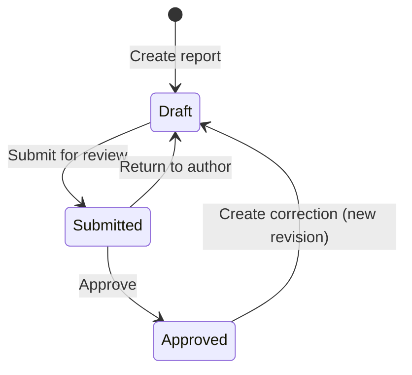

Collabase has two kinds of project reporting. Charts update themselves from the work items and show how the work is going. The monthly **status report** is written by the project manager, reviewed, and frozen once approved, so management sees a reliable picture per month.

## Charts and where to find them {#charts}

| Chart | Where | What it shows |
|---|---|---|
| **Status Overview** | Project **Home** | Work items per status |
| **Work Item Breakdown** | Project **Home** | Work items per type |
| **Assignee Workload** | Project **Home** | Work items per assignee |
| **Total Work Items**, **In Progress**, **Done**, **Overdue** | Project **Home** | Counts, with **Due This Week** |
| **Cycle Burndown** | **Cycles**, expanded cycle | Remaining work against the ideal pace. See [Cycles](/projects/sprints#follow) |
| **Velocity Chart** | **Cycles → Completed** | Committed against completed story points per cycle |
| Cycle report | **Report** on a completed cycle | Committed, delivered, completion and the scope change log |
| **Time Progress** | Project **Time** tab | Hours booked per day |
| Cost tiles and breakdowns | Project **Costs** tab | Budget, actual, remaining and forecast. Needs the **View project costs** permission |

The charts are fixed. You cannot build your own chart or add charts to a dashboard. For workload across projects, use the [Planner](/planning/planner-capacity).

## Status reports {#status-reports}

The **Reports** tab of a project holds one **HERMES status report** per month. It shows when the project uses the feature and you can view its work items.

### What a report contains

| Part | Content |
|---|---|
| **Traffic light** | **On track**, **At risk** or **Critical** |
| **Management attention** | Switch on when the project needs a decision, resources or an escalation. You must then say what the project needs |
| Text sections | **Project status overview**, **Assessment of objectives**, **Results: target, actual and forecast**, **Effort: target, actual and forecast**, **Costs: target, actual and forecast**, **Schedule: target, actual and forecast**, **Problems and measures**, **Risks**, **Outlook** |
| Figures | Budget, effort, milestones, the current phase, open and critical risks, and meeting decisions. Live while you write, frozen on approval |

Cost figures are only visible with the right to view project costs.

### Write and approve a report {#workflow}

<Steps>
  <Step title="Create the report">
    Open the **Reports** tab and click **Create report**. Changes are saved automatically.
  </Step>
  <Step title="Fill it in">
    Set the **Traffic light**, write the sections, and switch on **Management attention** if needed. Use **Compare with previous month** to see what changed.
  </Step>
  <Step title="Submit it">
    Click **Submit for review**. The report is locked until it is approved or returned.
  </Step>
  <Step title="Review it">
    The reviewer opens **Review**, then chooses **Approve** or **Return to author** with a comment.
  </Step>
</Steps>

Approval freezes the figures. To correct an approved report, use **Create correction**, which starts a new revision. A draft can be removed with **Delete draft**; submitted and approved reports cannot be deleted.

| Role | Needs |
|---|---|
| Author | **Manage project settings** |
| Reviewer | **Decide phase gate** |

The traffic light of the newest approved report appears on the [Portfolios](/planning/portfolios) page.

### Troubleshooting {#troubleshooting}

| Message | What to do |
|---|---|
| **A report for this month already exists. Correct the approved one instead.** | Open the existing report and use **Create correction** |
| **Only a draft can be changed.** | The report is submitted or approved. Ask the reviewer to return it, or create a correction |
| **Say what the project needs from management before submitting.** | Fill in the reason under **Management attention**, or switch it off |
| **Someone changed the report in the meantime. Reload to see their version.** | Reload the page and apply your change again |

## Related

<CardGroup cols={2}>
  <Card title="Portfolios" icon="folder-tree" href="/planning/portfolios">
    All projects with their traffic lights.
  </Card>
  <Card title="HERMES in Collabase" icon="book-open" href="/hermes/collabase-setup">
    Status reports in a HERMES project.
  </Card>
</CardGroup>
