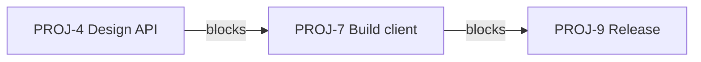

The **Timeline** tab shows each work item with dates as a bar on a calendar. Drag bars to reschedule, draw arrows to show what blocks what, and see cycles, phases and milestones in the same picture. Use it to plan dates and to explain the plan to others.

## Read the timeline {#read}

The left side lists the work items with the columns **Key**, **Work Item**, **Status**, **Assignee**, **Priority**, **Due** and **Start**. You can resize and hide these columns, and edit **Status**, **Assignee** and **Priority** in place. Sub-items sit under their parent and can be collapsed.

The right side is the calendar:

| Element | Meaning |
|---|---|
| Bar | From the start date to the due date of a work item |
| Arrow | A dependency between two work items |
| Bands in the header | Cycles and project phases |
| Diamond | A project milestone |
| **Today** line | The current date |

Select a bar and press `Enter` or `Space` to open the work item.

## Change the view {#view}

| Control | What it does |
|---|---|
| **Day**, **Week**, **Month**, **Quarter** | The zoom level. **Week** is the default |
| **Show earlier dates**, **Show later dates** | Extend the visible range |
| **Jump to today** | Scroll to the current date |
| **Timeline settings** | **Start of week** (Monday, Sunday or Saturday), and **Dependencies → Show related links** to also draw "relates to" links |
| **Enter fullscreen** | Use the whole screen. `Escape` leaves it |

The filter pills **Status**, **Assignee**, **Label** and **Priority** work as on the [Board](/projects/board#quick-filters).

## Reschedule work items {#reschedule}

- **Drag a bar** to move both dates by the same amount.
- **Drag the left or right end** to change the start or due date.

Changes save at once. Type a title in **Add a work item…** at the bottom of the list to create a work item from the timeline.

## Work items without dates {#no-dates}

Work items with neither a start nor a due date are listed under **Work items without scheduled dates**. Set a start and due date there to bring them onto the timeline.

## Dependencies {#dependencies}

A dependency says that one work item blocks another. Collabase draws it as an arrow from the blocking bar to the blocked bar.

<Steps>
  <Step title="Start the arrow">
    Hover a bar. Drag from the dot at its right end to make it block another work item, or from the dot at its left end to make it blocked by one.
  </Step>
  <Step title="Drop on the other bar">
    Release over the other work item. Collabase creates a **Blocks** relation. Press `Escape` to cancel while dragging.
  </Step>
  <Step title="Check or remove it">
    Click an arrow to see the dependencies between the two bars. Remove one with **Delete dependency from … to …**.
  </Step>
</Steps>

Dependencies created on the timeline are **Finish to start**: the blocked work starts after the blocking work finishes. Creating them needs the **Link task** permission. The same relations appear in the **Relations** section of each [work item](/projects/tasks#relations).

<Note>
  Collabase does not move dependent bars for you and has no critical path. When you move a blocking bar, check the bars it points to.
</Note>

## Milestones {#milestones}

Click **Milestones** to manage the project's milestones: give each a name (**Milestone**) and a **Due date**, **Mark as reached**, **Reopen**, or **Delete milestone**. Milestones appear as diamonds on the timeline.

## Next steps

<CardGroup cols={2}>
  <Card title="Planning across projects" icon="chart-gantt" href="/planning/overview">
    Portfolios, the Planner and dependencies beyond one project.
  </Card>
  <Card title="Cycles" icon="repeat" href="/projects/sprints">
    Time boxes shown as bands on the timeline.
  </Card>
</CardGroup>
