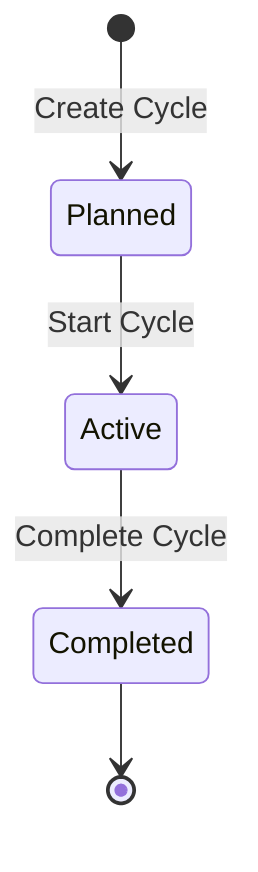

A cycle is a time box, often one or two weeks, with a set of work items the team commits to. Collabase calls sprints **Cycles**. You plan a cycle in the [Backlog](/projects/backlog), run it on the [Board](/projects/board), and review it in the **Cycles** tab.

## Switch cycles on {#enable-cycles}

Cycles are a project feature. A project admin switches them on under **Settings → Project features → Planning & tracking → Cycles**. Projects created from the **Scrum** template have them on.

The **Cycles** tab is visible to members whose role can create, start, complete, edit or delete cycles.

## Cycle lifecycle

| Status | Meaning |
|---|---|
| **Planned** | Created, work is being added. Several planned cycles can exist |
| **Active** | Running. A project has one active cycle at a time |
| **Completed** | Closed. Its numbers are kept for the report and the velocity chart |

The **Cycles** tab groups them in **Active**, **Upcoming** and **Completed**.

## Create a cycle {#create}

<Steps>
  <Step title="Open the dialog">
    Click **Add Cycle** in the **Cycles** tab, or **Create Cycle** in the Backlog.
  </Step>
  <Step title="Fill in the cycle">
    Enter a **Name** and, optionally, a **Cycle Goal**. **Start Date** defaults to today, **Due Date** to today plus the project's **Default cycle duration**.
  </Step>
  <Step title="Create it">
    Confirm, or press `Cmd + Enter` (Mac) or `Ctrl + Enter` (Windows and Linux). The cycle appears under **Upcoming** with the status **Planned**.
  </Step>
</Steps>

Change a cycle later with **Edit Cycle** in its actions menu.

## Start a cycle {#start}

Open the actions menu of a planned cycle and choose **Start Cycle**. The cycle starts at once, without a confirmation. Collabase records the committed story points at that moment, so work added later shows as scope change.

<Note>
  If another cycle is already active, the start does not happen and Collabase shows **Cycle not started** with the reason. Complete the active cycle first.
</Note>

## Follow a running cycle {#follow}

Expand the active cycle to see its charts.

| Element | What it tells you |
|---|---|
| **Cycle Burndown** | Remaining work against the ideal pace, with the lines **Scope**, **Ideal** and **Remaining** and a **Today** marker. The **Remaining** line ends at today. The ideal line drops on working days only |
| **Cycle Health** | **Ahead of schedule**, **On track**, **At risk** or **Behind schedule**, from how far remaining work is above or below the ideal line |
| Scope change | How many work items were added or removed since the start |

The burndown uses the estimates of the work items. When nothing is estimated, it counts work items instead.

On the **Board**, the **Scope** menu shows only the active cycle's work items by default.

## Complete a cycle {#complete}

<Steps>
  <Step title="Choose Complete Cycle">
    Open the actions menu of the active cycle and choose **Complete Cycle**. The dialog shows how many work items are done.
  </Step>
  <Step title="Decide where unfinished work goes">
    Under **Move unfinished work items to**, choose **Move to Backlog** (the default) or a planned cycle.
  </Step>
  <Step title="Confirm">
    The cycle moves to **Completed** and the unfinished work items move as chosen.
  </Step>
</Steps>

## Review completed cycles {#review}

| View | Where | Content |
|---|---|---|
| Cycle report | **Report** on a completed cycle | **Committed**, **Delivered**, **Completion**, the burndown and the **Scope Change Log** with **Added** and **Removed** work items |
| **Velocity Chart** | **Completed** sub-tab | **Committed** against **Completed** story points for every cycle, oldest first |

Use the velocity chart to size the next cycle. If the team completes about 30 points per cycle, a cycle planned at 50 points will likely carry work over.

## Estimation {#estimation}

When **Story Points** is switched on under **Project features**, **Settings → Estimation** offers one **Estimation Method** for the whole project:

| Method | Values |
|---|---|
| **Story Points** | Fibonacci sequence: 0, 1, 2, 3, 5, 8, 13, 21 |
| **T-Shirt Sizes** | XS, S, M, L, XL, XXL |
| **Time (Hours)** | Effort in hours |

<Note>
  The committed value recorded at the start of a cycle counts story points only. With T-shirt sizes or hours, the burndown and velocity fall back to counting work items for the committed side.
</Note>

## Subtasks and cycles {#subtasks-and-sprints}

Two settings under **Settings → Cycles** keep parents and children together when they move between the backlog and cycles:

| Setting | Effect |
|---|---|
| **Carry child work items** | When a work item is moved, its sub-items move with it |
| **Carry parent work item** | When a sub-item is moved, its parent moves with it |

Both reach one level only. The same section holds **Default cycle duration** and **Allowed work item types**.

## Who can manage cycles {#permissions}

Each action has its own permission in the Space's [Permission Scheme](/concepts/permissions): **Create cycle**, **Start cycle**, **Complete cycle**, **Edit cycle**, **Delete cycle** and **Manage cycle scope** (moving work in and out).

| Scheme | Create, start, complete, edit, manage scope | Delete |
|---|---|---|
| **Open Scheme**, **Default Software Scheme** | Space Admin, Manager, Member | Space Admin, Manager |
| **Client / Read-only**, **Restricted / Confidential** | Space Admin | Space Admin |

<Warning>
  **Delete Cycle** runs without a confirmation.
</Warning>

## Next steps

<CardGroup cols={2}>
  <Card title="Backlog" icon="inbox" href="/projects/backlog">
    Rank work and plan it into cycles.
  </Card>
  <Card title="Project reports" icon="chart-column" href="/projects/reports">
    All charts and reports in one place.
  </Card>
</CardGroup>
