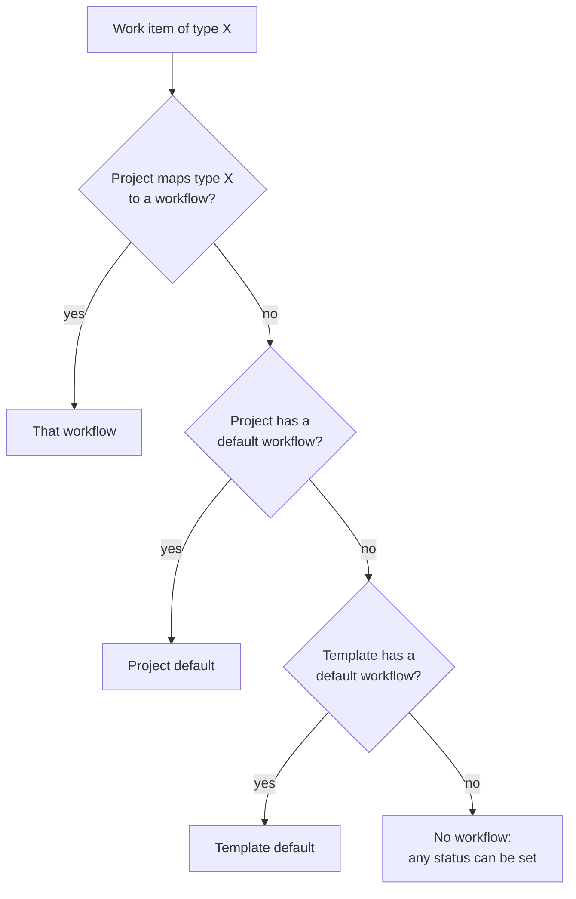

A project does not design its own statuses. It uses workflows that a system administrator builds in [Design workflows](/admin/workflows). In the project you choose which of them apply, which one is the default, and which work item type follows which workflow.

**Who can do this:** members whose Space role may edit project settings. If the project is linked to a project template, the template decides and this section is read-only.

## Which workflow a work item follows {#which-workflow}

A project can use several workflows. For each work item, Collabase picks the first one that applies, in this order:

Without any workflow, members can set any status directly. With a workflow, they can only use the transitions it defines.

## Assign workflows {#assign}

<Steps>
  <Step title="Open the Status section">
    Open the project, click the **Settings** tab and select **Workflow → Status**.
  </Step>
  <Step title="Add a workflow">
    Click **Add Workflow**, search for the workflow and select it. The first workflow you add becomes the **Default**.
  </Step>
  <Step title="Change the default (optional)">
    Hover over a workflow and click **Set as default**. If work items already exist, see [Switch the default workflow](#switch-default).
  </Step>
</Steps>

Click **View workflow** to see a workflow's statuses, and **Edit Workflow** in that preview to open it in the editor. To add or remove statuses, change the workflow itself; the project section only assigns workflows.

## Map work item types to workflows {#mapping}

When a project has two or more workflows, the section **Workflow → Work Item Type Mapping** appears. It lists the instance work item types.

<Steps>
  <Step title="Pick a workflow per type">
    For each type, choose a workflow, or leave **Project default**.
  </Step>
  <Step title="Save">
    Click **Save**. You see **Workflow mapping saved**.
  </Step>
</Steps>

Example: bugs follow a triage workflow, everything else follows the team's delivery workflow.

## Switch the default workflow {#switch-default}

When work items already sit in statuses of the old workflow, Collabase asks where they should go.

<Steps>
  <Step title="Set the new default">
    Click **Set as default** on the new workflow and save.
  </Step>
  <Step title="Map the statuses">
    The dialog **Reassign existing tasks** lists each **Current status**. Pick a **New status** from the new workflow for each one.
  </Step>
  <Step title="Confirm">
    Click **Migrate & Save**. The work items move to the new statuses and the project uses the new default.
  </Step>
</Steps>

## Move a work item through the workflow {#move-work-items}

Members change the status on the work item or by dragging its card on the [board](/projects/board). Collabase offers only the transitions that start at the current status and whose conditions are met.

If the transition asks for fields, a dialog opens. Fill in the fields marked with an asterisk and click **Confirm Transition**. If a validator fails, the work item stays where it is and the message says what is missing.

## Troubleshooting

| What you see | Cause | What to do |
|---|---|---|
| **No workflow assigned** | The project has no workflow | Click **Add Workflow**, or **Manage Workflows** to create one first |
| **Workflows are managed by the linked template.** | The project is linked to a project template | Change the template, or detach the project in **Settings → General** |
| The mapping section is missing | The project has fewer than two workflows | Add a second workflow |
| A status is missing on the board | The work item type follows another workflow | Check the type mapping |

## Related pages

<CardGroup cols={2}>
  <Card title="Design workflows" icon="git-branch" href="/admin/workflows">
    Statuses, transitions and rules.
  </Card>
  <Card title="Project settings" icon="settings" href="/projects/project-settings">
    Every section of a project's settings.
  </Card>
</CardGroup>
